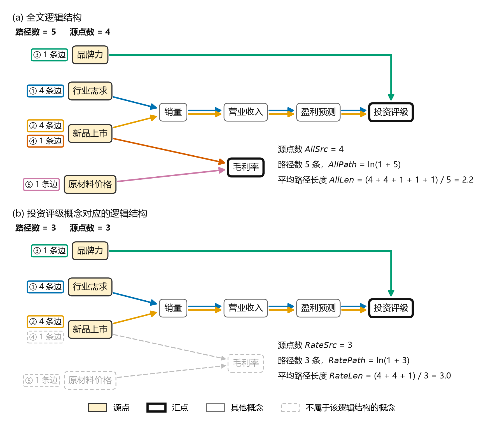
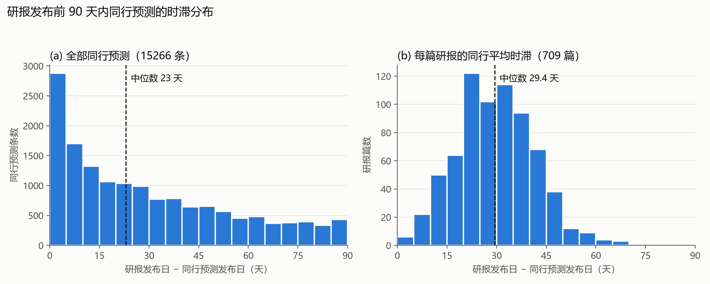

# 研报逻辑结构与分析师预测准确度

## 摘要

本文利用大语言模型提取研报中的概念及概念之间的因果关系，构建研报的逻辑结构，并以 2024 年沪深300 成分股的深度研报为样本，考察逻辑结构与分析师盈利预测准确度的关系。逻辑结构是以概念为节点、因果关系为边的有向图；其中“投资评级”及所有直接或间接影响它的概念构成投资评级概念对应的逻辑结构，反映分析师为得出评级所作的论证。研究发现，投资评级概念对应的逻辑结构越复杂、涵盖的概念越全面，研报的盈利预测相对同行越准确；研报全文的逻辑结构与预测准确度则没有显著关系。上述结果表明，与预测质量相关的不是研报整体的论述规模，而是分析师对投资评级的论证是否充分。

## 1　研究设计

### 1.1　样本

样本来自 2024 年沪深300 成分股的深度研报，共 791 篇。观测单位是研报。一篇研报进入样本需要满足：研报给出了 FY2025 归母净利润预测，公司已披露 2025 年年报实际值，并且在研报发布前 90 天内至少有 3 家其他券商对同一公司的 FY2025 净利润发布过预测。满足这些条件的研报有 771 篇。剔除缺少控制变量的研报，以及被固定效应完全吸收的单例观测后，基准回归的样本为 709 篇研报、180 家公司。

### 1.2　逻辑结构变量

研报的逻辑结构是用大语言模型从研报中抽取出的概念及其因果关系构成的有向图。本文区分两类逻辑结构：全文逻辑结构是研报的全部概念和因果关系；投资评级概念对应的逻辑结构是其中“投资评级”这一概念及其全部上游概念构成的子图。选择“投资评级”是因为抽取时不需要额外指定：提示词不预设固定概念，也没有专门要求抽取“投资评级”（只在举例中出现），791 篇研报中仍有 767 篇（97%）抽取出了这一概念。

源点是指没有其他概念指向它的概念，汇点是指有概念指向它、而它不再指向其他概念的概念。对两类逻辑结构各取源点数、路径数和平均路径长度三个变量，图 1 以一个例子说明它们的构建方式。

**图 1　逻辑结构变量的构建**

注：两个面板是同一篇研报的逻辑结构，箭头由原因指向结果。每条从源点到汇点的路径用一种颜色的连线表示并编号，源点左侧的标签给出该路径的边数。(a) 为全文逻辑结构；(b) 为投资评级概念对应的逻辑结构，只保留“投资评级”及其上游概念，灰色虚线部分不计入。

在图 1 的例子中，全文逻辑结构有 4 个源点和 2 个汇点，从源点到汇点共 5 条路径，平均路径长度为 2.2；投资评级概念对应的逻辑结构有 3 个源点，从源点到“投资评级”共 3 条路径，平均路径长度为 3.0。各变量的定义如下：

| 逻辑结构 | 符号 | 名称 | 定义 |
|---|---|---|---|
| 投资评级概念对应的逻辑结构 | *RateSrc* | 源点数 | 子图中源点的个数 |
| | *RatePath* | 路径数 | 从各源点到“投资评级”的不同路径条数，加 1 后取对数 |
| | *RateLen* | 平均路径长度 | 上述路径的平均边数 |
| 全文逻辑结构 | *AllSrc* | 源点数 | 全图中源点的个数 |
| | *AllPath* | 路径数 | 从各源点到各汇点的不同路径条数，加 1 后取对数 |
| | *AllLen* | 平均路径长度 | 上述路径的平均边数 |

投资评级概念对应的逻辑结构的变量只对“投资评级”是汇点的 606 篇研报有定义，在基准回归样本中为 520 篇研报、149 家公司；全文逻辑结构的变量对每篇研报都有定义。各变量按 1% 和 99% 分位缩尾。

### 1.3　预测准确度

预测准确度采用 Clement (1999) 和 Harford, Jiang, Wang and Xie (2019) 的相对预测误差（proportional mean absolute forecast error）：

$$
PMAFE_{i} \;=\; \frac{AFE_{i} - MAFE_{i}}{MAFE_{i}}, \qquad AFE_{i} \;=\; \left| F_{i} - A_{f} \right|, \qquad MAFE_{i} \;=\; \frac{1}{N_{i}} \sum_{j \in C_{i}} AFE_{j}
$$

*F*i 是研报 *i* 对公司 *f* 的 FY2025 归母净利润的预测，*A*f 是 2025 年年报披露的实际值，*AFE* 是绝对预测误差。*C*i 是研报 *i* 的比较组，*N*i 是其中的预测条数，*MAFE* 是比较组的平均绝对预测误差。*PMAFE* 表示研报的误差比比较组平均水平高出的比例，取值越小越准确，按 1% 和 99% 分位缩尾。

这一变量把研报的预测与同行对同一公司、同一年度的预测比较，剔除了公司和年度层面可预测程度的差异；除以 *MAFE* 使不同公司之间可比。比较组取研报发布时市场上已有的同行预测：记研报 *i* 的发布日为 *d*i，*C*i 包括其他券商在 [*d*i − 90, *d*i] 内对公司 *f* 的 FY2025 净利润发布的预测（每家券商取窗口内最新的一条）和研报 *i* 本身。样本内比较组的同行家数中位数为 20 家。

稳健性检验在同一比较组上计算 Hong and Kubik (2003) 的排名分数：

$$
Score_{i} \;=\; 100 \;-\; \frac{r_{i} - 1}{N_{i} - 1} \times 100
$$

*r*i 是研报 *i* 的绝对预测误差在比较组中的名次，误差最小的排第 1，并列取平均名次。*Score* 取值在 0 到 100 之间，越大越准确。

### 1.4　回归方程

基准回归为：

$$
PMAFE_{i} \;=\; \alpha \;+\; \beta\, G_{i} \;+\; \boldsymbol{\gamma}'\mathbf{X}_{i} \;+\; \theta\, PeerLag_{i} \;+\; \mu_{b} \;+\; \delta_{f} \;+\; \lambda_{t} \;+\; \varepsilon_{i}
$$

其中 *i* 表示研报，*f* 表示研报覆盖的公司，*b* 表示发布研报的券商，*t* 表示年度。

**解释变量　*G*i**　第 1.2 节的六个逻辑结构变量之一，在估计样本内标准化为均值 0、标准差 1。

**同行时滞　*PeerLag*i**　比较组内各条同行预测的发布日到研报发布日的天数的平均值：

$$
PeerLag_{i} \;=\; \frac{1}{N_{i} - 1} \sum_{j \in C_{i},\, j \neq i} \left( d_{i} - d_{j} \right)
$$

比较组只取研报发布前的预测，研报总是其中最晚发布的一条，相对同行有时效上的优势；同行的预测越陈旧，这一优势越大。*PeerLag* 用来控制这一差异，按 1% 和 99% 分位缩尾，不做标准化。

**控制变量　Xi**　与 Liu, Liu & Sui (2026) Table 10 相同的六个公司层面变量，在研报发布日上度量：

| 符号 | 含义 | 定义 |
|---|---|---|
| *Size* | 公司规模 | 研报发布日前一交易日总市值的对数 |
| *BM* | 账面市值比 | 最近年报年度末净资产 ÷ 总市值 |
| *Mom* | 动量 | 研报发布日前第 250 至第 21 个交易日的累计收益（%） |
| *Vol* | 波动率 | 研报发布日前 120 个交易日的日收益标准差（%） |
| *ROA* | 盈利能力 | 最近年报年度归母净利润 ÷ 年末总资产（%） |
| *LnAge* | 公司年龄 | 上市以来月数的对数；行情数据始于 2010 年 1 月，此前上市的公司取同一上限 |

**固定效应和标准误**　*μ*b、*δ*f、*λ*t 分别为券商、公司和年度固定效应；样本只有一个年度，*λ*t 被常数项吸收。加入公司固定效应后，*β* 由覆盖同一家公司的不同研报之间的差异识别；加入券商固定效应进一步排除券商之间在写作风格和预测能力上的固定差异。标准误按公司聚类。

**系数的含义**　*PMAFE* 的系数乘以 100 报告，*Score* 的系数以分数报告。*β* 表示逻辑结构变量提高一个标准差时，*PMAFE* 变动多少个百分点，或 *Score* 变动多少分；*PMAFE* 越小越准确，*β* < 0 表示预测更准确，*Score* 则相反。作为参照，样本内 *PMAFE* 的标准差为 33 个百分点，*Score* 的标准差约为 30 分，两者的相关系数为 −0.79。

## 2　描述性分析

### 2.1　逻辑结构变量的变异来源

回归用公司和券商固定效应识别 *β*，因此需要先了解逻辑结构变量的变异有多少来自公司之间、券商之间，有多少留在同一家公司、同一家券商内部。仿照 Liu, Liu & Sui (2026) Table 5 的固定效应分解，我们把每个变量分别对一组固定效应回归，报告调整 R²。

**表 1　逻辑结构变量的固定效应分解**

<table>
<tr><th>逻辑结构</th><th>变量</th><th>(1) 月份</th><th>(2) 行业</th><th>(3) 公司</th><th>(4) 券商</th><th>(5) 公司 + 券商</th><th>(6) 月份 + 公司 + 券商</th></tr>
<tr><td>投资评级概念对应的逻辑结构</td><td><i>RateSrc</i></td><td align="right">0.1</td><td align="right">6.7</td><td align="right">2.6</td><td align="right">5.3</td><td align="right">8.1</td><td align="right">8.5</td></tr>
<tr><td></td><td><i>RatePath</i></td><td align="right">−0.1</td><td align="right">6.0</td><td align="right">6.7</td><td align="right">7.1</td><td align="right">13.4</td><td align="right">13.0</td></tr>
<tr><td></td><td><i>RateLen</i></td><td align="right">−1.1</td><td align="right">2.1</td><td align="right">3.0</td><td align="right">7.8</td><td align="right">10.5</td><td align="right">12.5</td></tr>
<tr><td>全文逻辑结构</td><td><i>AllSrc</i></td><td align="right">0.5</td><td align="right">10.4</td><td align="right">24.8</td><td align="right">14.4</td><td align="right">36.2</td><td align="right">36.2</td></tr>
<tr><td></td><td><i>AllPath</i></td><td align="right">1.6</td><td align="right">14.4</td><td align="right">26.3</td><td align="right">14.1</td><td align="right">38.5</td><td align="right">38.6</td></tr>
<tr><td></td><td><i>AllLen</i></td><td align="right">−0.1</td><td align="right">11.4</td><td align="right">11.9</td><td align="right">3.9</td><td align="right">17.1</td><td align="right">17.1</td></tr>
</table>

注：每格为该变量对相应固定效应回归的调整 R²（%）。样本为基准回归样本，投资评级概念对应的逻辑结构各行为 520 篇研报，全文逻辑结构各行为 709 篇研报。月份为研报发布月份，行业按申万行业分类。

表 1 有两点结果。第一，发布月份几乎不解释任何变异，六个变量的调整 R² 都不超过 1.6%，逻辑结构的差异是截面上的差异，这与 Liu, Liu & Sui (2026) 对宏观逻辑链的发现一致。第二，投资评级概念对应的逻辑结构的变量主要在公司内部、券商内部变动：公司固定效应只解释 2.6% 至 6.7%，券商固定效应解释 5.3% 至 7.8%，两者合计解释 8.1% 至 13.4%，其余约九成的变异留在同一家公司、同一家券商内部，这部分变异正是基准回归识别 *β* 所用的。相比之下，全文逻辑结构的源点数和路径数有 36.2% 和 38.5% 可以由公司和券商固定效应解释，更多反映公司和券商层面的特征。

投资评级概念对应的逻辑结构的三个变量彼此高度相关，*RateSrc* 与 *RatePath* 的相关系数为 0.92，与 *RateLen* 为 0.70，刻画的是同一方面的特征，即支撑投资评级的论证的规模。公司和券商内部的变异中也包含逻辑结构抽取的噪声；噪声若与预测误差无关，会使回归系数偏向 0。

### 2.2　同行预测的时滞

研报相对同行的时效优势取决于同行的预测比研报早多少天。图 2 给出这一时滞在基准回归样本中的分布，时滞等于研报发布日减去同行预测发布日。

**图 2　研报发布前 90 天内同行预测的时滞分布**

注：样本为基准回归的 709 篇研报。(a) 为比较组内全部 15266 条同行预测的时滞，(b) 为每篇研报的同行平均时滞，即 *PeerLag*。虚线为中位数。

全部 15266 条同行预测的时滞中位数为 23 天，26% 发布于研报之前 7 天以内，15% 在 61 至 90 天；96% 的研报在发布前 7 天内至少有一家同行更新过预测。按研报平均后，*PeerLag* 的中位数为 29.4 天，四分位区间为 21.6 至 37.3 天，研报相对比较组平均领先约一个月。

时效优势只有在与逻辑结构变量相关时才会影响 *β*。*PeerLag* 与 *RateSrc* 的相关系数为 −0.03，按公司去均值后为 −0.02，都不显著：源点数多的研报面对的同行预测并不更陈旧。

## 3　回归结果

### 3.1　基准结果

表 2 报告基准回归的结果，每列放入一个逻辑结构变量。

**表 2　逻辑结构变量与 FY2025 相对预测误差**

<table>
<tr><th></th><th>(1) 投资评级概念 对应的逻辑结构 <i>RateSrc</i></th><th>(2) 投资评级概念 对应的逻辑结构 <i>RatePath</i></th><th>(3) 投资评级概念 对应的逻辑结构 <i>RateLen</i></th><th>(4) 全文 逻辑结构 <i>AllSrc</i></th><th>(5) 全文 逻辑结构 <i>AllPath</i></th><th>(6) 全文 逻辑结构 <i>AllLen</i></th></tr>
<tr><td><b><i>G</i></b></td><td align="right">−4.38*</td><td align="right">−4.38*</td><td align="right">−3.77</td><td align="right">1.55</td><td align="right">−0.08</td><td align="right">−3.01</td></tr>
<tr><td></td><td align="right">(−1.88)</td><td align="right">(−1.80)</td><td align="right">(−1.64)</td><td align="right">(0.74)</td><td align="right">(−0.03)</td><td align="right">(−1.56)</td></tr>
<tr><td><i>Size</i></td><td align="right">24.43</td><td align="right">26.55</td><td align="right">28.04</td><td align="right">17.68</td><td align="right">17.18</td><td align="right">19.72</td></tr>
<tr><td></td><td align="right">(0.92)</td><td align="right">(1.02)</td><td align="right">(1.07)</td><td align="right">(0.83)</td><td align="right">(0.80)</td><td align="right">(0.93)</td></tr>
<tr><td><i>BM</i></td><td align="right">29.39</td><td align="right">33.65</td><td align="right">37.84</td><td align="right">20.21</td><td align="right">18.10</td><td align="right">19.56</td></tr>
<tr><td></td><td align="right">(0.58)</td><td align="right">(0.68)</td><td align="right">(0.76)</td><td align="right">(0.51)</td><td align="right">(0.45)</td><td align="right">(0.50)</td></tr>
<tr><td><i>Mom</i></td><td align="right">0.09</td><td align="right">0.09</td><td align="right">0.10</td><td align="right">0.11</td><td align="right">0.11</td><td align="right">0.11</td></tr>
<tr><td></td><td align="right">(0.76)</td><td align="right">(0.80)</td><td align="right">(0.86)</td><td align="right">(1.19)</td><td align="right">(1.18)</td><td align="right">(1.18)</td></tr>
<tr><td><i>Vol</i></td><td align="right">−11.70*</td><td align="right">−11.59*</td><td align="right">−11.46*</td><td align="right">−9.32*</td><td align="right">−9.69*</td><td align="right">−10.38*</td></tr>
<tr><td></td><td align="right">(−1.77)</td><td align="right">(−1.75)</td><td align="right">(−1.68)</td><td align="right">(−1.67)</td><td align="right">(−1.74)</td><td align="right">(−1.87)</td></tr>
<tr><td><i>ROA</i></td><td align="right">−0.93</td><td align="right">−0.88</td><td align="right">−0.85</td><td align="right">−1.60</td><td align="right">−1.56</td><td align="right">−1.56</td></tr>
<tr><td></td><td align="right">(−0.49)</td><td align="right">(−0.47)</td><td align="right">(−0.45)</td><td align="right">(−1.02)</td><td align="right">(−0.99)</td><td align="right">(−1.01)</td></tr>
<tr><td><i>LnAge</i></td><td align="right">61.91</td><td align="right">54.33</td><td align="right">53.15</td><td align="right">54.73</td><td align="right">57.22</td><td align="right">54.27</td></tr>
<tr><td></td><td align="right">(0.88)</td><td align="right">(0.76)</td><td align="right">(0.72)</td><td align="right">(0.91)</td><td align="right">(0.96)</td><td align="right">(0.92)</td></tr>
<tr><td><i>PeerLag</i></td><td align="right">−0.11</td><td align="right">−0.11</td><td align="right">−0.09</td><td align="right">−0.02</td><td align="right">−0.02</td><td align="right">−0.02</td></tr>
<tr><td></td><td align="right">(−0.53)</td><td align="right">(−0.54)</td><td align="right">(−0.48)</td><td align="right">(−0.12)</td><td align="right">(−0.10)</td><td align="right">(−0.12)</td></tr>
<tr><td>调整 R²</td><td align="right">0.124</td><td align="right">0.123</td><td align="right">0.120</td><td align="right">0.071</td><td align="right">0.070</td><td align="right">0.077</td></tr>
<tr><td>N</td><td align="right">520</td><td align="right">520</td><td align="right">520</td><td align="right">709</td><td align="right">709</td><td align="right">709</td></tr>
<tr><td>券商固定效应</td><td align="center">是</td><td align="center">是</td><td align="center">是</td><td align="center">是</td><td align="center">是</td><td align="center">是</td></tr>
<tr><td>公司固定效应</td><td align="center">是</td><td align="center">是</td><td align="center">是</td><td align="center">是</td><td align="center">是</td><td align="center">是</td></tr>
<tr><td>年度固定效应</td><td align="center">是</td><td align="center">是</td><td align="center">是</td><td align="center">是</td><td align="center">是</td><td align="center">是</td></tr>
</table>

注：观测单位为研报。被解释变量为研报自身预测的 FY2025 相对预测误差 *PMAFE*，取值越小越准确。系数乘以 100，括号内为按公司聚类的 t 值。

投资评级概念对应的逻辑结构的源点数 *RateSrc* 和路径数 *RatePath* 在 10% 水平显著：两者各提高一个标准差，研报的相对预测误差分别降低 4.38 个百分点（t = −1.88）和 4.38 个百分点（t = −1.80）。平均路径长度 *RateLen* 的系数为 −3.77（t = −1.64），方向相同，略低于 10% 的显著性水平。全文逻辑结构的三个变量都不显著。同行时滞 *PeerLag* 在各列中都不显著，t 值的绝对值最大为 0.54。控制变量中只有 *Vol* 显著，系数为负。

### 3.2　固定效应的作用

表 3 在保持被解释变量和控制变量不变的前提下，逐步加入固定效应。

**表 3　不同固定效应下的 *β***

<table>
<tr><th>固定效应</th><th>投资评级概念 对应的逻辑结构 <i>RateSrc</i></th><th>投资评级概念 对应的逻辑结构 <i>RatePath</i></th><th>投资评级概念 对应的逻辑结构 <i>RateLen</i></th><th>全文 逻辑结构 <i>AllSrc</i></th><th>全文 逻辑结构 <i>AllPath</i></th><th>全文 逻辑结构 <i>AllLen</i></th><th>N</th></tr>
<tr><td>无</td><td align="right">−0.72 (−0.48)</td><td align="right">−0.56 (−0.38)</td><td align="right">0.03 (0.02)</td><td align="right">2.33* (1.95)</td><td align="right">1.59 (1.15)</td><td align="right">−0.10 (−0.08)</td><td align="right">587 / 763</td></tr>
<tr><td>行业</td><td align="right">−1.61 (−1.06)</td><td align="right">−1.34 (−0.88)</td><td align="right">−0.43 (−0.29)</td><td align="right">1.95 (1.59)</td><td align="right">0.53 (0.38)</td><td align="right">−1.33 (−1.02)</td><td align="right">585 / 762</td></tr>
<tr><td>公司</td><td align="right">−3.89* (−1.84)</td><td align="right">−3.81* (−1.86)</td><td align="right">−3.40* (−1.71)</td><td align="right">0.53 (0.32)</td><td align="right">−0.83 (−0.42)</td><td align="right">−2.95 (−1.62)</td><td align="right">521 / 709</td></tr>
<tr><td>公司 + 券商</td><td align="right">−4.38* (−1.88)</td><td align="right">−4.38* (−1.80)</td><td align="right">−3.77 (−1.64)</td><td align="right">1.55 (0.74)</td><td align="right">−0.08 (−0.03)</td><td align="right">−3.01 (−1.56)</td><td align="right">520 / 709</td></tr>
</table>

注：被解释变量为 FY2025 的相对预测误差 *PMAFE*，各回归均包含六个控制变量和 *PeerLag*。每格为 *G* 的系数（乘以 100）及按公司聚类的 t 值。行业按申万行业分类。最后一行即表 2。N 一列斜线前为投资评级概念对应的逻辑结构各列的观测数，斜线后为全文逻辑结构各列的观测数。

投资评级概念对应的逻辑结构的三个变量在不加固定效应和只加行业固定效应时都不显著，加入公司固定效应后系数均为负且在 10% 水平显著，t 值分别为 −1.84、−1.86 和 −1.71；再加入券商固定效应后，*RateSrc* 和 *RatePath* 仍在 10% 水平显著。这与表 1 一致：这些变量的变异主要在公司内部，它们与预测准确度的关系也来自覆盖同一家公司的不同研报之间的比较。全文逻辑结构的变量中，只有 *AllSrc* 在不加固定效应时为正且在 10% 水平显著，加入公司固定效应后不再显著。

### 3.3　控制全文逻辑结构

表 4 把投资评级概念对应的逻辑结构的变量与全文逻辑结构的同名变量成对放入回归，考察前者是否只是反映了全文逻辑结构的同名特征。

**表 4　两类逻辑结构的同名变量成对放入**

<table>
<tr><th></th><th>(1) 源点数</th><th>(2) 路径数</th><th>(3) 平均路径长度</th></tr>
<tr><td>投资评级概念对应的逻辑结构</td><td align="right">−5.56**</td><td align="right">−6.04**</td><td align="right">−3.33</td></tr>
<tr><td></td><td align="right">(−2.26)</td><td align="right">(−2.12)</td><td align="right">(−1.17)</td></tr>
<tr><td>全文逻辑结构</td><td align="right">5.10*</td><td align="right">4.17</td><td align="right">−0.87</td></tr>
<tr><td></td><td align="right">(1.75)</td><td align="right">(1.28)</td><td align="right">(−0.32)</td></tr>
<tr><td>控制变量 <b>X</b> 和 <i>PeerLag</i></td><td align="center">是</td><td align="center">是</td><td align="center">是</td></tr>
<tr><td>公司固定效应</td><td align="center">是</td><td align="center">是</td><td align="center">是</td></tr>
<tr><td>券商固定效应</td><td align="center">是</td><td align="center">是</td><td align="center">是</td></tr>
<tr><td>调整 R²</td><td align="right">0.136</td><td align="right">0.129</td><td align="right">0.117</td></tr>
<tr><td>N</td><td align="right">520</td><td align="right">520</td><td align="right">520</td></tr>
</table>

注：被解释变量为 FY2025 的相对预测误差 *PMAFE*。每列同时放入投资评级概念对应的逻辑结构和全文逻辑结构的同名变量，两行分别是各自的系数。系数乘以 100，括号内为按公司聚类的 t 值。

控制全文逻辑结构的同名变量后，*RateSrc* 的系数为 −5.56（t = −2.26），*RatePath* 的系数为 −6.04（t = −2.12），均在 5% 水平显著，绝对值比单独放入时更大；*RateLen* 不显著。全文逻辑结构变量的系数中只有 *AllSrc* 在 10% 水平显著，符号为正。投资评级概念对应的逻辑结构的源点数和路径数与预测准确度的关系，不是全文逻辑结构同名特征的反映。

### 3.4　对照：FY2024 相对预测误差

表 5 把被评价的预测换成研报对 FY2024 净利润的预测，比较组和 *PeerLag* 相应换成同行对 FY2024 的预测，其余设定与表 3 相同。

**表 5　逻辑结构变量与 FY2024 相对预测误差**

<table>
<tr><th>固定效应</th><th>投资评级概念 对应的逻辑结构 <i>RateSrc</i></th><th>投资评级概念 对应的逻辑结构 <i>RatePath</i></th><th>投资评级概念 对应的逻辑结构 <i>RateLen</i></th><th>全文 逻辑结构 <i>AllSrc</i></th><th>全文 逻辑结构 <i>AllPath</i></th><th>全文 逻辑结构 <i>AllLen</i></th><th>N</th></tr>
<tr><td>无</td><td align="right">2.45 (1.28)</td><td align="right">3.79* (1.91)</td><td align="right">3.03 (1.61)</td><td align="right">1.06 (0.63)</td><td align="right">0.41 (0.22)</td><td align="right">1.12 (0.70)</td><td align="right">589 / 768</td></tr>
<tr><td>行业</td><td align="right">0.97 (0.48)</td><td align="right">2.57 (1.24)</td><td align="right">2.47 (1.22)</td><td align="right">0.49 (0.28)</td><td align="right">−1.41 (−0.73)</td><td align="right">−0.77 (−0.47)</td><td align="right">587 / 767</td></tr>
<tr><td>公司</td><td align="right">−1.40 (−0.54)</td><td align="right">0.65 (0.23)</td><td align="right">−0.15 (−0.05)</td><td align="right">0.05 (0.02)</td><td align="right">−2.36 (−0.76)</td><td align="right">−1.09 (−0.47)</td><td align="right">524 / 712</td></tr>
<tr><td>公司 + 券商</td><td align="right">−1.35 (−0.48)</td><td align="right">1.36 (0.43)</td><td align="right">0.51 (0.16)</td><td align="right">0.64 (0.19)</td><td align="right">−1.29 (−0.38)</td><td align="right">−0.13 (−0.06)</td><td align="right">523 / 712</td></tr>
</table>

注：被解释变量为 FY2024 的相对预测误差 *PMAFE*。各回归均包含六个控制变量和 *PeerLag*。每格为 *G* 的系数（乘以 100）及按公司聚类的 t 值。

六个变量在含公司固定效应的设定下都不显著，t 值的绝对值最大为 0.76。不加固定效应时，*RatePath* 的系数为正且在 10% 水平显著（t = 1.91），方向与表 3 相反。

### 3.5　稳健性检验：排名分数

*PMAFE* 保留了误差大小的信息，取值受比较组内个别极端误差的影响；*Score* 只使用研报在比较组内的名次。表 6 以 FY2025 的 *Score* 为被解释变量，重复表 3 的回归。

**表 6　逻辑结构变量与 FY2025 排名分数**

<table>
<tr><th>固定效应</th><th>投资评级概念 对应的逻辑结构 <i>RateSrc</i></th><th>投资评级概念 对应的逻辑结构 <i>RatePath</i></th><th>投资评级概念 对应的逻辑结构 <i>RateLen</i></th><th>全文 逻辑结构 <i>AllSrc</i></th><th>全文 逻辑结构 <i>AllPath</i></th><th>全文 逻辑结构 <i>AllLen</i></th><th>N</th></tr>
<tr><td>无</td><td align="right">1.45 (1.17)</td><td align="right">1.01 (0.81)</td><td align="right">−0.20 (−0.17)</td><td align="right">−2.68** (−2.30)</td><td align="right">−1.56 (−1.17)</td><td align="right">−0.17 (−0.14)</td><td align="right">587 / 763</td></tr>
<tr><td>行业</td><td align="right">1.85 (1.54)</td><td align="right">1.25 (1.01)</td><td align="right">−0.06 (−0.05)</td><td align="right">−2.61** (−2.14)</td><td align="right">−0.91 (−0.68)</td><td align="right">0.79 (0.70)</td><td align="right">585 / 762</td></tr>
<tr><td>公司</td><td align="right">3.74** (2.37)</td><td align="right">3.35** (2.00)</td><td align="right">2.66 (1.62)</td><td align="right">−0.18 (−0.11)</td><td align="right">1.24 (0.73)</td><td align="right">1.96 (1.36)</td><td align="right">521 / 709</td></tr>
<tr><td>公司 + 券商</td><td align="right">3.72** (1.98)</td><td align="right">3.05 (1.51)</td><td align="right">2.01 (1.01)</td><td align="right">−0.99 (−0.58)</td><td align="right">0.11 (0.06)</td><td align="right">1.54 (1.04)</td><td align="right">520 / 709</td></tr>
</table>

注：被解释变量为 FY2025 的排名分数 *Score*（0 到 100），取值越大越准确。各回归均包含六个控制变量和 *PeerLag*。每格为 *G* 的系数及按公司聚类的 t 值。

*RateSrc* 在公司固定效应下的系数为 3.74（t = 2.37），在券商和公司固定效应下为 3.72（t = 1.98），均在 5% 水平显著；*RatePath* 在公司固定效应下为 3.35（t = 2.00），在 5% 水平显著，再加入券商固定效应后不显著；*RateLen* 不显著。全文逻辑结构的三个变量在含公司固定效应的设定下都不显著。

### 3.6　公司-券商-年度层面的检验

本节把观测单位换成公司-券商-年度，采用 Clement (1999) 和 Harford et al. (2019) 的比较组。被评价的预测是券商在 2024 年内对公司 FY2025 净利润的最后一次预测；比较组是 2024 年内对同一公司的 FY2025 净利润发布过预测的全部券商，每家取当年的最后一次预测，至少 4 家。同一家公司的所有券商共用一个比较组，不存在某一条预测总是最晚发布的问题。逻辑结构变量取自该券商当年对该公司发布的最新一篇深度研报。控制变量在被评价的预测的发布日上度量，并以 Harford et al. (2019) 的预测时效 *DAge* 代替 *PeerLag*；*DAge* 等于被评价的预测到财年末的天数减去比较组的平均值。

样本为 701 个观测、182 家公司，投资评级概念对应的逻辑结构各列为 518 个观测。其中 24% 的观测，被评价的预测正好出自深度研报；其余观测的最后一次预测晚于深度研报，间隔的中位数为 146 天。

**表 7　公司-券商-年度层面：逻辑结构变量与 FY2025 相对预测误差**

<table>
<tr><th>固定效应</th><th>投资评级概念 对应的逻辑结构 <i>RateSrc</i></th><th>投资评级概念 对应的逻辑结构 <i>RatePath</i></th><th>投资评级概念 对应的逻辑结构 <i>RateLen</i></th><th>全文 逻辑结构 <i>AllSrc</i></th><th>全文 逻辑结构 <i>AllPath</i></th><th>全文 逻辑结构 <i>AllLen</i></th><th>N</th></tr>
<tr><td>无</td><td align="right">0.70 (0.54)</td><td align="right">−0.04 (−0.03)</td><td align="right">0.49 (0.36)</td><td align="right">3.44*** (2.63)</td><td align="right">1.72 (1.24)</td><td align="right">0.61 (0.42)</td><td align="right">582 / 756</td></tr>
<tr><td>行业</td><td align="right">−0.01 (−0.01)</td><td align="right">−0.58 (−0.37)</td><td align="right">−0.03 (−0.02)</td><td align="right">2.87** (1.99)</td><td align="right">0.80 (0.55)</td><td align="right">−0.50 (−0.34)</td><td align="right">581 / 755</td></tr>
<tr><td>公司</td><td align="right">−0.13 (−0.07)</td><td align="right">−0.09 (−0.04)</td><td align="right">−0.70 (−0.32)</td><td align="right">2.33 (1.14)</td><td align="right">0.56 (0.28)</td><td align="right">−0.61 (−0.36)</td><td align="right">518 / 701</td></tr>
<tr><td>公司 + 券商</td><td align="right">0.03 (0.01)</td><td align="right">0.01 (0.01)</td><td align="right">−1.11 (−0.49)</td><td align="right">2.56 (1.14)</td><td align="right">0.85 (0.35)</td><td align="right">−0.82 (−0.44)</td><td align="right">518 / 701</td></tr>
</table>

注：观测单位为公司-券商-年度。被解释变量为券商当年最后一次预测的 FY2025 相对预测误差 *PMAFE*。各回归均包含六个控制变量和 *DAge*。每格为 *G* 的系数（乘以 100）及按公司聚类的 t 值。N 一列斜线前为投资评级概念对应的逻辑结构各列的观测数，斜线后为全文逻辑结构各列的观测数。

**表 8　公司-券商-年度层面：两类逻辑结构的同名变量成对放入**

<table>
<tr><th></th><th>(1) 源点数</th><th>(2) 路径数</th><th>(3) 平均路径长度</th></tr>
<tr><td>投资评级概念对应的逻辑结构</td><td align="right">−1.11</td><td align="right">−1.70</td><td align="right">−0.98</td></tr>
<tr><td></td><td align="right">(−0.56)</td><td align="right">(−0.64)</td><td align="right">(−0.31)</td></tr>
<tr><td>全文逻辑结构</td><td align="right">4.96</td><td align="right">4.16</td><td align="right">−0.25</td></tr>
<tr><td></td><td align="right">(1.65)</td><td align="right">(1.27)</td><td align="right">(−0.08)</td></tr>
<tr><td>控制变量 <b>X</b> 和 <i>DAge</i></td><td align="center">是</td><td align="center">是</td><td align="center">是</td></tr>
<tr><td>公司固定效应</td><td align="center">是</td><td align="center">是</td><td align="center">是</td></tr>
<tr><td>券商固定效应</td><td align="center">是</td><td align="center">是</td><td align="center">是</td></tr>
<tr><td>调整 R²</td><td align="right">0.244</td><td align="right">0.241</td><td align="right">0.236</td></tr>
<tr><td>N</td><td align="right">518</td><td align="right">518</td><td align="right">518</td></tr>
</table>

注：被解释变量为券商当年最后一次预测的 FY2025 相对预测误差 *PMAFE*。每列同时放入投资评级概念对应的逻辑结构和全文逻辑结构的同名变量。系数乘以 100，括号内为按公司聚类的 t 值。

六个变量在含公司固定效应的设定下都不显著，t 值的绝对值最大为 1.14；成对放入时也都不显著。不加公司固定效应时 *AllSrc* 的系数为正且显著，加入公司固定效应后消失。两个层面评价的预测不同：研报层面评价的是深度研报发布时的预测，公司-券商-年度层面评价的是券商当年的最后一次预测，其中约四分之三晚于深度研报，间隔的中位数超过四个月。支撑投资评级的论证更充分的研报，其发布时的预测更准确，但这一优势没有延续到数月之后更新的预测上。

## 4　补充说明

1. **同行时滞的作用**　去掉 *PeerLag* 后，在公司固定效应以及券商和公司固定效应下，*RateSrc* 的系数为 −3.90（t = −1.85）和 −4.32（t = −1.86），*RatePath* 的系数为 −3.82（t = −1.88）和 −4.30（t = −1.80），与表 3 几乎相同。把 *PeerLag* 换成同行时滞的中位数，或同时控制比较组同行家数的对数，*RateSrc* 的 t 值在 −1.82 至 −1.87 之间。加入研报发布月份固定效应后，投资评级概念对应的逻辑结构的三个变量都在 5% 水平显著，*RateSrc* 的系数为 −4.05（t = −2.03）和 −4.82（t = −2.22）。
2. **比较组的窗口**　把窗口向后延伸 30 天，即取 [*d* − 90, *d* + 30] 内的同行最新预测，研报不再总是比较组中最晚的一条。此时 *RateSrc* 的系数为 −3.44（t = −1.59）和 −4.01（t = −1.67），*RatePath* 的系数为 −3.46（t = −1.69）和 −3.92（t = −1.59），方向不变，显著性有所下降。
3. **排名分数下控制全文逻辑结构**　以 *Score* 为被解释变量重复表 4，*RateSrc* 的系数为 4.57（t = 2.30），在 5% 水平显著；*RatePath* 的系数为 4.33（t = 1.79），在 10% 水平显著。
4. **样本的可比性**　把全文逻辑结构的变量限定在投资评级概念对应的逻辑结构有定义的 520 篇研报上，三个变量单独放入时仍然都不显著，t 值的绝对值最大为 1.50。两类逻辑结构结果的差别不是样本不同造成的。
5. **源点数取对数**　把源点数取对数后，*RateSrc* 的系数为 −3.43（t = −1.63）和 −3.82（t = −1.50），方向不变但未达到 10% 显著；与取对数的全文逻辑结构源点数成对放入时为 −3.86（t = −1.73）和 −4.62（t = −1.76），在 10% 水平显著。
6. **多重检验**　表 3、表 5 和表 6 共检验 72 个系数，含公司固定效应的 36 个系数中有 8 个在 10% 水平显著，全部来自投资评级概念对应的逻辑结构的变量。这三个变量高度相关，它们的显著性不是相互独立的证据。
7. **标准误偏保守**　自由度修正计入了全部固定效应虚拟变量。若按通行做法不计入嵌套在聚类内的公司固定效应，t 值约增大两成。
8. **待核实的实际值**　五粮液 2025 年归母净利润在数据中为 89.5 亿元，而 2024 年为 318.5 亿元，有待核实。剔除该公司后，*RateSrc* 的系数为 −3.97（t = −1.83）和 −4.33（t = −1.80），与全文逻辑结构的同名变量成对放入时为 −4.91（t = −2.00）和 −5.57（t = −2.17），结论不变。
