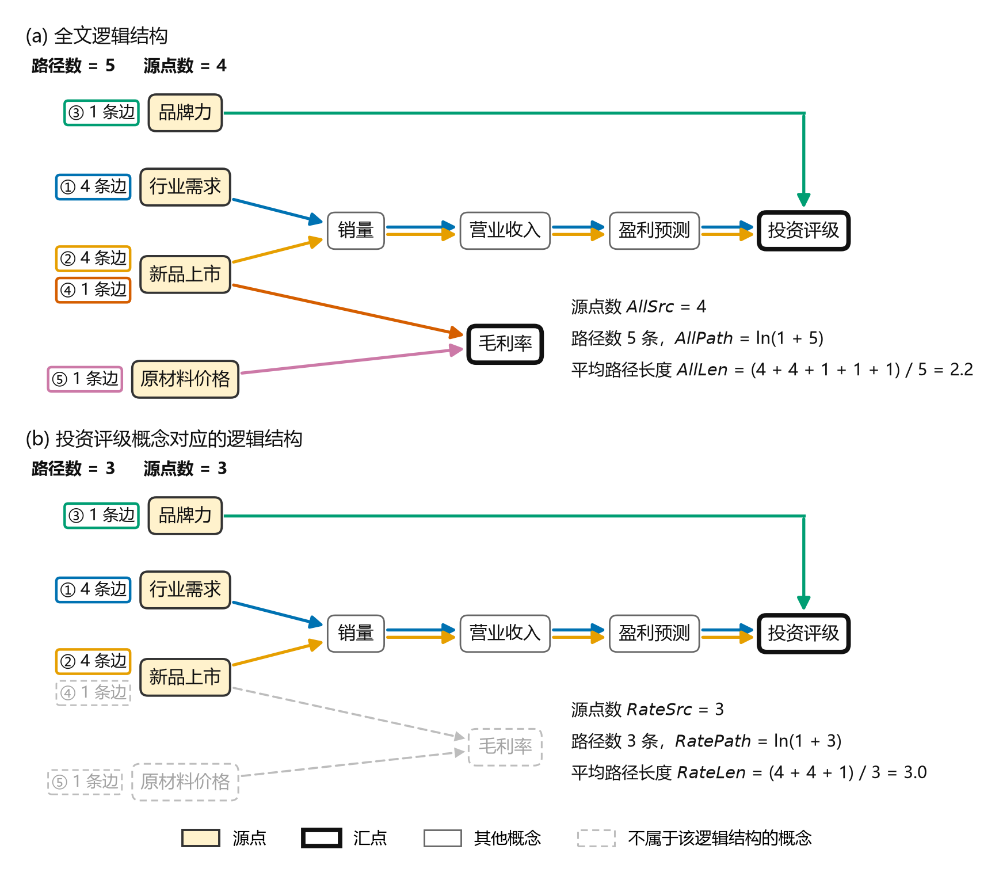
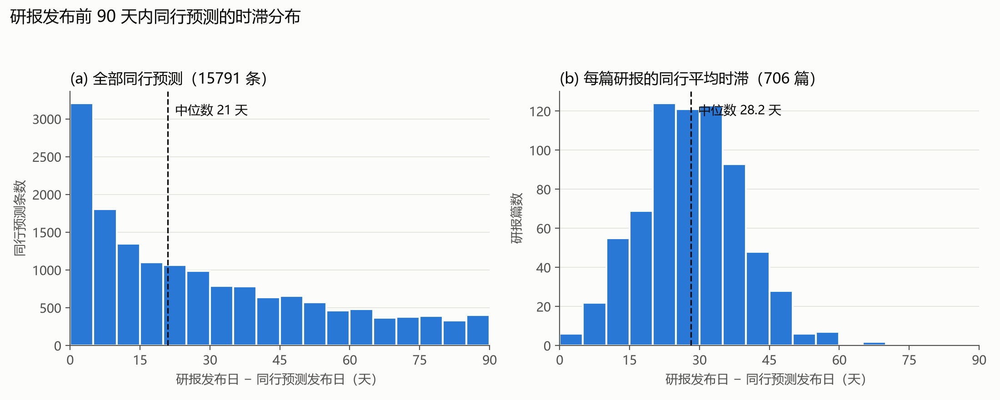

# 研报逻辑结构与分析师预测准确度

样本：hs300_deep（沪深300 深度研报）　抽取版本：v1

## 摘要

本文利用大语言模型提取研报中的概念及概念之间的因果关系，构建研报的逻辑结构，并以 2024 年沪深300 成分股的深度研报为样本，考察逻辑结构与分析师盈利预测准确度的关系。逻辑结构是以概念为节点、因果关系为边的有向图；其中“投资评级”及所有直接或间接影响它的概念构成投资评级概念对应的逻辑结构，反映分析师为得出评级所作的论证。盈利预测准确度用研报对第二个预测财年（H2）归母净利润的预测相对同行的比例误差 *PMED*180 衡量：研报的绝对误差减去 180 天同行窗口内同行绝对误差的中位数，再除以这一中位数；同行中位数取自外部提供的预测误差数据，这一比例口径由本文派生，形式上与上一版自算的相对预测误差最接近。研究发现，投资评级概念对应的逻辑结构的源点数越多，研报的盈利预测相对同行越准确：基准回归中源点数在 5% 水平显著，提高一个标准差，比例误差降低 6.14 个百分点；与全文逻辑结构的同名变量成对放入后，源点数在 1% 水平显著，路径数在 5% 水平显著。路径数和平均路径长度单独放入时不显著，研报全文的逻辑结构与预测准确度也没有显著关系。这一结果对误差的定义敏感：以同行误差中位数为分母的比例误差和以市值为分母的增量误差下源点数都显著，数据文件直接给出的、以同行误差离散度为分母的相对误差和不相对同行的原始误差下都不显著；H1、H3 两个窗口和公司-券商-年度层面也没有显著结果。

## 1　研究设计

### 1.1　样本

样本来自 2024 年沪深300 成分股的深度研报，共 791 篇。观测单位是研报。一篇研报进入样本需要满足：研报给出了 H2（研报的第二个预测财年，见 1.3 节）的归母净利润预测，公司已披露该财年的年报实际值，并且能用预测误差数据算出这篇研报的比例误差（主变量非缺失）。满足这些条件的研报有 778 篇。剔除缺少控制变量的研报，以及被固定效应完全吸收的单例观测后，基准回归的样本为 706 篇研报、180 家公司。

### 1.2　逻辑结构变量

研报的逻辑结构是用大语言模型从研报中抽取出的概念及其因果关系构成的有向图。本文区分两类逻辑结构：全文逻辑结构是研报的全部概念和因果关系；投资评级概念对应的逻辑结构是其中“投资评级”这一概念及其全部上游概念构成的子图。选择“投资评级”是因为抽取时不需要额外指定：提示词不预设固定概念，也没有专门要求抽取“投资评级”（只在举例中出现），791 篇研报中仍有 767 篇（97%）抽取出了这一概念。

源点是指没有其他概念指向它的概念，汇点是指有概念指向它、而它不再指向其他概念的概念。对两类逻辑结构各取源点数、路径数和平均路径长度三个变量，图 1 以一个例子说明它们的构建方式。

**图 1　逻辑结构变量的构建**

注：两个面板是同一篇研报的逻辑结构，箭头由原因指向结果。每条从源点到汇点的路径用一种颜色的连线表示并编号，源点左侧的标签给出该路径的边数。(a) 为全文逻辑结构；(b) 为投资评级概念对应的逻辑结构，只保留“投资评级”及其上游概念，灰色虚线部分不计入。

在图 1 的例子中，全文逻辑结构有 4 个源点和 2 个汇点，从源点到汇点共 5 条路径，平均路径长度为 2.2；投资评级概念对应的逻辑结构有 3 个源点，从源点到“投资评级”共 3 条路径，平均路径长度为 3.0。各变量的定义如下：

| 逻辑结构 | 符号 | 名称 | 定义 |
|---|---|---|---|
| 投资评级概念对应的逻辑结构 | *RateSrc* | 源点数 | 子图中源点的个数 |
| | *RatePath* | 路径数 | 从各源点到“投资评级”的不同路径条数，加 1 后取对数 |
| | *RateLen* | 平均路径长度 | 上述路径的平均边数 |
| 全文逻辑结构 | *AllSrc* | 源点数 | 全图中源点的个数 |
| | *AllPath* | 路径数 | 从各源点到各汇点的不同路径条数，加 1 后取对数 |
| | *AllLen* | 平均路径长度 | 上述路径的平均边数 |

投资评级概念对应的逻辑结构的变量只对“投资评级”是汇点的 606 篇研报有定义，在基准回归样本中为 518 篇研报、149 家公司；全文逻辑结构的变量对每篇研报都有定义。各变量按 1% 和 99% 分位缩尾。

### 1.3　预测准确度

**数据来源**　预测误差取自外部提供的预测误差数据（`data/forecast_errors.parquet`）。数据对每篇研报给出连续三个预测财年（H1、H2、H3）的归母净利润和每股收益（EPS）两种口径的误差，并给出两个同行窗口（75 天和 180 天）上的同行比较量。记研报 *i* 对公司 *f* 的预测为 *F*i，对应财年的年报实际值为 *A*f；窗口 *w* 内的同行预测构成同行组，*M*iw 和 *S*iw 是同行绝对误差的中位数和离散度，*C*iw 是不含本券商的同行一致预期（均值），*C*iall,w 是含本券商的一致预期，*D*i 是缩放基数（净利润口径为市值，EPS 口径为股价）。同行窗口的具体取法（往前多少天、是否每家券商只取最新一条）以数据文件为准，文件未附说明。本文使用的误差定义如下：

$$
RFE_{i}^{w} \;=\; \frac{\left| A_{f} - F_{i} \right| - M_{i}^{w}}{S_{i}^{w}}, \qquad PMED_{i}^{w} \;=\; \frac{\left| A_{f} - F_{i} \right| - M_{i}^{w}}{M_{i}^{w}}
$$

$$
IFE_{i}^{w} \;=\; \frac{\left| F_{i} - A_{f} \right| - \left| C_{i}^{w} - A_{f} \right|}{D_{i}}, \qquad IFEAll_{i}^{w} \;=\; \frac{\left| F_{i} - A_{f} \right| - \left| C_{i}^{\mathrm{all},w} - A_{f} \right|}{D_{i}}, \qquad RawFE_{i} \;=\; \frac{\left| A_{f} - F_{i} \right|}{D_{i}}
$$

*RFE*（相对误差）、*IFE* 和 *IFEAll*（相对一致预期的增量误差）、*RawFE*（原始误差）直接取自数据文件，*w* = 75、180。*PMED* 是本文用数据文件给出的同行中位数 *M*iw 派生的比例误差，数据文件没有直接给出；*M*iw 为 0 时记缺失。每个定义都分净利润和 EPS 两种口径、H1 至 H3 三个窗口，共 54 个变量，都在 786 篇基础样本内按 1% 和 99% 分位缩尾，取值越大预测越不准确。*RFE*、*PMED* 无量纲；*IFE*、*IFEAll*、*RawFE* 以占 *D*i 的比例计。只有数据文件的公司代码与研报公司相同时才使用文件的值：一篇研报覆盖多家公司时，文件可能取了另一家公司，这 3 篇研报的文件变量记缺失。

**主变量**　主变量是净利润口径、H2、180 天窗口的比例误差 *PMED*180。它是用数据文件给出的 180 天窗口同行绝对误差中位数派生的，数据文件没有直接给出这一变量。选它作主变量，是因为它在形式上与上一版自算的相对预测误差 *PMAFE* 最接近：同为净利润、同为第二个预测财年，同为“研报误差减去同行基准、再除以同行基准”的比例口径，只是同行基准由均值换成了中位数。上一版的 *PMAFE* 采用 Clement (1999) 和 Harford, Jiang, Wang and Xie (2019) 的定义：

$$
PMAFE_{i} \;=\; \frac{AFE_{i} - MAFE_{i}}{MAFE_{i}}, \qquad AFE_{i} \;=\; \left| F_{i} - A_{f} \right|, \qquad MAFE_{i} \;=\; \frac{1}{N_{i}} \sum_{j \in C_{i}} AFE_{j}
$$

其中比较组 *C*i 包括其他券商在研报发布前 90 天内对同一公司同一财年净利润发布的预测（每家券商取窗口内最新的一条）和研报本身，至少 3 家同行。自算的 *PMAFE* 和同一比较组上的 Hong and Kubik (2003) 排名分数 *Score* 保留在样本里，作为对照（3.5 节）。表 1 报告 H2 各变量的描述性统计。

**表 1　预测误差变量的描述性统计（H2）**

<table>
<tr><th>变量</th><th>口径</th><th>N</th><th>均值</th><th>标准差</th><th>最小值</th><th>P25</th><th>中位数</th><th>P75</th><th>最大值</th></tr>
<tr><td align="left"><i>PMED</i>180</td><td align="left">净利润</td><td align="right">778</td><td align="right">−0.04</td><td align="right">0.44</td><td align="right">−0.94</td><td align="right">−0.27</td><td align="right">−0.07</td><td align="right">0.08</td><td align="right">1.79</td></tr>
<tr><td align="left"><i>RFE</i>75</td><td align="left">净利润</td><td align="right">772</td><td align="right">−0.11</td><td align="right">1.09</td><td align="right">−3.03</td><td align="right">−0.72</td><td align="right">−0.17</td><td align="right">0.45</td><td align="right">3.20</td></tr>
<tr><td align="left"><i>RFE</i>180</td><td align="left">净利润</td><td align="right">778</td><td align="right">−0.22</td><td align="right">1.00</td><td align="right">−3.06</td><td align="right">−0.81</td><td align="right">−0.28</td><td align="right">0.27</td><td align="right">2.89</td></tr>
<tr><td align="left"><i>IFE</i>75</td><td align="left">净利润</td><td align="right">772</td><td align="right">−0.07</td><td align="right">0.69</td><td align="right">−2.59</td><td align="right">−0.30</td><td align="right">−0.04</td><td align="right">0.17</td><td align="right">2.33</td></tr>
<tr><td align="left"><i>IFE</i>180</td><td align="left">净利润</td><td align="right">778</td><td align="right">−0.19</td><td align="right">0.83</td><td align="right">−3.49</td><td align="right">−0.43</td><td align="right">−0.08</td><td align="right">0.13</td><td align="right">2.44</td></tr>
<tr><td align="left"><i>IFEAll</i>75</td><td align="left">净利润</td><td align="right">772</td><td align="right">−0.07</td><td align="right">0.69</td><td align="right">−2.59</td><td align="right">−0.30</td><td align="right">−0.04</td><td align="right">0.17</td><td align="right">2.33</td></tr>
<tr><td align="left"><i>IFEAll</i>180</td><td align="left">净利润</td><td align="right">778</td><td align="right">−0.19</td><td align="right">0.83</td><td align="right">−3.49</td><td align="right">−0.43</td><td align="right">−0.08</td><td align="right">0.13</td><td align="right">2.44</td></tr>
<tr><td align="left"><i>RawFE</i></td><td align="left">净利润</td><td align="right">778</td><td align="right">2.30</td><td align="right">2.74</td><td align="right">0.02</td><td align="right">0.63</td><td align="right">1.43</td><td align="right">2.87</td><td align="right">15.94</td></tr>
<tr><td align="left"><i>PMED</i>75</td><td align="left">净利润</td><td align="right">777</td><td align="right">0.01</td><td align="right">0.48</td><td align="right">−0.90</td><td align="right">−0.22</td><td align="right">−0.04</td><td align="right">0.12</td><td align="right">2.25</td></tr>
<tr><td align="left"><i>PMED</i>180</td><td align="left">EPS</td><td align="right">778</td><td align="right">−0.04</td><td align="right">0.44</td><td align="right">−0.92</td><td align="right">−0.26</td><td align="right">−0.07</td><td align="right">0.08</td><td align="right">1.75</td></tr>
<tr><td align="left"><i>RFE</i>75</td><td align="left">EPS</td><td align="right">772</td><td align="right">−0.08</td><td align="right">1.14</td><td align="right">−3.10</td><td align="right">−0.71</td><td align="right">−0.14</td><td align="right">0.48</td><td align="right">3.78</td></tr>
<tr><td align="left"><i>RFE</i>180</td><td align="left">EPS</td><td align="right">778</td><td align="right">−0.22</td><td align="right">1.02</td><td align="right">−3.05</td><td align="right">−0.80</td><td align="right">−0.27</td><td align="right">0.27</td><td align="right">2.89</td></tr>
<tr><td align="left"><i>IFE</i>75</td><td align="left">EPS</td><td align="right">772</td><td align="right">−0.07</td><td align="right">0.70</td><td align="right">−2.65</td><td align="right">−0.28</td><td align="right">−0.03</td><td align="right">0.16</td><td align="right">2.51</td></tr>
<tr><td align="left"><i>IFE</i>180</td><td align="left">EPS</td><td align="right">778</td><td align="right">−0.19</td><td align="right">0.83</td><td align="right">−3.49</td><td align="right">−0.42</td><td align="right">−0.08</td><td align="right">0.12</td><td align="right">2.44</td></tr>
<tr><td align="left"><i>IFEAll</i>75</td><td align="left">EPS</td><td align="right">772</td><td align="right">−0.07</td><td align="right">0.70</td><td align="right">−2.67</td><td align="right">−0.28</td><td align="right">−0.03</td><td align="right">0.16</td><td align="right">2.51</td></tr>
<tr><td align="left"><i>IFEAll</i>180</td><td align="left">EPS</td><td align="right">778</td><td align="right">−0.19</td><td align="right">0.83</td><td align="right">−3.49</td><td align="right">−0.42</td><td align="right">−0.08</td><td align="right">0.12</td><td align="right">2.44</td></tr>
<tr><td align="left"><i>RawFE</i></td><td align="left">EPS</td><td align="right">778</td><td align="right">2.29</td><td align="right">2.76</td><td align="right">0.03</td><td align="right">0.58</td><td align="right">1.38</td><td align="right">2.86</td><td align="right">15.96</td></tr>
<tr><td align="left"><i>PMED</i>75</td><td align="left">EPS</td><td align="right">777</td><td align="right">0.02</td><td align="right">0.50</td><td align="right">−0.88</td><td align="right">−0.21</td><td align="right">−0.04</td><td align="right">0.13</td><td align="right">2.72</td></tr>
<tr><td align="left"><i>PMAFE</i>（自算）</td><td align="left">净利润</td><td align="right">772</td><td align="right">−0.05</td><td align="right">0.37</td><td align="right">−0.91</td><td align="right">−0.23</td><td align="right">−0.05</td><td align="right">0.08</td><td align="right">1.25</td></tr>
<tr><td align="left"><i>Score</i>（自算）</td><td align="left">净利润</td><td align="right">772</td><td align="right">54.58</td><td align="right">29.59</td><td align="right">0.00</td><td align="right">28.57</td><td align="right">57.14</td><td align="right">80.00</td><td align="right">100.00</td></tr>
<tr><td align="left"><i>n</i>75（条）</td><td align="left">净利润</td><td align="right">781</td><td align="right">29.89</td><td align="right">17.73</td><td align="right">0</td><td align="right">17</td><td align="right">26</td><td align="right">40</td><td align="right">87</td></tr>
<tr><td align="left"><i>n</i>180（条）</td><td align="left">净利润</td><td align="right">781</td><td align="right">48.02</td><td align="right">25.70</td><td align="right">4</td><td align="right">30</td><td align="right">44</td><td align="right">62</td><td align="right">128</td></tr>
<tr><td align="left">自算同行家数（家）</td><td align="left">净利润</td><td align="right">786</td><td align="right">21.38</td><td align="right">10.58</td><td align="right">1</td><td align="right">14</td><td align="right">20</td><td align="right">29</td><td align="right">52</td></tr>
</table>

注：样本为 786 篇基础样本中各变量的非缺失值，缩尾后。*IFE*、*IFEAll*、*RawFE* 乘以 100，单位为占市值（净利润口径）或股价（EPS 口径）的百分点；*RFE*、*PMED*、*PMAFE* 无量纲，*Score* 为 0 到 100 的分数。*n*75、*n*180 为数据文件给出的净利润口径 H2 同行组的预测条数，自算同行家数为上一版 90 天比较组的同行家数。

**与自算 *PMAFE* 的一致性**　表 2 比较 H2 各变量与自算 *PMAFE* 的一致性（H1、H3 的结果见输出文件 `consistency.csv`）。主变量 *PMED*180 与 *PMAFE* 都非缺失的研报有 768 篇，Pearson 相关系数为 0.92，Spearman 秩相关为 0.90，88% 的研报两者符号相同（同为好于或差于同行）；75 天窗口的 *PMED*75 为 0.88 和 0.89。数据文件直接给出的、以离散度为分母的 *RFE*75 为 0.76 和 0.83；以市值为分母的 *IFE*75 为 0.61 和 0.75；*RawFE* 不相对同行，与 *PMAFE* 的 Pearson 相关只有 0.22。

**表 2　数据文件的预测误差与自算 *PMAFE* 的一致性（H2）**

<table>
<tr><th>定义</th><th>口径</th><th>公式</th><th>非缺失 篇数</th><th>与自算 <i>PMAFE</i> 同时非缺失</th><th>Pearson</th><th>Spearman</th><th>符号 一致率</th></tr>
<tr><td align="left"><i>RFE</i>75</td><td align="left">净利润</td><td align="left">(|A − F| − M75) / S75</td><td align="right">772</td><td align="right">767</td><td align="right">0.76</td><td align="right">0.83</td><td align="right">0.89</td></tr>
<tr><td align="left"><i>RFE</i>180</td><td align="left">净利润</td><td align="left">(|A − F| − M180) / S180</td><td align="right">778</td><td align="right">768</td><td align="right">0.77</td><td align="right">0.82</td><td align="right">0.88</td></tr>
<tr><td align="left"><i>IFE</i>75</td><td align="left">净利润</td><td align="left">(|F − A| − |C75 − A|) / D</td><td align="right">772</td><td align="right">767</td><td align="right">0.61</td><td align="right">0.75</td><td align="right">0.88</td></tr>
<tr><td align="left"><i>IFE</i>180</td><td align="left">净利润</td><td align="left">(|F − A| − |C180 − A|) / D</td><td align="right">778</td><td align="right">768</td><td align="right">0.55</td><td align="right">0.69</td><td align="right">0.84</td></tr>
<tr><td align="left"><i>IFEAll</i>75</td><td align="left">净利润</td><td align="left">(|F − A| − |C_all75 − A|) / D</td><td align="right">772</td><td align="right">767</td><td align="right">0.61</td><td align="right">0.75</td><td align="right">0.88</td></tr>
<tr><td align="left"><i>IFEAll</i>180</td><td align="left">净利润</td><td align="left">(|F − A| − |C_all180 − A|) / D</td><td align="right">778</td><td align="right">768</td><td align="right">0.55</td><td align="right">0.69</td><td align="right">0.84</td></tr>
<tr><td align="left"><i>RawFE</i></td><td align="left">净利润</td><td align="left">|A − F| / D</td><td align="right">778</td><td align="right">768</td><td align="right">0.22</td><td align="right">0.42</td><td align="right">—</td></tr>
<tr><td align="left"><i>PMED</i>75</td><td align="left">净利润</td><td align="left">(|A − F| − M75) / M75（派生）</td><td align="right">777</td><td align="right">767</td><td align="right">0.88</td><td align="right">0.89</td><td align="right">0.89</td></tr>
<tr><td align="left"><i>PMED</i>180</td><td align="left">净利润</td><td align="left">(|A − F| − M180) / M180（派生）</td><td align="right">778</td><td align="right">768</td><td align="right">0.92</td><td align="right">0.90</td><td align="right">0.88</td></tr>
<tr><td align="left"><i>RFE</i>75</td><td align="left">EPS</td><td align="left">(|A − F| − M75) / S75</td><td align="right">772</td><td align="right">767</td><td align="right">0.71</td><td align="right">0.79</td><td align="right">0.87</td></tr>
<tr><td align="left"><i>RFE</i>180</td><td align="left">EPS</td><td align="left">(|A − F| − M180) / S180</td><td align="right">778</td><td align="right">768</td><td align="right">0.74</td><td align="right">0.79</td><td align="right">0.87</td></tr>
<tr><td align="left"><i>IFE</i>75</td><td align="left">EPS</td><td align="left">(|F − A| − |C75 − A|) / D</td><td align="right">772</td><td align="right">767</td><td align="right">0.57</td><td align="right">0.74</td><td align="right">0.88</td></tr>
<tr><td align="left"><i>IFE</i>180</td><td align="left">EPS</td><td align="left">(|F − A| − |C180 − A|) / D</td><td align="right">778</td><td align="right">768</td><td align="right">0.52</td><td align="right">0.68</td><td align="right">0.83</td></tr>
<tr><td align="left"><i>IFEAll</i>75</td><td align="left">EPS</td><td align="left">(|F − A| − |C_all75 − A|) / D</td><td align="right">772</td><td align="right">767</td><td align="right">0.57</td><td align="right">0.74</td><td align="right">0.88</td></tr>
<tr><td align="left"><i>IFEAll</i>180</td><td align="left">EPS</td><td align="left">(|F − A| − |C_all180 − A|) / D</td><td align="right">778</td><td align="right">768</td><td align="right">0.52</td><td align="right">0.68</td><td align="right">0.83</td></tr>
<tr><td align="left"><i>RawFE</i></td><td align="left">EPS</td><td align="left">|A − F| / D</td><td align="right">778</td><td align="right">768</td><td align="right">0.19</td><td align="right">0.35</td><td align="right">—</td></tr>
<tr><td align="left"><i>PMED</i>75</td><td align="left">EPS</td><td align="left">(|A − F| − M75) / M75（派生）</td><td align="right">777</td><td align="right">767</td><td align="right">0.78</td><td align="right">0.83</td><td align="right">0.87</td></tr>
<tr><td align="left"><i>PMED</i>180</td><td align="left">EPS</td><td align="left">(|A − F| − M180) / M180（派生）</td><td align="right">778</td><td align="right">768</td><td align="right">0.84</td><td align="right">0.86</td><td align="right">0.87</td></tr>
</table>

注：样本为 786 篇基础样本。相关系数用两者都非缺失的研报、缩尾后的值计算；Spearman 为取秩后的 Pearson 相关。符号一致率为两者符号相同的研报占比；*RawFE* 恒为正，没有符号含义，记“—”。

主变量与 *PMAFE* 的差别有以下几个来源。第一，基准不同：*PMAFE* 以同行绝对误差的均值为基准，*PMED*180 以中位数为基准，两者都除以基准本身；中位数不受个别极端误差影响，基准回归样本中 *PMED*180 的标准差为 0.42，*PMAFE* 为 0.36。数据文件直接给出的 *RFE* 则除以同行误差的离散度，与 *PMAFE* 的口径差别更大。第二，同行组不同：数据文件的窗口为 180 天，上一版为 90 天；数据文件的 *n*180 是同行组的预测条数，基准回归样本中位数为 46 条（*n*75 为 28 条），上一版的同行家数中位数为 21 家，同行组的具体取法未附说明；数据文件也不要求至少 3 条同行预测（180 天窗口下主变量非缺失的研报中没有同行不足 3 条的）。两边的样本因此不完全重合：主变量缺失而 *PMAFE* 非缺失的研报有 4 篇，反之有 10 篇。第三，实际值的版本不同：数据文件的预测值与本文使用的预测值完全相同，H2 的实际值在两者都非缺失的 778 篇中有 20 篇不同，相对差异的中位数为 0.22%，最大为 16.8%（H1 有 97 篇不同）。第四，3 篇研报因数据文件的公司与研报公司不符记缺失；786 篇基础样本中有 784 篇能在数据文件里找到，目标财年与本文的对应关系完全相同。

数据文件给出的 *M*iw 是同行绝对误差的中位数，这一点可以核对：同行条数 *n*75 为奇数时，中位数应等于某一条同行预测的绝对误差。在 892 个净利润口径、*n*75 为奇数的样本行中，全部都能在本文的分析师预测表里找到发布于研报之前 75 天内、绝对误差恰好等于 *M*i75 的另一条预测；*n*75 为偶数时这一比例只有 28%，与中位数取中间两条的均值一致。数据文件本身只收录了一部分预测，在数据文件的行中只能为 50% 的奇数样本行找到这样的预测。

**预测窗口**　研报一般给出连续三个财年的归母净利润预测，从最近一个尚未披露年报的财年开始；H1、H2、H3 依次是对这三个财年的预测。样本研报都发布于 2024 年，但预测的起始财年有两种，同一窗口对应的财年因此不同：

| 预测的起始财年 | 发布时间 | 研报篇数 | H1 | H2 | H3 |
|---|---|---|---|---|---|
| 2023 财年 | 2024 年 1–4 月 | 198 | 2023 财年（196） | 2024 财年（196） | 2025 财年（196） |
| 2024 财年 | 2024 年 3–12 月 | 588 | 2024 财年（585） | 2025 财年（582） | 2026 财年（年报尚未披露） |

注：研报篇数为匹配到研报自身的预测、有 H1 预测和实际值且发布于 H1 财年年报披露之前的研报；括号内为其中该窗口净利润口径的 *PMED*180 非缺失的研报篇数。数据文件的预测财年与本文逐篇相同。

2024 年 1–4 月发布的 198 篇研报都发布于公司 2023 年年报披露之前，预测从 2023 财年开始，其 H1、H2、H3 对应 2023、2024、2025 财年；其余 588 篇研报的预测从 2024 财年开始，H1、H2、H3 对应 2024、2025、2026 财年。2026 财年的年报尚未披露，所以 H3 只对前一类研报可以评价。主分析使用 H2：H2 对全部研报都可以评价；H1 的目标财年在研报发布时已经结束或正在进行（预测从 2023 财年开始的研报，其 H1 是已经结束的 2023 财年）；H3 只有少部分研报可以评价。H1、H3 的结果在 3.4 节报告。

### 1.4　回归方程

基准回归为：

$$
PMED_{i} \;=\; \alpha \;+\; \beta\, G_{i} \;+\; \boldsymbol{\gamma}'\mathbf{X}_{i} \;+\; \theta\, PeerLag_{i} \;+\; \mu_{b} \;+\; \delta_{f} \;+\; \lambda_{t} \;+\; \varepsilon_{i}
$$

其中 *i* 表示研报，*f* 表示研报覆盖的公司，*b* 表示发布研报的券商，*t* 表示预测的目标财年。稳健性检验把被解释变量换成 1.3 节的其他定义。

**解释变量　*G*i**　第 1.2 节的六个逻辑结构变量之一，在估计样本内标准化为均值 0、标准差 1。

**同行时滞　*PeerLag*i**　上一版 90 天比较组 *C*i 内各条同行预测的发布日到研报发布日的天数的平均值：

$$
PeerLag_{i} \;=\; \frac{1}{N_{i} - 1} \sum_{j \in C_{i},\, j \neq i} \left( d_{i} - d_{j} \right)
$$

比较组只取研报发布前的预测，研报总是其中最晚发布的一条，相对同行有时效上的优势；同行的预测越陈旧，这一优势越大。*PeerLag* 用来控制这一差异，按 1% 和 99% 分位缩尾，不做标准化。数据文件没有给出同行预测的发布时间，所以各误差定义都控制同一窗口的这一变量，它与数据文件的 75 天、180 天同行组并不完全对应。

**控制变量　Xi**　与 Liu, Liu & Sui (2026) Table 10 相同的六个公司层面变量，在研报发布日上度量：

| 符号 | 含义 | 定义 |
|---|---|---|
| *Size* | 公司规模 | 研报发布日前一交易日总市值的对数 |
| *BM* | 账面市值比 | 最近年报年度末净资产 ÷ 总市值 |
| *Mom* | 动量 | 研报发布日前第 250 至第 21 个交易日的累计收益（%） |
| *Vol* | 波动率 | 研报发布日前 120 个交易日的日收益标准差（%） |
| *ROA* | 盈利能力 | 最近年报年度归母净利润 ÷ 年末总资产（%） |
| *LnAge* | 公司年龄 | 上市以来月数的对数；行情数据始于 2010 年 1 月，此前上市的公司取同一上限 |

**固定效应和标准误**　*μ*b、*δ*f、*λ*t 分别为券商、公司和目标财年固定效应；H2 的目标财年在样本中有 2024 和 2025 两个取值，分别对应预测从 2023 财年和 2024 财年开始的研报。加入公司固定效应后，*β* 由覆盖同一家公司的不同研报之间的差异识别；加入券商固定效应进一步排除券商之间在写作风格和预测能力上的固定差异。标准误按公司聚类。

**系数的含义**　表中系数乘以 100 报告（*Score* 除外）。*RFE*、*PMED*、*PMAFE* 无量纲，*β* 表示逻辑结构变量提高一个标准差时被解释变量变动多少个百分点（以 0.01 为一个单位）；*IFE*、*IFEAll*、*RawFE* 的系数乘以 100 后，单位是占市值（净利润口径）或股价（EPS 口径）的百分点；*Score* 的系数以分数报告。误差变量越小越准确，*β* < 0 表示预测更准确，*Score* 则相反。作为参照，基准回归样本中 *PMED*180 的标准差为 42 个百分点，自算 *PMAFE* 为 36 个百分点；*PMED*180 与 *PMAFE* 的相关系数为 0.91，与 *Score* 为 −0.74。

## 2　描述性分析

### 2.1　逻辑结构变量的描述性统计

表 3 报告六个逻辑结构变量在基准回归样本中的描述性统计。为了便于理解量级，路径数按取对数之前的条数报告。

**表 3　逻辑结构变量的描述性统计**

<table>
<tr><th>逻辑结构</th><th>变量</th><th>N</th><th>均值</th><th>标准差</th><th>最小值</th><th>P25</th><th>中位数</th><th>P75</th><th>最大值</th></tr>
<tr><td>投资评级概念 对应的逻辑结构</td><td>源点数 <i>RateSrc</i></td><td align="right">518</td><td align="right">4.89</td><td align="right">5.02</td><td align="right">1.00</td><td align="right">1.00</td><td align="right">3.00</td><td align="right">7.00</td><td align="right">24.00</td></tr>
<tr><td></td><td>路径数（条）</td><td align="right">518</td><td align="right">7.98</td><td align="right">13.32</td><td align="right">1.00</td><td align="right">1.00</td><td align="right">3.00</td><td align="right">8.75</td><td align="right">93.80</td></tr>
<tr><td></td><td>平均路径长度 <i>RateLen</i></td><td align="right">518</td><td align="right">2.40</td><td align="right">1.29</td><td align="right">1.00</td><td align="right">1.00</td><td align="right">2.00</td><td align="right">3.25</td><td align="right">6.53</td></tr>
<tr><td>全文逻辑结构</td><td>源点数 <i>AllSrc</i></td><td align="right">706</td><td align="right">27.63</td><td align="right">11.91</td><td align="right">6.00</td><td align="right">19.00</td><td align="right">26.00</td><td align="right">34.00</td><td align="right">63.15</td></tr>
<tr><td></td><td>路径数（条）</td><td align="right">706</td><td align="right">77.20</td><td align="right">68.68</td><td align="right">7.85</td><td align="right">38.00</td><td align="right">57.00</td><td align="right">94.75</td><td align="right">475.25</td></tr>
<tr><td></td><td>平均路径长度 <i>AllLen</i></td><td align="right">706</td><td align="right">2.18</td><td align="right">0.79</td><td align="right">1.07</td><td align="right">1.62</td><td align="right">2.00</td><td align="right">2.60</td><td align="right">5.69</td></tr>
</table>

注：样本为基准回归样本，投资评级概念对应的逻辑结构各行为 518 篇研报，全文逻辑结构各行为 706 篇研报。各变量按 1% 和 99% 分位缩尾。路径数为取对数之前的条数，回归中使用的 *RatePath*、*AllPath* 是路径数加 1 后的对数。

投资评级概念对应的逻辑结构比全文逻辑结构小得多：源点数的中位数为 3 个，全文逻辑结构为 26 个；路径数的中位数为 3 条，全文逻辑结构为 57 条。投资评级概念对应的逻辑结构的三个变量明显右偏，均值都高于中位数，有 27% 的研报只有 1 个源点。两类逻辑结构的平均路径长度相近，中位数都是 2.00。

### 2.2　逻辑结构变量的变异来源

回归用公司和券商固定效应识别 *β*，因此需要先了解逻辑结构变量的变异有多少来自公司之间、券商之间，有多少留在同一家公司、同一家券商内部。仿照 Liu, Liu & Sui (2026) Table 5 的固定效应分解，我们把每个变量分别对一组固定效应回归，报告调整 R²。

**表 4　逻辑结构变量的固定效应分解**

<table>
<tr><th>逻辑结构</th><th>变量</th><th>(1) 月份</th><th>(2) 行业</th><th>(3) 公司</th><th>(4) 券商</th><th>(5) 公司 + 券商</th><th>(6) 月份 + 公司 + 券商</th></tr>
<tr><td>投资评级概念对应的逻辑结构</td><td><i>RateSrc</i></td><td align="right">0.2</td><td align="right">6.4</td><td align="right">2.5</td><td align="right">5.6</td><td align="right">8.0</td><td align="right">8.9</td></tr>
<tr><td></td><td><i>RatePath</i></td><td align="right">−0.1</td><td align="right">5.7</td><td align="right">6.7</td><td align="right">7.4</td><td align="right">13.6</td><td align="right">13.5</td></tr>
<tr><td></td><td><i>RateLen</i></td><td align="right">−1.1</td><td align="right">2.1</td><td align="right">3.4</td><td align="right">8.3</td><td align="right">11.1</td><td align="right">13.7</td></tr>
<tr><td>全文逻辑结构</td><td><i>AllSrc</i></td><td align="right">0.4</td><td align="right">10.3</td><td align="right">24.5</td><td align="right">14.5</td><td align="right">36.0</td><td align="right">36.0</td></tr>
<tr><td></td><td><i>AllPath</i></td><td align="right">1.5</td><td align="right">14.3</td><td align="right">26.8</td><td align="right">14.7</td><td align="right">39.2</td><td align="right">39.3</td></tr>
<tr><td></td><td><i>AllLen</i></td><td align="right">−0.0</td><td align="right">11.3</td><td align="right">12.9</td><td align="right">4.2</td><td align="right">18.2</td><td align="right">18.6</td></tr>
</table>

注：每格为该变量对相应固定效应回归的调整 R²（%）。样本为基准回归样本，投资评级概念对应的逻辑结构各行为 518 篇研报，全文逻辑结构各行为 706 篇研报。月份为研报发布月份，行业按申万行业分类。

表 4 有两点结果。第一，发布月份几乎不解释任何变异，六个变量的调整 R² 都不超过 1.5%，逻辑结构的差异是截面上的差异，这与 Liu, Liu & Sui (2026) 对宏观逻辑链的发现一致。第二，投资评级概念对应的逻辑结构的变量主要在公司内部、券商内部变动：公司固定效应只解释 2.5% 至 6.7%，券商固定效应解释 5.6% 至 8.3%，两者合计解释 8.0% 至 13.6%，其余约九成的变异留在同一家公司、同一家券商内部，这部分变异正是基准回归识别 *β* 所用的。相比之下，全文逻辑结构的源点数和路径数有 36.0% 和 39.2% 可以由公司和券商固定效应解释，更多反映公司和券商层面的特征。

投资评级概念对应的逻辑结构的三个变量彼此高度相关，*RateSrc* 与 *RatePath* 的相关系数为 0.92，与 *RateLen* 为 0.70，刻画的是同一方面的特征，即支撑投资评级的论证的规模。公司和券商内部的变异中也包含逻辑结构抽取的噪声；噪声若与预测误差无关，会使回归系数偏向 0。

### 2.3　同行预测的时滞

研报相对同行的时效优势取决于同行的预测比研报早多少天。图 2 给出这一时滞在基准回归样本中的分布，时滞等于研报发布日减去同行预测发布日。

**图 2　研报发布前 90 天内同行预测的时滞分布**

注：样本为基准回归的 706 篇研报，同行预测为上一版 90 天比较组内其他券商对同一公司同一财年（H2）的预测。(a) 为比较组内全部 15791 条同行预测的时滞，(b) 为每篇研报的同行平均时滞，即 *PeerLag*。虚线为中位数。

全部 15791 条同行预测的时滞中位数为 21 天，28% 发布于研报之前 7 天以内，14% 在 61 至 90 天；97% 的研报在发布前 7 天内至少有一家同行更新过预测。按研报平均后，*PeerLag* 的中位数为 28.2 天，四分位区间为 21.0 至 35.5 天，研报相对比较组平均领先约一个月。

时效优势只有在与逻辑结构变量相关时才会影响 *β*。*PeerLag* 与 *RateSrc* 的相关系数为 −0.08（p = 0.072），在 10% 水平显著；按公司去均值后为 −0.05（p = 0.264），不显著。相关系数为负：源点数多的研报面对的同行预测并不更陈旧。

## 3　回归结果

### 3.1　基准结果

表 5 报告基准回归的结果，每列放入一个逻辑结构变量。

**表 5　逻辑结构变量与 H2 相对预测误差**

<table>
<tr><th></th><th>(1) 投资评级概念 对应的逻辑结构 <i>RateSrc</i></th><th>(2) 投资评级概念 对应的逻辑结构 <i>RatePath</i></th><th>(3) 投资评级概念 对应的逻辑结构 <i>RateLen</i></th><th>(4) 全文 逻辑结构 <i>AllSrc</i></th><th>(5) 全文 逻辑结构 <i>AllPath</i></th><th>(6) 全文 逻辑结构 <i>AllLen</i></th></tr>
<tr><td><b><i>G</i></b></td><td align="right">−6.14**</td><td align="right">−4.35</td><td align="right">−4.73</td><td align="right">1.31</td><td align="right">−0.16</td><td align="right">−1.64</td></tr>
<tr><td></td><td align="right">(−2.19)</td><td align="right">(−1.45)</td><td align="right">(−1.60)</td><td align="right">(0.48)</td><td align="right">(−0.05)</td><td align="right">(−0.88)</td></tr>
<tr><td><i>Size</i></td><td align="right">−7.37</td><td align="right">−5.27</td><td align="right">−3.16</td><td align="right">−7.30</td><td align="right">−7.66</td><td align="right">−5.94</td></tr>
<tr><td></td><td align="right">(−0.24)</td><td align="right">(−0.17)</td><td align="right">(−0.10)</td><td align="right">(−0.28)</td><td align="right">(−0.30)</td><td align="right">(−0.23)</td></tr>
<tr><td><i>BM</i></td><td align="right">−81.89</td><td align="right">−76.07</td><td align="right">−70.67</td><td align="right">−36.23</td><td align="right">−38.08</td><td align="right">−36.80</td></tr>
<tr><td></td><td align="right">(−1.22)</td><td align="right">(−1.13)</td><td align="right">(−1.05)</td><td align="right">(−0.70)</td><td align="right">(−0.74)</td><td align="right">(−0.71)</td></tr>
<tr><td><i>Mom</i></td><td align="right">0.15</td><td align="right">0.17</td><td align="right">0.18</td><td align="right">0.18</td><td align="right">0.18</td><td align="right">0.18</td></tr>
<tr><td></td><td align="right">(1.03)</td><td align="right">(1.11)</td><td align="right">(1.15)</td><td align="right">(1.39)</td><td align="right">(1.38)</td><td align="right">(1.37)</td></tr>
<tr><td><i>Vol</i></td><td align="right">−10.77</td><td align="right">−10.63</td><td align="right">−10.63</td><td align="right">−8.76</td><td align="right">−9.08</td><td align="right">−9.37</td></tr>
<tr><td></td><td align="right">(−1.26)</td><td align="right">(−1.23)</td><td align="right">(−1.20)</td><td align="right">(−1.17)</td><td align="right">(−1.22)</td><td align="right">(−1.26)</td></tr>
<tr><td><i>ROA</i></td><td align="right">0.68</td><td align="right">0.71</td><td align="right">0.80</td><td align="right">0.28</td><td align="right">0.32</td><td align="right">0.31</td></tr>
<tr><td></td><td align="right">(0.34)</td><td align="right">(0.35)</td><td align="right">(0.41)</td><td align="right">(0.17)</td><td align="right">(0.19)</td><td align="right">(0.18)</td></tr>
<tr><td><i>LnAge</i></td><td align="right">−27.13</td><td align="right">−40.49</td><td align="right">−42.25</td><td align="right">−35.54</td><td align="right">−33.25</td><td align="right">−33.39</td></tr>
<tr><td></td><td align="right">(−0.22)</td><td align="right">(−0.33)</td><td align="right">(−0.33)</td><td align="right">(−0.35)</td><td align="right">(−0.33)</td><td align="right">(−0.33)</td></tr>
<tr><td><i>PeerLag</i></td><td align="right">−0.33</td><td align="right">−0.32</td><td align="right">−0.31</td><td align="right">−0.03</td><td align="right">−0.03</td><td align="right">−0.03</td></tr>
<tr><td></td><td align="right">(−1.17)</td><td align="right">(−1.14)</td><td align="right">(−1.12)</td><td align="right">(−0.15)</td><td align="right">(−0.12)</td><td align="right">(−0.15)</td></tr>
<tr><td>调整 R²</td><td align="right">0.197</td><td align="right">0.187</td><td align="right">0.189</td><td align="right">0.130</td><td align="right">0.129</td><td align="right">0.131</td></tr>
<tr><td>N</td><td align="right">518</td><td align="right">518</td><td align="right">518</td><td align="right">706</td><td align="right">706</td><td align="right">706</td></tr>
<tr><td>券商固定效应</td><td align="center">是</td><td align="center">是</td><td align="center">是</td><td align="center">是</td><td align="center">是</td><td align="center">是</td></tr>
<tr><td>公司固定效应</td><td align="center">是</td><td align="center">是</td><td align="center">是</td><td align="center">是</td><td align="center">是</td><td align="center">是</td></tr>
<tr><td>年度固定效应</td><td align="center">是</td><td align="center">是</td><td align="center">是</td><td align="center">是</td><td align="center">是</td><td align="center">是</td></tr>
</table>

注：观测单位为研报。被解释变量为研报自身 H2 净利润预测的比例误差 *PMED*180（用数据文件的 180 天同行绝对误差中位数派生），取值越小越准确。年度固定效应为目标财年固定效应。系数乘以 100，括号内为按公司聚类的 t 值。

投资评级概念对应的逻辑结构的三个变量的系数都为负。源点数 *RateSrc* 在 5% 水平显著，提高一个标准差，研报的比例误差降低 6.14 个百分点（t = −2.19）；路径数 *RatePath* 和平均路径长度 *RateLen* 的系数为 −4.35（t = −1.45）和 −4.73（t = −1.60），都不显著。全文逻辑结构的三个变量都不显著。同行时滞 *PeerLag* 在各列中都不显著，t 值的绝对值最大为 1.17。控制变量都不显著。上一版以自算 *PMAFE* 为被解释变量时，同一设定下 *RateSrc* 在 5% 水平显著（−5.72，t = −2.37），*RatePath* 和 *RateLen* 在 10% 水平显著（表 9 倒数第二行）；换成主变量后，*RateSrc* 的系数和显著性与之相近，*RatePath* 和 *RateLen* 不再显著。

### 3.2　固定效应的作用

表 6 在保持被解释变量和控制变量不变的前提下，逐步加入固定效应。

**表 6　不同固定效应下的 *β***

<table>
<tr><th>固定效应</th><th>投资评级概念 对应的逻辑结构 <i>RateSrc</i></th><th>投资评级概念 对应的逻辑结构 <i>RatePath</i></th><th>投资评级概念 对应的逻辑结构 <i>RateLen</i></th><th>全文 逻辑结构 <i>AllSrc</i></th><th>全文 逻辑结构 <i>AllPath</i></th><th>全文 逻辑结构 <i>AllLen</i></th><th>N</th></tr>
<tr><td>无</td><td align="right">−2.26 (−1.23)</td><td align="right">−1.39 (−0.72)</td><td align="right">−0.91 (−0.51)</td><td align="right">3.08** (2.01)</td><td align="right">2.04 (1.12)</td><td align="right">0.65 (0.40)</td><td align="right">585 / 760</td></tr>
<tr><td>行业</td><td align="right">−3.33* (−1.75)</td><td align="right">−2.37 (−1.25)</td><td align="right">−1.54 (−0.87)</td><td align="right">2.56 (1.52)</td><td align="right">0.68 (0.36)</td><td align="right">−0.98 (−0.63)</td><td align="right">583 / 759</td></tr>
<tr><td>公司</td><td align="right">−4.72* (−1.83)</td><td align="right">−3.46 (−1.33)</td><td align="right">−4.08 (−1.63)</td><td align="right">0.84 (0.37)</td><td align="right">−0.49 (−0.20)</td><td align="right">−1.60 (−0.87)</td><td align="right">519 / 706</td></tr>
<tr><td>公司 + 券商</td><td align="right">−6.14** (−2.19)</td><td align="right">−4.35 (−1.45)</td><td align="right">−4.73 (−1.60)</td><td align="right">1.31 (0.48)</td><td align="right">−0.16 (−0.05)</td><td align="right">−1.64 (−0.88)</td><td align="right">518 / 706</td></tr>
</table>

注：被解释变量为 H2 的比例误差 *PMED*180，各回归均包含六个控制变量和 *PeerLag*，除“无”以外各行都包含目标财年固定效应。每格为 *G* 的系数（乘以 100）及按公司聚类的 t 值。行业按申万行业分类。最后一行即表 5。N 一列斜线前为投资评级概念对应的逻辑结构各列的观测数，斜线后为全文逻辑结构各列的观测数。

投资评级概念对应的逻辑结构的三个变量在各设定下系数都为负，加入公司固定效应后绝对值变大。*RateSrc* 在只加行业固定效应时在 10% 水平显著（−3.33，t = −1.75），加入公司固定效应后在 10% 水平显著（−4.72，t = −1.83），再加入券商固定效应后在 5% 水平显著；*RatePath* 和 *RateLen* 在各设定下都不显著，含公司固定效应时 t 值在 −1.33 至 −1.63 之间。这与表 4 一致：这些变量的变异主要在公司内部，它们与预测准确度的关系也来自覆盖同一家公司的不同研报之间的比较。全文逻辑结构的变量中，*AllSrc* 在不加固定效应时为正且在 5% 水平显著（3.08，t = 2.01），加入行业固定效应后不再显著；其余各格都不显著。

### 3.3　控制全文逻辑结构

表 7 把投资评级概念对应的逻辑结构的变量与全文逻辑结构的同名变量成对放入回归，考察前者是否只是反映了全文逻辑结构的同名特征。

**表 7　两类逻辑结构的同名变量成对放入**

<table>
<tr><th></th><th>(1) 源点数</th><th>(2) 路径数</th><th>(3) 平均路径长度</th></tr>
<tr><td colspan="4" align="center"><b>Panel A：公司 + 年度 + 券商固定效应</b></td></tr>
<tr><td>投资评级概念对应的逻辑结构</td><td align="right">−7.75***</td><td align="right">−6.46**</td><td align="right">−5.41</td></tr>
<tr><td></td><td align="right">(−2.76)</td><td align="right">(−1.98)</td><td align="right">(−1.51)</td></tr>
<tr><td>全文逻辑结构</td><td align="right">6.97**</td><td align="right">5.42</td><td align="right">1.39</td></tr>
<tr><td></td><td align="right">(1.99)</td><td align="right">(1.27)</td><td align="right">(0.46)</td></tr>
<tr><td>控制变量 <b>X</b> 和 <i>PeerLag</i></td><td align="center">是</td><td align="center">是</td><td align="center">是</td></tr>
<tr><td>公司固定效应</td><td align="center">是</td><td align="center">是</td><td align="center">是</td></tr>
<tr><td>券商固定效应</td><td align="center">是</td><td align="center">是</td><td align="center">是</td></tr>
<tr><td>调整 R²</td><td align="right">0.210</td><td align="right">0.193</td><td align="right">0.187</td></tr>
<tr><td>N</td><td align="right">518</td><td align="right">518</td><td align="right">518</td></tr>
<tr><td colspan="4" align="center"><b>Panel B：公司 + 年度固定效应</b></td></tr>
<tr><td>投资评级概念对应的逻辑结构</td><td align="right">−6.26**</td><td align="right">−5.17*</td><td align="right">−4.58</td></tr>
<tr><td></td><td align="right">(−2.33)</td><td align="right">(−1.79)</td><td align="right">(−1.48)</td></tr>
<tr><td>全文逻辑结构</td><td align="right">5.56*</td><td align="right">4.03</td><td align="right">0.97</td></tr>
<tr><td></td><td align="right">(1.80)</td><td align="right">(1.17)</td><td align="right">(0.34)</td></tr>
<tr><td>控制变量 <b>X</b> 和 <i>PeerLag</i></td><td align="center">是</td><td align="center">是</td><td align="center">是</td></tr>
<tr><td>公司固定效应</td><td align="center">是</td><td align="center">是</td><td align="center">是</td></tr>
<tr><td>调整 R²</td><td align="right">0.201</td><td align="right">0.189</td><td align="right">0.187</td></tr>
<tr><td>N</td><td align="right">519</td><td align="right">519</td><td align="right">519</td></tr>
</table>

注：被解释变量为 H2 的比例误差 *PMED*180。每列同时放入投资评级概念对应的逻辑结构和全文逻辑结构的同名变量，两行分别是各自的系数。各回归同时包含目标财年固定效应。系数乘以 100，括号内为按公司聚类的 t 值。

在公司 + 年度 + 券商固定效应下（Panel A），控制全文逻辑结构的同名变量后，*RateSrc* 的系数为 −7.75（t = −2.76），在 1% 水平显著，*RatePath* 为 −6.46（t = −1.98），在 5% 水平显著，绝对值都比单独放入时更大；*RateLen* 为 −5.41（t = −1.51），不显著。全文逻辑结构变量的系数中只有 *AllSrc* 显著（6.97，t = 1.99，5% 水平），符号为正。在公司 + 年度固定效应下（Panel B），*RateSrc* 为 −6.26（t = −2.33），在 5% 水平显著，*RatePath* 为 −5.17（t = −1.79），在 10% 水平显著，*AllSrc* 为 5.56（t = 1.80），在 10% 水平显著。投资评级概念对应的逻辑结构的源点数和路径数与预测准确度的关系，不是全文逻辑结构同名特征的反映；在投资评级论证相同的研报之间，全文源点数越多，预测越不准确。上一版以自算 *PMAFE* 为被解释变量时结果相近（第 4 节第 3 条）。

### 3.4　对照：其他预测窗口

表 8 把被评价的预测换成研报的 H1 预测（Panel A）和 H3 预测（Panel B），被解释变量相应换成同一定义在该窗口上的 *PMED*180，*PeerLag* 换成同一财年的同行时滞，其余设定与表 6 相同。H3 只对预测从 2023 财年开始的研报（2024 年 1–4 月发布）可以评价，Panel B 的样本很小。

**表 8　其他预测窗口：逻辑结构变量与 H1、H3 相对预测误差**

<table>
<tr><th>固定效应</th><th>投资评级概念 对应的逻辑结构 <i>RateSrc</i></th><th>投资评级概念 对应的逻辑结构 <i>RatePath</i></th><th>投资评级概念 对应的逻辑结构 <i>RateLen</i></th><th>全文 逻辑结构 <i>AllSrc</i></th><th>全文 逻辑结构 <i>AllPath</i></th><th>全文 逻辑结构 <i>AllLen</i></th><th>N</th></tr>
<tr><td colspan="8" align="center"><b>Panel A：H1</b></td></tr>
<tr><td>无</td><td align="right">1.38 (0.48)</td><td align="right">1.01 (0.36)</td><td align="right">2.34 (0.90)</td><td align="right">0.44 (0.19)</td><td align="right">−0.15 (−0.07)</td><td align="right">−0.06 (−0.03)</td><td align="right">587 / 763</td></tr>
<tr><td>行业</td><td align="right">1.72 (0.57)</td><td align="right">1.33 (0.46)</td><td align="right">3.17 (1.13)</td><td align="right">0.51 (0.23)</td><td align="right">0.19 (0.08)</td><td align="right">0.11 (0.05)</td><td align="right">585 / 762</td></tr>
<tr><td>公司</td><td align="right">1.02 (0.23)</td><td align="right">1.48 (0.38)</td><td align="right">1.39 (0.34)</td><td align="right">1.72 (0.55)</td><td align="right">1.07 (0.32)</td><td align="right">0.73 (0.25)</td><td align="right">522 / 708</td></tr>
<tr><td>公司 + 券商</td><td align="right">2.33 (0.49)</td><td align="right">2.93 (0.65)</td><td align="right">3.35 (0.75)</td><td align="right">2.98 (0.88)</td><td align="right">3.49 (0.95)</td><td align="right">2.28 (0.81)</td><td align="right">521 / 708</td></tr>
<tr><td colspan="8" align="center"><b>Panel B：H3</b></td></tr>
<tr><td>无</td><td align="right">3.23 (0.91)</td><td align="right">4.84 (1.44)</td><td align="right">3.52 (1.04)</td><td align="right">2.07 (0.72)</td><td align="right">1.48 (0.67)</td><td align="right">−0.40 (−0.16)</td><td align="right">134 / 186</td></tr>
<tr><td>行业</td><td align="right">0.11 (0.03)</td><td align="right">1.95 (0.47)</td><td align="right">3.00 (0.74)</td><td align="right">1.97 (0.65)</td><td align="right">−0.19 (−0.07)</td><td align="right">−2.77 (−0.98)</td><td align="right">131 / 182</td></tr>
<tr><td>公司</td><td align="right">−1.50 (−0.24)</td><td align="right">−3.05 (−0.34)</td><td align="right">−2.86 (−0.37)</td><td align="right">−1.00 (−0.18)</td><td align="right">3.16 (0.49)</td><td align="right">1.36 (0.29)</td><td align="right">69 / 107</td></tr>
<tr><td>公司 + 券商</td><td align="right">—</td><td align="right">—</td><td align="right">—</td><td align="right">−5.47 (−0.47)</td><td align="right">6.03 (0.53)</td><td align="right">5.65 (0.53)</td><td align="right">— / 93</td></tr>
</table>

注：Panel A 的被解释变量为 H1 净利润预测的比例误差 *PMED*180，Panel B 为 H3 的比例误差。Panel B 只含预测从 2023 财年开始的研报（2024 年 1–4 月发布），目标财年都是 2025 财年。各回归均包含六个控制变量和 *PeerLag*，除“无”以外各行都包含目标财年固定效应。每格为 *G* 的系数（乘以 100）及按公司聚类的 t 值。“—”表示无法估计：在公司 + 券商固定效应下，投资评级概念对应的逻辑结构各列去掉单例后观测数不超过参数个数。N 一列斜线前为投资评级概念对应的逻辑结构各列的观测数，斜线后为全文逻辑结构各列的观测数。

两栏中所有系数都不显著。含公司固定效应时，t 值的绝对值最大为 0.95（Panel A）和 0.53（Panel B）。H1 下投资评级概念对应的逻辑结构各列的系数在含公司固定效应时都为正，与 H2 的方向相反。Panel B 的样本很小：不加固定效应时投资评级概念对应的逻辑结构各列为 134 篇研报，加入公司固定效应后只有 69 篇，全文逻辑结构各列加入公司固定效应后为 107 篇，解读时需注意。

### 3.5　稳健性检验：不同误差定义

主变量只是数据文件可以构造的一种误差定义。表 9 和表 10 对 H2 的全部定义和口径分别估计六个逻辑结构变量的系数，表 9 为公司 + 年度 + 券商固定效应，表 10 为公司 + 年度固定效应；两表的第一行是主变量，最后两行是上一版自算的 *PMAFE* 和 *Score*，作为对照。表 11 对 H1、H3 做同样的估计。

**表 9　不同误差定义：H2，公司 + 年度 + 券商固定效应**

<table>
<tr><th>定义</th><th>投资评级概念 对应的逻辑结构 <i>RateSrc</i></th><th>投资评级概念 对应的逻辑结构 <i>RatePath</i></th><th>投资评级概念 对应的逻辑结构 <i>RateLen</i></th><th>全文 逻辑结构 <i>AllSrc</i></th><th>全文 逻辑结构 <i>AllPath</i></th><th>全文 逻辑结构 <i>AllLen</i></th><th>N</th></tr>
<tr><td colspan="8"><i>净利润口径</i></td></tr>
<tr><td align="left"><i>PMED</i>180</td><td align="right">−6.14** (−2.19)</td><td align="right">−4.35 (−1.45)</td><td align="right">−4.73 (−1.60)</td><td align="right">1.31 (0.48)</td><td align="right">−0.16 (−0.05)</td><td align="right">−1.64 (−0.88)</td><td align="right">518 / 706</td></tr>
<tr><td align="left"><i>RFE</i>75</td><td align="right">−10.20 (−1.31)</td><td align="right">−6.76 (−0.90)</td><td align="right">−5.61 (−0.80)</td><td align="right">7.23 (1.06)</td><td align="right">3.53 (0.46)</td><td align="right">−1.79 (−0.35)</td><td align="right">518 / 706</td></tr>
<tr><td align="left"><i>RFE</i>180</td><td align="right">−10.55 (−1.44)</td><td align="right">−6.22 (−0.89)</td><td align="right">−7.85 (−1.17)</td><td align="right">5.07 (0.83)</td><td align="right">2.45 (0.36)</td><td align="right">−3.14 (−0.70)</td><td align="right">518 / 706</td></tr>
<tr><td align="left"><i>IFE</i>75</td><td align="right">−0.064* (−1.80)</td><td align="right">−0.043 (−1.10)</td><td align="right">−0.046 (−1.14)</td><td align="right">−0.006 (−0.18)</td><td align="right">−0.027 (−0.61)</td><td align="right">−0.030 (−0.92)</td><td align="right">518 / 706</td></tr>
<tr><td align="left"><i>IFE</i>180</td><td align="right">−0.071* (−1.87)</td><td align="right">−0.048 (−1.14)</td><td align="right">−0.049 (−1.08)</td><td align="right">−0.011 (−0.30)</td><td align="right">−0.048 (−1.07)</td><td align="right">−0.041 (−1.16)</td><td align="right">518 / 706</td></tr>
<tr><td align="left"><i>IFEAll</i>75</td><td align="right">−0.064* (−1.81)</td><td align="right">−0.044 (−1.12)</td><td align="right">−0.046 (−1.15)</td><td align="right">−0.007 (−0.21)</td><td align="right">−0.028 (−0.65)</td><td align="right">−0.031 (−0.95)</td><td align="right">518 / 706</td></tr>
<tr><td align="left"><i>IFEAll</i>180</td><td align="right">−0.072* (−1.89)</td><td align="right">−0.049 (−1.16)</td><td align="right">−0.050 (−1.09)</td><td align="right">−0.012 (−0.32)</td><td align="right">−0.048 (−1.08)</td><td align="right">−0.042 (−1.18)</td><td align="right">518 / 706</td></tr>
<tr><td align="left"><i>RawFE</i></td><td align="right">−0.036 (−0.72)</td><td align="right">0.012 (0.20)</td><td align="right">−0.023 (−0.39)</td><td align="right">0.068 (1.04)</td><td align="right">0.028 (0.33)</td><td align="right">−0.036 (−0.55)</td><td align="right">518 / 706</td></tr>
<tr><td align="left"><i>PMED</i>75</td><td align="right">−6.53** (−2.23)</td><td align="right">−5.50* (−1.85)</td><td align="right">−5.57* (−1.95)</td><td align="right">−0.11 (−0.04)</td><td align="right">−0.37 (−0.11)</td><td align="right">−1.53 (−0.72)</td><td align="right">518 / 706</td></tr>
<tr><td colspan="8"><i>EPS口径</i></td></tr>
<tr><td align="left"><i>PMED</i>180</td><td align="right">−5.96** (−2.21)</td><td align="right">−4.43 (−1.53)</td><td align="right">−4.59 (−1.52)</td><td align="right">0.45 (0.17)</td><td align="right">−1.11 (−0.37)</td><td align="right">−2.08 (−1.13)</td><td align="right">518 / 706</td></tr>
<tr><td align="left"><i>RFE</i>75</td><td align="right">−10.02 (−1.26)</td><td align="right">−6.65 (−0.88)</td><td align="right">−5.30 (−0.75)</td><td align="right">6.08 (0.83)</td><td align="right">2.32 (0.28)</td><td align="right">−1.94 (−0.36)</td><td align="right">518 / 706</td></tr>
<tr><td align="left"><i>RFE</i>180</td><td align="right">−10.25 (−1.40)</td><td align="right">−6.11 (−0.88)</td><td align="right">−7.58 (−1.12)</td><td align="right">4.19 (0.68)</td><td align="right">1.39 (0.20)</td><td align="right">−3.75 (−0.82)</td><td align="right">518 / 706</td></tr>
<tr><td align="left"><i>IFE</i>75</td><td align="right">−0.061* (−1.75)</td><td align="right">−0.042 (−1.06)</td><td align="right">−0.043 (−1.08)</td><td align="right">−0.008 (−0.23)</td><td align="right">−0.038 (−0.84)</td><td align="right">−0.040 (−1.15)</td><td align="right">518 / 706</td></tr>
<tr><td align="left"><i>IFE</i>180</td><td align="right">−0.068* (−1.80)</td><td align="right">−0.047 (−1.11)</td><td align="right">−0.048 (−1.05)</td><td align="right">−0.015 (−0.42)</td><td align="right">−0.061 (−1.36)</td><td align="right">−0.052 (−1.44)</td><td align="right">518 / 706</td></tr>
<tr><td align="left"><i>IFEAll</i>75</td><td align="right">−0.061* (−1.75)</td><td align="right">−0.042 (−1.08)</td><td align="right">−0.043 (−1.08)</td><td align="right">−0.009 (−0.26)</td><td align="right">−0.039 (−0.88)</td><td align="right">−0.041 (−1.19)</td><td align="right">518 / 706</td></tr>
<tr><td align="left"><i>IFEAll</i>180</td><td align="right">−0.068* (−1.82)</td><td align="right">−0.047 (−1.14)</td><td align="right">−0.048 (−1.06)</td><td align="right">−0.016 (−0.44)</td><td align="right">−0.061 (−1.38)</td><td align="right">−0.053 (−1.46)</td><td align="right">518 / 706</td></tr>
<tr><td align="left"><i>RawFE</i></td><td align="right">−0.037 (−0.76)</td><td align="right">0.010 (0.18)</td><td align="right">−0.019 (−0.36)</td><td align="right">0.042 (0.67)</td><td align="right">0.003 (0.04)</td><td align="right">−0.049 (−0.74)</td><td align="right">518 / 706</td></tr>
<tr><td align="left"><i>PMED</i>75</td><td align="right">−6.36** (−2.28)</td><td align="right">−5.43* (−1.89)</td><td align="right">−4.94* (−1.77)</td><td align="right">−1.11 (−0.38)</td><td align="right">−1.47 (−0.43)</td><td align="right">−1.84 (−0.85)</td><td align="right">518 / 706</td></tr>
<tr><td colspan="8"><i>自算（上一版的比较组）</i></td></tr>
<tr><td align="left"><i>PMAFE</i></td><td align="right">−5.72** (−2.37)</td><td align="right">−4.46* (−1.76)</td><td align="right">−4.47* (−1.96)</td><td align="right">1.16 (0.52)</td><td align="right">−1.41 (−0.49)</td><td align="right">−2.99 (−1.61)</td><td align="right">520 / 710</td></tr>
<tr><td align="left"><i>Score</i></td><td align="right">4.55** (2.40)</td><td align="right">3.52* (1.74)</td><td align="right">2.76 (1.44)</td><td align="right">−0.48 (−0.28)</td><td align="right">0.97 (0.50)</td><td align="right">1.41 (1.09)</td><td align="right">520 / 710</td></tr>
</table>

注：每行为一个被解释变量，每格为单独放入该逻辑结构变量时 *G* 的系数及按公司聚类的 t 值；各回归均包含六个控制变量、*PeerLag* 和公司、目标财年、券商固定效应。*RFE*、*PMED*、*PMAFE* 的系数乘以 100；*IFE*、*IFEAll*、*RawFE* 的系数乘以 100 后单位为占市值（净利润口径）或股价（EPS 口径）的百分点，保留三位小数；*Score* 的系数以分数报告，越大越准确。第一行即表 5 的 *G* 行。最后两行为上一版自算的 *PMAFE* 和 *Score*（样本为自算变量非缺失的研报），数值与上一版的表 3、表 7 相同。N 一列斜线前为投资评级概念对应的逻辑结构各列的观测数，斜线后为全文逻辑结构各列的观测数。

**表 10　不同误差定义：H2，公司 + 年度固定效应**

<table>
<tr><th>定义</th><th>投资评级概念 对应的逻辑结构 <i>RateSrc</i></th><th>投资评级概念 对应的逻辑结构 <i>RatePath</i></th><th>投资评级概念 对应的逻辑结构 <i>RateLen</i></th><th>全文 逻辑结构 <i>AllSrc</i></th><th>全文 逻辑结构 <i>AllPath</i></th><th>全文 逻辑结构 <i>AllLen</i></th><th>N</th></tr>
<tr><td colspan="8"><i>净利润口径</i></td></tr>
<tr><td align="left"><i>PMED</i>180</td><td align="right">−4.72* (−1.83)</td><td align="right">−3.46 (−1.33)</td><td align="right">−4.08 (−1.63)</td><td align="right">0.84 (0.37)</td><td align="right">−0.49 (−0.20)</td><td align="right">−1.60 (−0.87)</td><td align="right">519 / 706</td></tr>
<tr><td align="left"><i>RFE</i>75</td><td align="right">−10.41 (−1.50)</td><td align="right">−8.53 (−1.36)</td><td align="right">−7.89 (−1.30)</td><td align="right">4.63 (0.74)</td><td align="right">0.26 (0.04)</td><td align="right">−3.48 (−0.64)</td><td align="right">519 / 706</td></tr>
<tr><td align="left"><i>RFE</i>180</td><td align="right">−10.02 (−1.47)</td><td align="right">−7.33 (−1.20)</td><td align="right">−9.04 (−1.51)</td><td align="right">3.78 (0.70)</td><td align="right">0.86 (0.15)</td><td align="right">−3.67 (−0.74)</td><td align="right">519 / 706</td></tr>
<tr><td align="left"><i>IFE</i>75</td><td align="right">−0.067** (−2.09)</td><td align="right">−0.058* (−1.75)</td><td align="right">−0.052 (−1.54)</td><td align="right">−0.022 (−0.70)</td><td align="right">−0.046 (−1.17)</td><td align="right">−0.039 (−1.05)</td><td align="right">519 / 706</td></tr>
<tr><td align="left"><i>IFE</i>180</td><td align="right">−0.072** (−2.13)</td><td align="right">−0.059* (−1.74)</td><td align="right">−0.059 (−1.60)</td><td align="right">−0.023 (−0.69)</td><td align="right">−0.060 (−1.49)</td><td align="right">−0.046 (−1.14)</td><td align="right">519 / 706</td></tr>
<tr><td align="left"><i>IFEAll</i>75</td><td align="right">−0.067** (−2.09)</td><td align="right">−0.058* (−1.75)</td><td align="right">−0.051 (−1.53)</td><td align="right">−0.022 (−0.71)</td><td align="right">−0.046 (−1.18)</td><td align="right">−0.039 (−1.05)</td><td align="right">519 / 706</td></tr>
<tr><td align="left"><i>IFEAll</i>180</td><td align="right">−0.072** (−2.13)</td><td align="right">−0.059* (−1.75)</td><td align="right">−0.059 (−1.60)</td><td align="right">−0.023 (−0.70)</td><td align="right">−0.060 (−1.49)</td><td align="right">−0.046 (−1.14)</td><td align="right">519 / 706</td></tr>
<tr><td align="left"><i>RawFE</i></td><td align="right">−0.032 (−0.74)</td><td align="right">0.004 (0.09)</td><td align="right">−0.021 (−0.44)</td><td align="right">0.026 (0.47)</td><td align="right">−0.012 (−0.16)</td><td align="right">−0.047 (−0.65)</td><td align="right">519 / 706</td></tr>
<tr><td align="left"><i>PMED</i>75</td><td align="right">−5.04** (−2.01)</td><td align="right">−4.47* (−1.78)</td><td align="right">−4.65* (−1.95)</td><td align="right">−0.31 (−0.12)</td><td align="right">−0.57 (−0.20)</td><td align="right">−1.21 (−0.60)</td><td align="right">519 / 706</td></tr>
<tr><td colspan="8"><i>EPS口径</i></td></tr>
<tr><td align="left"><i>PMED</i>180</td><td align="right">−4.54* (−1.83)</td><td align="right">−3.31 (−1.32)</td><td align="right">−3.81 (−1.49)</td><td align="right">0.22 (0.10)</td><td align="right">−1.02 (−0.42)</td><td align="right">−1.95 (−1.09)</td><td align="right">519 / 706</td></tr>
<tr><td align="left"><i>RFE</i>75</td><td align="right">−10.09 (−1.41)</td><td align="right">−8.13 (−1.28)</td><td align="right">−7.18 (−1.16)</td><td align="right">4.81 (0.73)</td><td align="right">0.67 (0.09)</td><td align="right">−2.97 (−0.53)</td><td align="right">519 / 706</td></tr>
<tr><td align="left"><i>RFE</i>180</td><td align="right">−9.47 (−1.39)</td><td align="right">−6.71 (−1.09)</td><td align="right">−8.39 (−1.39)</td><td align="right">3.51 (0.65)</td><td align="right">0.63 (0.11)</td><td align="right">−3.85 (−0.77)</td><td align="right">519 / 706</td></tr>
<tr><td align="left"><i>IFE</i>75</td><td align="right">−0.062* (−1.89)</td><td align="right">−0.050 (−1.48)</td><td align="right">−0.043 (−1.28)</td><td align="right">−0.022 (−0.70)</td><td align="right">−0.053 (−1.37)</td><td align="right">−0.046 (−1.23)</td><td align="right">519 / 706</td></tr>
<tr><td align="left"><i>IFE</i>180</td><td align="right">−0.065* (−1.91)</td><td align="right">−0.050 (−1.46)</td><td align="right">−0.052 (−1.38)</td><td align="right">−0.024 (−0.73)</td><td align="right">−0.068* (−1.75)</td><td align="right">−0.054 (−1.36)</td><td align="right">519 / 706</td></tr>
<tr><td align="left"><i>IFEAll</i>75</td><td align="right">−0.061* (−1.88)</td><td align="right">−0.050 (−1.47)</td><td align="right">−0.043 (−1.27)</td><td align="right">−0.022 (−0.71)</td><td align="right">−0.053 (−1.39)</td><td align="right">−0.046 (−1.23)</td><td align="right">519 / 706</td></tr>
<tr><td align="left"><i>IFEAll</i>180</td><td align="right">−0.065* (−1.91)</td><td align="right">−0.050 (−1.47)</td><td align="right">−0.051 (−1.38)</td><td align="right">−0.024 (−0.74)</td><td align="right">−0.068* (−1.75)</td><td align="right">−0.054 (−1.37)</td><td align="right">519 / 706</td></tr>
<tr><td align="left"><i>RawFE</i></td><td align="right">−0.032 (−0.77)</td><td align="right">0.005 (0.11)</td><td align="right">−0.013 (−0.30)</td><td align="right">0.000 (0.00)</td><td align="right">−0.037 (−0.51)</td><td align="right">−0.057 (−0.79)</td><td align="right">519 / 706</td></tr>
<tr><td align="left"><i>PMED</i>75</td><td align="right">−5.17** (−2.13)</td><td align="right">−4.52* (−1.88)</td><td align="right">−4.21* (−1.80)</td><td align="right">−1.25 (−0.49)</td><td align="right">−1.51 (−0.54)</td><td align="right">−1.57 (−0.81)</td><td align="right">519 / 706</td></tr>
<tr><td colspan="8"><i>自算（上一版的比较组）</i></td></tr>
<tr><td align="left"><i>PMAFE</i></td><td align="right">−4.74** (−2.12)</td><td align="right">−3.98* (−1.77)</td><td align="right">−4.14** (−2.04)</td><td align="right">0.12 (0.06)</td><td align="right">−2.17 (−0.84)</td><td align="right">−3.04* (−1.66)</td><td align="right">521 / 710</td></tr>
<tr><td align="left"><i>Score</i></td><td align="right">4.28*** (2.62)</td><td align="right">3.79** (2.24)</td><td align="right">3.42** (2.06)</td><td align="right">0.24 (0.15)</td><td align="right">1.94 (1.11)</td><td align="right">1.95 (1.44)</td><td align="right">521 / 710</td></tr>
</table>

注：同表 9，但不含券商固定效应。

表 9 和表 10 显示，结论取决于误差的定义，各定义之间并不一致。

第一，比例误差 *PMED*（两个窗口 × 两种口径共 4 个变量，含主变量）下，*RateSrc* 在公司 + 年度 + 券商固定效应下的 4 个变量中都在 5% 水平显著，系数在 −5.96 至 −6.53 之间（t 在 −2.19 至 −2.28 之间）；在公司 + 年度固定效应下，75 天窗口的两种口径在 5% 水平显著，180 天窗口的两种口径（含主变量）在 10% 水平显著。*RatePath* 和 *RateLen* 在 75 天窗口下两种固定效应、两种口径都在 10% 水平显著，在 180 天窗口下都不显著。自算 *PMAFE* 下 *RateSrc* 的系数为 −5.72（t = −2.37）和 −4.74（t = −2.12），与 *PMED* 相近。

第二，数据文件直接给出的、以同行绝对误差的离散度为分母的相对误差 *RFE*（4 个变量）下，投资评级概念对应的逻辑结构的三个变量在两种固定效应下系数都为负、绝对值大于 *PMED*，但 24 个系数都不显著，*RateSrc* 的 t 值在 −1.26 至 −1.50 之间。*RFE* 的标准差是 *PMED* 的两倍多（表 1），同行误差越集中，*RFE* 的绝对值越大，噪声也越大。

第三，以市值（或股价）为分母的增量误差 *IFE*、*IFEAll*（8 个变量）下，*RateSrc* 在公司 + 年度 + 券商固定效应下都在 10% 水平显著，系数在 −0.061 至 −0.072 之间，即源点数提高一个标准差，研报相对同行一致预期的误差降低约 0.06 至 0.07 个市值（或股价）百分点；在公司 + 年度固定效应下，净利润口径的 4 个变量在 5% 水平显著，EPS 口径的 4 个变量在 10% 水平显著。*RatePath* 只在公司 + 年度固定效应、净利润口径下在 10% 水平显著，*RateLen* 都不显著。同一窗口下 *IFE* 和 *IFEAll*（一致预期是否含本券商）的结果几乎相同。

第四，不相对同行的原始误差 *RawFE* 下，六个变量都不显著，投资评级概念对应的逻辑结构的系数接近 0。

全文逻辑结构的三个变量在 H2 的各定义下几乎都不显著：数据文件 18 个变量 × 两种固定效应的 108 个系数中，只有 EPS 口径 180 天窗口的 *IFE* 和 *IFEAll* 在公司 + 年度固定效应下 *AllPath* 在 10% 水平显著（−0.068，t = −1.75），符号为负。自算 *Score* 下 *RateSrc* 在两种固定效应下分别在 5% 和 1% 水平显著。

表 11 报告 H1、H3 各定义的结果。

**表 11　不同误差定义：H1、H3**

<table>
<tr><th>定义</th><th>投资评级概念 对应的逻辑结构 <i>RateSrc</i></th><th>投资评级概念 对应的逻辑结构 <i>RatePath</i></th><th>投资评级概念 对应的逻辑结构 <i>RateLen</i></th><th>全文 逻辑结构 <i>AllSrc</i></th><th>全文 逻辑结构 <i>AllPath</i></th><th>全文 逻辑结构 <i>AllLen</i></th><th>N</th></tr>
<tr><td colspan="8" align="center"><b>Panel A：H1，公司 + 年度 + 券商固定效应</b></td></tr>
<tr><td colspan="8"><i>净利润口径</i></td></tr>
<tr><td align="left"><i>PMED</i>180</td><td align="right">2.33 (0.49)</td><td align="right">2.93 (0.65)</td><td align="right">3.35 (0.75)</td><td align="right">2.98 (0.88)</td><td align="right">3.49 (0.95)</td><td align="right">2.28 (0.81)</td><td align="right">521 / 708</td></tr>
<tr><td align="left"><i>RFE</i>75</td><td align="right">−4.45 (−0.57)</td><td align="right">−3.21 (−0.44)</td><td align="right">2.51 (0.33)</td><td align="right">1.68 (0.28)</td><td align="right">−0.63 (−0.09)</td><td align="right">−1.63 (−0.30)</td><td align="right">521 / 708</td></tr>
<tr><td align="left"><i>RFE</i>180</td><td align="right">−2.81 (−0.45)</td><td align="right">−2.09 (−0.33)</td><td align="right">1.40 (0.21)</td><td align="right">1.89 (0.38)</td><td align="right">3.08 (0.51)</td><td align="right">1.13 (0.25)</td><td align="right">521 / 708</td></tr>
<tr><td align="left"><i>IFE</i>75</td><td align="right">−0.017 (−0.59)</td><td align="right">−0.014 (−0.48)</td><td align="right">0.010 (0.38)</td><td align="right">0.007 (0.32)</td><td align="right">−0.001 (−0.03)</td><td align="right">−0.004 (−0.18)</td><td align="right">521 / 708</td></tr>
<tr><td align="left"><i>IFE</i>180</td><td align="right">−0.016 (−0.51)</td><td align="right">−0.012 (−0.39)</td><td align="right">0.010 (0.32)</td><td align="right">0.020 (0.84)</td><td align="right">0.008 (0.28)</td><td align="right">−0.008 (−0.30)</td><td align="right">521 / 708</td></tr>
<tr><td align="left"><i>IFEAll</i>75</td><td align="right">−0.016 (−0.58)</td><td align="right">−0.013 (−0.45)</td><td align="right">0.011 (0.42)</td><td align="right">0.007 (0.35)</td><td align="right">−0.000 (−0.01)</td><td align="right">−0.004 (−0.18)</td><td align="right">521 / 708</td></tr>
<tr><td align="left"><i>IFEAll</i>180</td><td align="right">−0.016 (−0.50)</td><td align="right">−0.011 (−0.36)</td><td align="right">0.011 (0.35)</td><td align="right">0.021 (0.84)</td><td align="right">0.009 (0.29)</td><td align="right">−0.007 (−0.28)</td><td align="right">521 / 708</td></tr>
<tr><td align="left"><i>RawFE</i></td><td align="right">0.012 (0.36)</td><td align="right">0.010 (0.29)</td><td align="right">−0.005 (−0.15)</td><td align="right">−0.034 (−0.72)</td><td align="right">−0.029 (−0.58)</td><td align="right">−0.021 (−0.54)</td><td align="right">521 / 708</td></tr>
<tr><td align="left"><i>PMED</i>75</td><td align="right">2.17 (0.40)</td><td align="right">3.04 (0.59)</td><td align="right">3.91 (0.76)</td><td align="right">2.36 (0.59)</td><td align="right">2.69 (0.71)</td><td align="right">1.58 (0.56)</td><td align="right">521 / 708</td></tr>
<tr><td colspan="8"><i>EPS口径</i></td></tr>
<tr><td align="left"><i>PMED</i>180</td><td align="right">2.79 (0.61)</td><td align="right">3.13 (0.73)</td><td align="right">3.83 (0.89)</td><td align="right">2.35 (0.73)</td><td align="right">3.08 (0.88)</td><td align="right">3.51 (1.20)</td><td align="right">521 / 708</td></tr>
<tr><td align="left"><i>RFE</i>75</td><td align="right">−4.87 (−0.66)</td><td align="right">−3.40 (−0.49)</td><td align="right">2.73 (0.37)</td><td align="right">1.19 (0.21)</td><td align="right">−1.34 (−0.19)</td><td align="right">−0.77 (−0.14)</td><td align="right">521 / 708</td></tr>
<tr><td align="left"><i>RFE</i>180</td><td align="right">−2.03 (−0.33)</td><td align="right">−1.80 (−0.29)</td><td align="right">1.63 (0.25)</td><td align="right">1.62 (0.35)</td><td align="right">2.34 (0.40)</td><td align="right">1.83 (0.41)</td><td align="right">521 / 708</td></tr>
<tr><td align="left"><i>IFE</i>75</td><td align="right">−0.022 (−0.82)</td><td align="right">−0.016 (−0.58)</td><td align="right">0.009 (0.33)</td><td align="right">−0.000 (−0.01)</td><td align="right">−0.008 (−0.30)</td><td align="right">−0.005 (−0.19)</td><td align="right">521 / 708</td></tr>
<tr><td align="left"><i>IFE</i>180</td><td align="right">−0.020 (−0.65)</td><td align="right">−0.010 (−0.32)</td><td align="right">0.013 (0.40)</td><td align="right">0.015 (0.60)</td><td align="right">0.002 (0.06)</td><td align="right">−0.006 (−0.24)</td><td align="right">521 / 708</td></tr>
<tr><td align="left"><i>IFEAll</i>75</td><td align="right">−0.021 (−0.80)</td><td align="right">−0.015 (−0.55)</td><td align="right">0.010 (0.37)</td><td align="right">0.000 (0.02)</td><td align="right">−0.007 (−0.27)</td><td align="right">−0.004 (−0.18)</td><td align="right">521 / 708</td></tr>
<tr><td align="left"><i>IFEAll</i>180</td><td align="right">−0.020 (−0.63)</td><td align="right">−0.009 (−0.29)</td><td align="right">0.013 (0.43)</td><td align="right">0.015 (0.60)</td><td align="right">0.002 (0.07)</td><td align="right">−0.006 (−0.24)</td><td align="right">521 / 708</td></tr>
<tr><td align="left"><i>RawFE</i></td><td align="right">0.008 (0.24)</td><td align="right">0.008 (0.24)</td><td align="right">−0.007 (−0.21)</td><td align="right">−0.044 (−0.94)</td><td align="right">−0.039 (−0.80)</td><td align="right">−0.023 (−0.59)</td><td align="right">521 / 708</td></tr>
<tr><td align="left"><i>PMED</i>75</td><td align="right">3.23 (0.66)</td><td align="right">3.91 (0.84)</td><td align="right">5.40 (1.11)</td><td align="right">2.11 (0.55)</td><td align="right">3.09 (0.83)</td><td align="right">4.05 (1.37)</td><td align="right">521 / 708</td></tr>
<tr><td colspan="8" align="center"><b>Panel B：H1，公司 + 年度固定效应</b></td></tr>
<tr><td colspan="8"><i>净利润口径</i></td></tr>
<tr><td align="left"><i>PMED</i>180</td><td align="right">1.02 (0.23)</td><td align="right">1.48 (0.38)</td><td align="right">1.39 (0.34)</td><td align="right">1.72 (0.55)</td><td align="right">1.07 (0.32)</td><td align="right">0.73 (0.25)</td><td align="right">522 / 708</td></tr>
<tr><td align="left"><i>RFE</i>75</td><td align="right">−6.58 (−0.88)</td><td align="right">−5.24 (−0.78)</td><td align="right">−0.51 (−0.07)</td><td align="right">−0.28 (−0.06)</td><td align="right">−4.73 (−0.81)</td><td align="right">−4.33 (−0.81)</td><td align="right">522 / 708</td></tr>
<tr><td align="left"><i>RFE</i>180</td><td align="right">−5.14 (−0.91)</td><td align="right">−4.64 (−0.85)</td><td align="right">−1.31 (−0.22)</td><td align="right">0.69 (0.17)</td><td align="right">0.05 (0.01)</td><td align="right">−0.54 (−0.13)</td><td align="right">522 / 708</td></tr>
<tr><td align="left"><i>IFE</i>75</td><td align="right">−0.021 (−0.86)</td><td align="right">−0.019 (−0.77)</td><td align="right">0.003 (0.15)</td><td align="right">0.008 (0.47)</td><td align="right">−0.004 (−0.17)</td><td align="right">−0.005 (−0.20)</td><td align="right">522 / 708</td></tr>
<tr><td align="left"><i>IFE</i>180</td><td align="right">−0.017 (−0.59)</td><td align="right">−0.012 (−0.43)</td><td align="right">0.006 (0.24)</td><td align="right">0.024 (1.11)</td><td align="right">0.007 (0.27)</td><td align="right">−0.005 (−0.19)</td><td align="right">522 / 708</td></tr>
<tr><td align="left"><i>IFEAll</i>75</td><td align="right">−0.020 (−0.84)</td><td align="right">−0.018 (−0.74)</td><td align="right">0.004 (0.19)</td><td align="right">0.009 (0.49)</td><td align="right">−0.004 (−0.16)</td><td align="right">−0.005 (−0.20)</td><td align="right">522 / 708</td></tr>
<tr><td align="left"><i>IFEAll</i>180</td><td align="right">−0.016 (−0.57)</td><td align="right">−0.011 (−0.40)</td><td align="right">0.007 (0.28)</td><td align="right">0.024 (1.10)</td><td align="right">0.008 (0.28)</td><td align="right">−0.004 (−0.17)</td><td align="right">522 / 708</td></tr>
<tr><td align="left"><i>RawFE</i></td><td align="right">0.015 (0.54)</td><td align="right">0.018 (0.60)</td><td align="right">0.009 (0.29)</td><td align="right">−0.029 (−0.61)</td><td align="right">−0.021 (−0.43)</td><td align="right">−0.008 (−0.22)</td><td align="right">522 / 708</td></tr>
<tr><td align="left"><i>PMED</i>75</td><td align="right">0.55 (0.11)</td><td align="right">1.45 (0.31)</td><td align="right">1.30 (0.28)</td><td align="right">1.49 (0.43)</td><td align="right">0.33 (0.10)</td><td align="right">−0.55 (−0.19)</td><td align="right">522 / 708</td></tr>
<tr><td colspan="8"><i>EPS口径</i></td></tr>
<tr><td align="left"><i>PMED</i>180</td><td align="right">1.27 (0.31)</td><td align="right">1.73 (0.46)</td><td align="right">1.26 (0.32)</td><td align="right">1.46 (0.49)</td><td align="right">1.23 (0.38)</td><td align="right">1.66 (0.58)</td><td align="right">522 / 708</td></tr>
<tr><td align="left"><i>RFE</i>75</td><td align="right">−6.69 (−0.92)</td><td align="right">−4.92 (−0.76)</td><td align="right">−0.32 (−0.04)</td><td align="right">−0.18 (−0.04)</td><td align="right">−4.53 (−0.80)</td><td align="right">−3.57 (−0.67)</td><td align="right">522 / 708</td></tr>
<tr><td align="left"><i>RFE</i>180</td><td align="right">−4.25 (−0.79)</td><td align="right">−3.91 (−0.74)</td><td align="right">−1.16 (−0.21)</td><td align="right">0.84 (0.22)</td><td align="right">−0.21 (−0.04)</td><td align="right">0.01 (0.00)</td><td align="right">522 / 708</td></tr>
<tr><td align="left"><i>IFE</i>75</td><td align="right">−0.024 (−1.08)</td><td align="right">−0.020 (−0.84)</td><td align="right">0.002 (0.07)</td><td align="right">0.004 (0.26)</td><td align="right">−0.007 (−0.32)</td><td align="right">−0.004 (−0.18)</td><td align="right">522 / 708</td></tr>
<tr><td align="left"><i>IFE</i>180</td><td align="right">−0.020 (−0.72)</td><td align="right">−0.010 (−0.37)</td><td align="right">0.007 (0.29)</td><td align="right">0.022 (0.98)</td><td align="right">0.005 (0.17)</td><td align="right">−0.003 (−0.12)</td><td align="right">522 / 708</td></tr>
<tr><td align="left"><i>IFEAll</i>75</td><td align="right">−0.024 (−1.07)</td><td align="right">−0.020 (−0.82)</td><td align="right">0.002 (0.11)</td><td align="right">0.005 (0.28)</td><td align="right">−0.007 (−0.30)</td><td align="right">−0.004 (−0.17)</td><td align="right">522 / 708</td></tr>
<tr><td align="left"><i>IFEAll</i>180</td><td align="right">−0.019 (−0.70)</td><td align="right">−0.010 (−0.34)</td><td align="right">0.008 (0.32)</td><td align="right">0.022 (0.97)</td><td align="right">0.005 (0.18)</td><td align="right">−0.003 (−0.11)</td><td align="right">522 / 708</td></tr>
<tr><td align="left"><i>RawFE</i></td><td align="right">0.012 (0.46)</td><td align="right">0.018 (0.59)</td><td align="right">0.009 (0.32)</td><td align="right">−0.033 (−0.71)</td><td align="right">−0.025 (−0.52)</td><td align="right">−0.009 (−0.25)</td><td align="right">522 / 708</td></tr>
<tr><td align="left"><i>PMED</i>75</td><td align="right">1.02 (0.22)</td><td align="right">1.84 (0.43)</td><td align="right">1.70 (0.38)</td><td align="right">1.04 (0.31)</td><td align="right">0.54 (0.16)</td><td align="right">1.25 (0.43)</td><td align="right">522 / 708</td></tr>
<tr><td colspan="8" align="center"><b>Panel C：H3，公司 + 年度 + 券商固定效应</b></td></tr>
<tr><td colspan="8"><i>净利润口径</i></td></tr>
<tr><td align="left"><i>PMED</i>180</td><td align="right">—</td><td align="right">—</td><td align="right">—</td><td align="right">−5.47 (−0.47)</td><td align="right">6.03 (0.53)</td><td align="right">5.65 (0.53)</td><td align="right">— / 93</td></tr>
<tr><td align="left"><i>RFE</i>75</td><td align="right">—</td><td align="right">—</td><td align="right">—</td><td align="right">5.01 (0.11)</td><td align="right">44.65 (1.07)</td><td align="right">11.19 (0.32)</td><td align="right">— / 93</td></tr>
<tr><td align="left"><i>RFE</i>180</td><td align="right">—</td><td align="right">—</td><td align="right">—</td><td align="right">−5.73 (−0.17)</td><td align="right">19.25 (0.54)</td><td align="right">−4.66 (−0.15)</td><td align="right">— / 93</td></tr>
<tr><td align="left"><i>IFE</i>75</td><td align="right">—</td><td align="right">—</td><td align="right">—</td><td align="right">−0.020 (−0.06)</td><td align="right">0.280 (0.92)</td><td align="right">0.178 (0.63)</td><td align="right">— / 93</td></tr>
<tr><td align="left"><i>IFE</i>180</td><td align="right">—</td><td align="right">—</td><td align="right">—</td><td align="right">−0.099 (−0.28)</td><td align="right">0.166 (0.50)</td><td align="right">0.127 (0.41)</td><td align="right">— / 93</td></tr>
<tr><td align="left"><i>IFEAll</i>75</td><td align="right">—</td><td align="right">—</td><td align="right">—</td><td align="right">−0.018 (−0.05)</td><td align="right">0.279 (0.92)</td><td align="right">0.174 (0.62)</td><td align="right">— / 93</td></tr>
<tr><td align="left"><i>IFEAll</i>180</td><td align="right">—</td><td align="right">—</td><td align="right">—</td><td align="right">−0.092 (−0.26)</td><td align="right">0.173 (0.53)</td><td align="right">0.136 (0.45)</td><td align="right">— / 93</td></tr>
<tr><td align="left"><i>RawFE</i></td><td align="right">—</td><td align="right">—</td><td align="right">—</td><td align="right">−0.065 (−0.19)</td><td align="right">0.139 (0.45)</td><td align="right">0.080 (0.28)</td><td align="right">— / 93</td></tr>
<tr><td align="left"><i>PMED</i>75</td><td align="right">—</td><td align="right">—</td><td align="right">—</td><td align="right">−6.46 (−0.30)</td><td align="right">15.81 (0.89)</td><td align="right">13.11 (0.81)</td><td align="right">— / 93</td></tr>
<tr><td colspan="8"><i>EPS口径</i></td></tr>
<tr><td align="left"><i>PMED</i>180</td><td align="right">—</td><td align="right">—</td><td align="right">—</td><td align="right">−2.91 (−0.27)</td><td align="right">6.40 (0.60)</td><td align="right">3.10 (0.34)</td><td align="right">— / 93</td></tr>
<tr><td align="left"><i>RFE</i>75</td><td align="right">—</td><td align="right">—</td><td align="right">—</td><td align="right">8.56 (0.19)</td><td align="right">45.44 (1.07)</td><td align="right">5.87 (0.16)</td><td align="right">— / 93</td></tr>
<tr><td align="left"><i>RFE</i>180</td><td align="right">—</td><td align="right">—</td><td align="right">—</td><td align="right">−7.24 (−0.20)</td><td align="right">20.68 (0.57)</td><td align="right">−5.70 (−0.19)</td><td align="right">— / 93</td></tr>
<tr><td align="left"><i>IFE</i>75</td><td align="right">—</td><td align="right">—</td><td align="right">—</td><td align="right">−0.003 (−0.01)</td><td align="right">0.298 (0.97)</td><td align="right">0.156 (0.55)</td><td align="right">— / 93</td></tr>
<tr><td align="left"><i>IFE</i>180</td><td align="right">—</td><td align="right">—</td><td align="right">—</td><td align="right">−0.085 (−0.24)</td><td align="right">0.188 (0.56)</td><td align="right">0.104 (0.34)</td><td align="right">— / 93</td></tr>
<tr><td align="left"><i>IFEAll</i>75</td><td align="right">—</td><td align="right">—</td><td align="right">—</td><td align="right">0.000 (0.00)</td><td align="right">0.297 (0.98)</td><td align="right">0.152 (0.54)</td><td align="right">— / 93</td></tr>
<tr><td align="left"><i>IFEAll</i>180</td><td align="right">—</td><td align="right">—</td><td align="right">—</td><td align="right">−0.077 (−0.22)</td><td align="right">0.196 (0.60)</td><td align="right">0.113 (0.38)</td><td align="right">— / 93</td></tr>
<tr><td align="left"><i>RawFE</i></td><td align="right">—</td><td align="right">—</td><td align="right">—</td><td align="right">−0.090 (−0.27)</td><td align="right">0.143 (0.46)</td><td align="right">0.040 (0.14)</td><td align="right">— / 93</td></tr>
<tr><td align="left"><i>PMED</i>75</td><td align="right">—</td><td align="right">—</td><td align="right">—</td><td align="right">−1.16 (−0.06)</td><td align="right">17.00 (1.03)</td><td align="right">8.85 (0.63)</td><td align="right">— / 93</td></tr>
<tr><td colspan="8" align="center"><b>Panel D：H3，公司 + 年度固定效应</b></td></tr>
<tr><td colspan="8"><i>净利润口径</i></td></tr>
<tr><td align="left"><i>PMED</i>180</td><td align="right">−1.50 (−0.24)</td><td align="right">−3.05 (−0.34)</td><td align="right">−2.86 (−0.37)</td><td align="right">−1.00 (−0.18)</td><td align="right">3.16 (0.49)</td><td align="right">1.36 (0.29)</td><td align="right">69 / 107</td></tr>
<tr><td align="left"><i>RFE</i>75</td><td align="right">−24.09 (−0.81)</td><td align="right">−23.91 (−0.76)</td><td align="right">−19.71 (−0.73)</td><td align="right">−9.46 (−0.47)</td><td align="right">8.70 (0.40)</td><td align="right">−6.66 (−0.36)</td><td align="right">69 / 107</td></tr>
<tr><td align="left"><i>RFE</i>180</td><td align="right">−12.74 (−0.61)</td><td align="right">−14.19 (−0.64)</td><td align="right">−12.66 (−0.64)</td><td align="right">−5.03 (−0.30)</td><td align="right">3.99 (0.23)</td><td align="right">−8.22 (−0.57)</td><td align="right">69 / 107</td></tr>
<tr><td align="left"><i>IFE</i>75</td><td align="right">0.133 (0.79)</td><td align="right">0.109 (0.67)</td><td align="right">0.115 (0.81)</td><td align="right">−0.003 (−0.02)</td><td align="right">0.111 (0.75)</td><td align="right">0.120 (0.98)</td><td align="right">69 / 107</td></tr>
<tr><td align="left"><i>IFE</i>180</td><td align="right">0.190 (1.02)</td><td align="right">0.107 (0.75)</td><td align="right">0.106 (0.85)</td><td align="right">0.001 (0.01)</td><td align="right">0.074 (0.50)</td><td align="right">0.108 (0.95)</td><td align="right">69 / 107</td></tr>
<tr><td align="left"><i>IFEAll</i>75</td><td align="right">0.131 (0.78)</td><td align="right">0.107 (0.66)</td><td align="right">0.114 (0.81)</td><td align="right">−0.001 (−0.01)</td><td align="right">0.113 (0.76)</td><td align="right">0.122 (0.99)</td><td align="right">69 / 107</td></tr>
<tr><td align="left"><i>IFEAll</i>180</td><td align="right">0.183 (1.05)</td><td align="right">0.106 (0.75)</td><td align="right">0.105 (0.85)</td><td align="right">0.003 (0.02)</td><td align="right">0.076 (0.51)</td><td align="right">0.108 (0.94)</td><td align="right">69 / 107</td></tr>
<tr><td align="left"><i>RawFE</i></td><td align="right">0.152 (1.19)</td><td align="right">0.042 (0.25)</td><td align="right">0.069 (0.53)</td><td align="right">0.046 (0.45)</td><td align="right">0.063 (0.41)</td><td align="right">0.050 (0.42)</td><td align="right">69 / 107</td></tr>
<tr><td align="left"><i>PMED</i>75</td><td align="right">1.81 (0.15)</td><td align="right">3.44 (0.19)</td><td align="right">3.53 (0.24)</td><td align="right">−2.51 (−0.33)</td><td align="right">5.38 (0.52)</td><td align="right">3.39 (0.51)</td><td align="right">69 / 107</td></tr>
<tr><td colspan="8"><i>EPS口径</i></td></tr>
<tr><td align="left"><i>PMED</i>180</td><td align="right">−0.02 (−0.00)</td><td align="right">0.21 (0.03)</td><td align="right">−0.55 (−0.09)</td><td align="right">0.91 (0.18)</td><td align="right">4.47 (0.74)</td><td align="right">1.00 (0.22)</td><td align="right">69 / 107</td></tr>
<tr><td align="left"><i>RFE</i>75</td><td align="right">−22.38 (−0.73)</td><td align="right">−18.41 (−0.57)</td><td align="right">−15.55 (−0.57)</td><td align="right">−5.89 (−0.31)</td><td align="right">10.22 (0.49)</td><td align="right">−8.47 (−0.46)</td><td align="right">69 / 107</td></tr>
<tr><td align="left"><i>RFE</i>180</td><td align="right">−11.54 (−0.55)</td><td align="right">−10.30 (−0.45)</td><td align="right">−9.90 (−0.48)</td><td align="right">−3.72 (−0.23)</td><td align="right">5.65 (0.32)</td><td align="right">−8.46 (−0.59)</td><td align="right">69 / 107</td></tr>
<tr><td align="left"><i>IFE</i>75</td><td align="right">0.171 (1.05)</td><td align="right">0.176 (1.17)</td><td align="right">0.165 (1.24)</td><td align="right">−0.000 (−0.00)</td><td align="right">0.121 (0.84)</td><td align="right">0.126 (1.06)</td><td align="right">69 / 107</td></tr>
<tr><td align="left"><i>IFE</i>180</td><td align="right">0.214 (1.18)</td><td align="right">0.160 (1.23)</td><td align="right">0.145 (1.23)</td><td align="right">−0.001 (−0.00)</td><td align="right">0.079 (0.55)</td><td align="right">0.107 (0.96)</td><td align="right">69 / 107</td></tr>
<tr><td align="left"><i>IFEAll</i>75</td><td align="right">0.169 (1.05)</td><td align="right">0.174 (1.16)</td><td align="right">0.164 (1.24)</td><td align="right">0.002 (0.02)</td><td align="right">0.123 (0.86)</td><td align="right">0.128 (1.07)</td><td align="right">69 / 107</td></tr>
<tr><td align="left"><i>IFEAll</i>180</td><td align="right">0.208 (1.22)</td><td align="right">0.159 (1.24)</td><td align="right">0.145 (1.24)</td><td align="right">0.002 (0.01)</td><td align="right">0.081 (0.56)</td><td align="right">0.107 (0.96)</td><td align="right">69 / 107</td></tr>
<tr><td align="left"><i>RawFE</i></td><td align="right">0.156 (1.23)</td><td align="right">0.078 (0.53)</td><td align="right">0.095 (0.83)</td><td align="right">0.036 (0.36)</td><td align="right">0.057 (0.39)</td><td align="right">0.034 (0.31)</td><td align="right">69 / 107</td></tr>
<tr><td align="left"><i>PMED</i>75</td><td align="right">4.09 (0.37)</td><td align="right">8.20 (0.52)</td><td align="right">7.35 (0.56)</td><td align="right">0.34 (0.05)</td><td align="right">8.38 (0.90)</td><td align="right">3.01 (0.47)</td><td align="right">69 / 107</td></tr>
</table>

注：同表 9，但没有自算变量的对照行。Panel A、B 为 H1，Panel C、D 为 H3；Panel A、C 含公司、目标财年和券商固定效应，Panel B、D 不含券商固定效应。H3 只含预测从 2023 财年开始的研报（2024 年 1–4 月发布）。“—”表示无法估计：H3 加入券商固定效应后，投资评级概念对应的逻辑结构各列去掉单例后观测数不超过参数个数。

H1、H3 的各定义下，所有系数都不显著。H1 下，*RFE*、*IFE*、*IFEAll* 的 *RateSrc*、*RatePath* 系数为负，*PMED* 的投资评级概念对应的逻辑结构各列系数在两种固定效应下全部为正，方向在定义之间也不一致。H3 只有一个目标财年、样本很小，加入公司固定效应后 *RFE* 下投资评级概念对应的逻辑结构的系数为负，*IFE*、*RawFE* 下为正，都不显著。

### 3.6　公司-券商-年度层面的检验

本节把观测单位换成公司-券商-年度，采用 Clement (1999) 和 Harford et al. (2019) 的做法评价券商当年最后一次预测。被评价的预测是券商在 2024 年内对公司发布的最后一次盈利预测中的 H2 预测；被解释变量是用数据文件中这条预测所在研报的行算出的 *PMED*180（净利润口径、目标财年与被评价的预测相同）。逻辑结构变量取自该券商当年对该公司发布的最新一篇深度研报。控制变量在被评价的预测的发布日上度量，并以 Harford et al. (2019) 的预测时效 *DAge* 代替 *PeerLag*；*DAge* 等于被评价的预测到目标财年末的天数减去上一版比较组（2024 年内对同一公司同一财年发布过预测的券商，至少 4 家）的平均值。

760 个公司-券商对中有 759 个有被评价的预测，其中 501 个能在数据文件里找到对应的行（匹配到的行都是该研报的 H2），500 个的 *PMED*180 非缺失。找不到的主要是 12 月发布的预测：被评价的预测发布于 2024 年 12 月的 275 对中只有 85 对能找到，1–11 月的 484 对中有 416 对能找到。样本因此比上一版小，且偏向较早发布的最后一次预测：*PMED*180 非缺失的对中，被评价的预测正好出自深度研报的占 36%（全部样本对为 24%），其余最后一次预测晚于深度研报，间隔的中位数为 131 天（全部样本对为 146 天）。被评价的预测的目标财年绝大多数是 2025 财年：500 对中 487 对为 2025 财年，13 对为 2024 财年。回归样本为 423 个观测、135 家公司，投资评级概念对应的逻辑结构各列为 301 个观测。

**表 12　公司-券商-年度层面：逻辑结构变量与 H2 相对预测误差**

<table>
<tr><th>固定效应</th><th>投资评级概念 对应的逻辑结构 <i>RateSrc</i></th><th>投资评级概念 对应的逻辑结构 <i>RatePath</i></th><th>投资评级概念 对应的逻辑结构 <i>RateLen</i></th><th>全文 逻辑结构 <i>AllSrc</i></th><th>全文 逻辑结构 <i>AllPath</i></th><th>全文 逻辑结构 <i>AllLen</i></th><th>N</th></tr>
<tr><td>无</td><td align="right">−2.28 (−1.27)</td><td align="right">−3.42 (−1.59)</td><td align="right">−1.13 (−0.53)</td><td align="right">2.73 (1.61)</td><td align="right">2.64 (1.35)</td><td align="right">1.19 (0.57)</td><td align="right">385 / 500</td></tr>
<tr><td>行业</td><td align="right">−2.51 (−1.36)</td><td align="right">−3.70 (−1.58)</td><td align="right">−1.21 (−0.54)</td><td align="right">2.22 (1.08)</td><td align="right">1.51 (0.73)</td><td align="right">−0.69 (−0.32)</td><td align="right">383 / 499</td></tr>
<tr><td>公司</td><td align="right">−2.79 (−1.18)</td><td align="right">−2.68 (−0.91)</td><td align="right">−1.30 (−0.40)</td><td align="right">−0.19 (−0.07)</td><td align="right">0.78 (0.34)</td><td align="right">1.36 (0.54)</td><td align="right">305 / 425</td></tr>
<tr><td>公司 + 券商</td><td align="right">−3.77 (−1.32)</td><td align="right">−4.06 (−1.22)</td><td align="right">−1.83 (−0.51)</td><td align="right">−0.06 (−0.02)</td><td align="right">0.47 (0.15)</td><td align="right">0.78 (0.30)</td><td align="right">301 / 423</td></tr>
</table>

注：观测单位为公司-券商-年度。被解释变量为券商当年最后一次预测所在研报的 H2 净利润比例误差 *PMED*180（用数据文件派生）。各回归均包含六个控制变量和 *DAge*，除“无”以外各行都包含目标财年固定效应。每格为 *G* 的系数（乘以 100）及按公司聚类的 t 值。N 一列斜线前为投资评级概念对应的逻辑结构各列的观测数，斜线后为全文逻辑结构各列的观测数。

**表 13　公司-券商-年度层面：两类逻辑结构的同名变量成对放入**

<table>
<tr><th></th><th>(1) 源点数</th><th>(2) 路径数</th><th>(3) 平均路径长度</th></tr>
<tr><td>投资评级概念对应的逻辑结构</td><td align="right">−4.11</td><td align="right">−6.09</td><td align="right">−2.25</td></tr>
<tr><td></td><td align="right">(−1.38)</td><td align="right">(−1.58)</td><td align="right">(−0.48)</td></tr>
<tr><td>全文逻辑结构</td><td align="right">1.62</td><td align="right">5.03</td><td align="right">0.85</td></tr>
<tr><td></td><td align="right">(0.45)</td><td align="right">(1.13)</td><td align="right">(0.19)</td></tr>
<tr><td>控制变量 <b>X</b> 和 <i>DAge</i></td><td align="center">是</td><td align="center">是</td><td align="center">是</td></tr>
<tr><td>公司固定效应</td><td align="center">是</td><td align="center">是</td><td align="center">是</td></tr>
<tr><td>券商固定效应</td><td align="center">是</td><td align="center">是</td><td align="center">是</td></tr>
<tr><td>调整 R²</td><td align="right">0.350</td><td align="right">0.357</td><td align="right">0.345</td></tr>
<tr><td>N</td><td align="right">301</td><td align="right">301</td><td align="right">301</td></tr>
</table>

注：被解释变量为券商当年最后一次预测所在研报的 H2 净利润比例误差 *PMED*180。每列同时放入投资评级概念对应的逻辑结构和全文逻辑结构的同名变量。各回归同时包含目标财年固定效应。系数乘以 100，括号内为按公司聚类的 t 值。

投资评级概念对应的逻辑结构的三个变量在各设定下系数都为负，但都不显著，含公司固定效应时 t 值的绝对值最大为 1.32；全文逻辑结构的变量也都不显著；成对放入时同样都不显著。两个层面评价的预测不同：研报层面评价的是深度研报发布时的预测，公司-券商-年度层面评价的是券商当年的最后一次预测，多数晚于深度研报。这一层面只有 500 个公司-券商对有被解释变量，约占全部 760 对的三分之二，且被评价的预测更多出自深度研报本身，两个层面的结果不能直接比较。支撑投资评级的论证更充分的研报，其发布时的预测相对同行更准确，但在这一层面没有看到这一优势延续到券商当年最后一次预测上。

## 4　补充说明

1. **同行时滞的作用**　去掉 *PeerLag* 后，在公司固定效应以及券商和公司固定效应下，*RateSrc* 的系数为 −4.67（t = −1.83）和 −5.79（t = −2.11），分别在 10% 和 5% 水平显著，*RatePath* 的系数为 −3.41（t = −1.35）和 −4.06（t = −1.39），与表 6 相近。把 *PeerLag* 换成同行时滞的中位数，*RateSrc* 的 t 值为 −1.85 和 −2.18；在 *PeerLag* 之外再控制数据文件 180 天窗口同行条数的对数 ln(*n*180)，*RateSrc* 的 t 值为 −1.82 和 −2.18，显著性与表 6 相同，ln(*n*180) 本身不显著。加入研报发布月份固定效应后，*RateSrc* 的系数为 −4.60（t = −1.82）和 −6.11（t = −2.27），分别在 10% 和 5% 水平显著；*RateLen* 在公司 + 月份固定效应下在 10% 水平显著（−4.32，t = −1.70），在公司 + 券商 + 月份固定效应下不显著；*RatePath* 都不显著。
2. **比较组的窗口**　把同行窗口从 180 天换成 75 天（表 9、表 10 的 *PMED*75 行），净利润口径的 *PMED*75 下 *RateSrc* 的系数为 −6.53（t = −2.23）和 −5.04（t = −2.01），都在 5% 水平显著，*RatePath* 和 *RateLen* 也都在 10% 水平显著，比 180 天窗口更强。同一 75 天窗口下数据文件直接给出的 *RFE*75 不显著（第 3.5 节）。
3. **自算 *PMAFE* 下控制全文逻辑结构**　以上一版自算的 *PMAFE* 为被解释变量重复表 7，在公司 + 年度 + 券商固定效应下 *RateSrc* 的系数为 −7.17（t = −2.94），在 1% 水平显著，*RatePath* 为 −6.04（t = −2.17），在 5% 水平显著，*AllSrc* 为 6.27（t = 2.20）；在公司 + 年度固定效应下 *RateSrc* 为 −6.04（t = −2.54），*RatePath* 为 −5.01（t = −2.02），都在 5% 水平显著。公司 + 年度 + 券商固定效应下的数值与上一版的表 5 相同。
4. **样本的可比性**　把全文逻辑结构的变量限定在投资评级概念对应的逻辑结构有定义的 518 篇研报上，三个变量单独放入时仍然都不显著，t 值的绝对值最大为 1.28。两类逻辑结构结果的差别不是样本不同造成的。
5. **源点数取对数**　把源点数取对数后，*RateSrc* 的系数为 −3.93（t = −1.51）和 −4.49（t = −1.42），都不显著；与取对数的全文逻辑结构源点数成对放入时为 −4.88（t = −1.85）和 −5.56（t = −1.76），都在 10% 水平显著。
6. **多重检验**　表 6 和表 8 共检验 69 个系数（表 8 Panel B 有 3 格无法估计），含公司固定效应的 33 个系数中有 2 个在 10% 水平显著，都是 H2 的 *RateSrc*（表 6 最后两行）；不含公司固定效应的格子中有 2 个显著，即只加行业固定效应时的 *RateSrc* 和不加固定效应时的 *AllSrc*。数据文件的全部 54 个误差变量在含公司固定效应的两种设定下共有 594 个系数，其中 38 个在 10% 水平显著，36 个来自投资评级概念对应的逻辑结构的变量（共 270 个系数），全部集中在 H2 的 *PMED*、*IFE*、*IFEAll* 下。各误差定义彼此高度相关，投资评级概念对应的逻辑结构的三个变量也高度相关，这些显著性不是相互独立的证据。
7. **标准误偏保守**　自由度修正计入了全部固定效应虚拟变量。若按通行做法不计入嵌套在聚类内的公司固定效应，t 值约增大两成。
8. **待核实的实际值**　五粮液 2025 年归母净利润在本文的实际值数据中为 89.5 亿元，而 2024 年为 318.5 亿元，有待核实。剔除该公司后，*RateSrc* 的系数为 −4.80（t = −1.81）和 −6.05（t = −2.09），分别在 10% 和 5% 水平显著；与全文逻辑结构的同名变量成对放入时为 −6.51（t = −2.35）和 −7.73（t = −2.66），分别在 5% 和 1% 水平显著，结论不变。
9. **公司 × 年度固定效应**　把公司固定效应和目标财年固定效应换成公司 × 目标财年固定效应，即只比较同一公司同一目标财年的研报。在公司 × 年度固定效应以及再加入券商固定效应的两种设定下，*RateSrc* 的系数为 −3.51（t = −1.36）和 −4.52（t = −1.58），*RatePath* 为 −2.11（t = −0.73）和 −2.92（t = −0.90），*RateLen* 为 −2.39（t = −0.86）和 −2.97（t = −0.92），方向不变但都不显著。这一设定下投资评级概念对应的逻辑结构各列的样本减为 442 篇和 439 篇（表 5 为 518 篇）。
