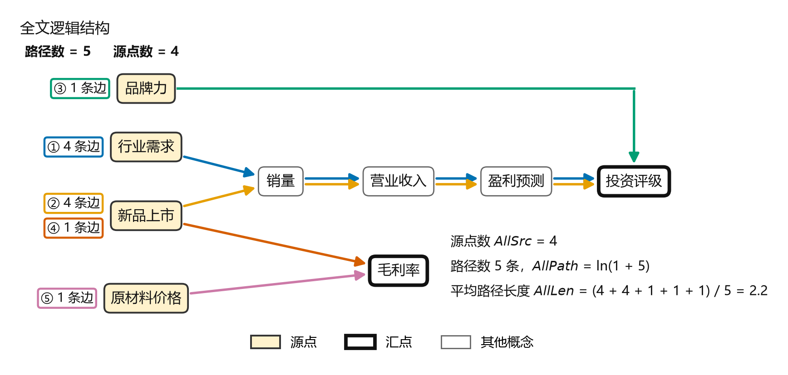
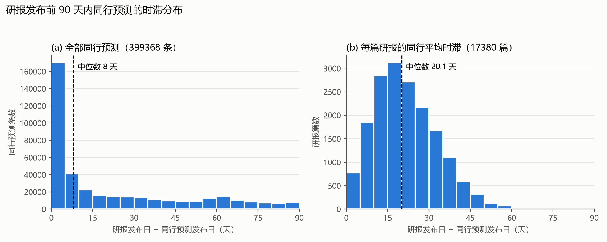

# 研报逻辑结构与分析师预测准确度

样本：hs300_full（沪深300 成分股的全部个股研报）　变量：只用全文逻辑结构（--target none）　范围：逻辑结构至少有一条边的全部研报　抽取版本：v1

相对标准版（如 hs300_full_v1_rating），本版省略了子图变量的定义、“控制全文逻辑结构”一节和两张成对放入的表（标准版表 7、表 13），以及第 4 节中成对放入和相同样本的两条补充说明：本版不放任何目标对应的子图变量，研究范围也不按子图筛选，这些内容没有对象；其余各节保留，表号依次前移（标准版表 8–12 为本版表 7–11）。

## 摘要

本文利用大语言模型提取研报中的概念及概念之间的因果关系，构建研报的逻辑结构，并以 2024 年沪深300 成分股的个股研报为样本，考察逻辑结构与分析师盈利预测准确度的关系。逻辑结构是以概念为节点、因果关系为边的有向图；本文只使用全文逻辑结构，即研报的全部概念和因果关系，用源点数、路径数和平均路径长度三个变量刻画。研究范围是逻辑结构至少有一条边的全部研报，共 17661 篇，占全部 17748 篇个股研报的 99.5%，其中绝大多数是篇幅较短的点评和跟踪报告。盈利预测准确度用研报对第二个预测财年（H2）归母净利润的预测相对同行的比例误差 *PMED*180 衡量：研报的绝对误差减去 180 天同行窗口内同行绝对误差的中位数，再除以这一中位数；同行中位数取自外部提供的预测误差数据，这一比例口径由本文派生。研究发现，全文逻辑结构的三个变量与预测准确度没有显著关系：基准回归中源点数、路径数和平均路径长度的系数都为正且不显著，源点数的系数为 0.61（t = 1.65），未达到 10% 的显著性水平，即使按点估计，量级也很小；逐步加入固定效应、去掉或替换同行时滞、加入月份固定效应或公司 × 年度固定效应后，三个变量也都不显著；H1、H3 下含公司固定效应时同样不显著。换用其他误差定义时只有少数格子显著：H2 下多是源点数、系数为正（多在 75 天窗口），H1、H3 下为负；以上一版自算的 *PMAFE* 为被解释变量时，源点数在公司 + 年度 + 券商固定效应下在 5% 水平显著为正。公司-券商-年度层面，含公司固定效应时源点数和路径数在 5% 或 10% 水平显著为正。作为对照，在按目标筛选、只含约一半研报的标准版样本中，全文源点数和路径数在含公司固定效应时显著为正；放到全部研报后不再显著。

## 1　研究设计

### 1.1　样本

样本来自 2024 年沪深300 成分股的个股研报（hs300_full，17748 篇，326 家公司），其中绝大多数不是深度报告，而是篇幅较短的点评和跟踪报告。本文的研究范围是其中逻辑结构至少有一条边的全部研报，共 17661 篇，占 hs300_full 的 99.5%；其余 87 篇的逻辑结构没有边，不进入研究范围。与标准版不同，研究范围不要求任何特定概念出现在逻辑结构中或是汇点。观测单位是研报。一篇研报进入样本需要满足：研报给出了 H2（研报的第二个预测财年，见 1.3 节）的归母净利润预测，公司已披露该财年的年报实际值，并且能用预测误差数据算出这篇研报的比例误差（主变量非缺失）。满足这些条件的研报有 17520 篇。剔除缺少控制变量的研报，以及被固定效应完全吸收的单例观测后，基准回归的样本为 17380 篇研报、310 家公司。

### 1.2　逻辑结构变量

研报的逻辑结构是用大语言模型从研报中抽取出的概念及其因果关系构成的有向图。本文只使用全文逻辑结构，即研报的全部概念和因果关系，不再取以某一概念为终点的子图。

源点是指没有其他概念指向它的概念，汇点是指有概念指向它、而它不再指向其他概念的概念。对全文逻辑结构取源点数、路径数和平均路径长度三个变量，图 1 以一个例子说明它们的构建方式。

**图 1　逻辑结构变量的构建**

注：图为一篇研报的全文逻辑结构，箭头由原因指向结果。每条从源点到汇点的路径用一种颜色的连线表示并编号，源点左侧的标签给出该路径的边数。

在图 1 的例子中，全文逻辑结构有 4 个源点和 2 个汇点，从源点到汇点共 5 条路径，平均路径长度为 2.2。各变量的定义如下：

| 逻辑结构 | 符号 | 名称 | 定义 |
|---|---|---|---|
| 全文逻辑结构 | *AllSrc* | 源点数 | 全图中源点的个数 |
| | *AllPath* | 路径数 | 从各源点到各汇点的不同路径条数，加 1 后取对数 |
| | *AllLen* | 平均路径长度 | 上述路径的平均边数 |

逻辑结构至少有一条边时三个变量都有定义，所以它们对研究范围内的全部研报都有定义，在基准回归样本中为 17380 篇研报、310 家公司。各变量按 1% 和 99% 分位缩尾。

### 1.3　预测准确度

**数据来源**　预测误差取自外部提供的预测误差数据（`data/forecast_errors.parquet`）。数据对每篇研报给出连续三个预测财年（H1、H2、H3）的归母净利润和每股收益（EPS）两种口径的误差，并给出两个同行窗口（75 天和 180 天）上的同行比较量。记研报 *i* 对公司 *f* 的预测为 *F*i，对应财年的年报实际值为 *A*f；窗口 *w* 内的同行预测构成同行组，*M*iw 和 *S*iw 是同行绝对误差的中位数和离散度，*C*iw 是不含本券商的同行一致预期（均值），*C*iall,w 是含本券商的一致预期，*D*i 是缩放基数（净利润口径为市值，EPS 口径为股价）。同行窗口的具体取法（往前多少天、是否每家券商只取最新一条）以数据文件为准，文件未附说明。本文使用的误差定义如下：

$$
RFE_{i}^{w} \;=\; \frac{\left| A_{f} - F_{i} \right| - M_{i}^{w}}{S_{i}^{w}}, \qquad PMED_{i}^{w} \;=\; \frac{\left| A_{f} - F_{i} \right| - M_{i}^{w}}{M_{i}^{w}}
$$

$$
IFE_{i}^{w} \;=\; \frac{\left| F_{i} - A_{f} \right| - \left| C_{i}^{w} - A_{f} \right|}{D_{i}}, \qquad IFEAll_{i}^{w} \;=\; \frac{\left| F_{i} - A_{f} \right| - \left| C_{i}^{\mathrm{all},w} - A_{f} \right|}{D_{i}}, \qquad RawFE_{i} \;=\; \frac{\left| A_{f} - F_{i} \right|}{D_{i}}
$$

*RFE*（相对误差）、*IFE* 和 *IFEAll*（相对一致预期的增量误差）、*RawFE*（原始误差）直接取自数据文件，*w* = 75、180。*PMED* 是本文用数据文件给出的同行中位数 *M*iw 派生的比例误差，数据文件没有直接给出；*M*iw 为 0 时记缺失。每个定义都分净利润和 EPS 两种口径、H1 至 H3 三个窗口，共 54 个变量，都在 17631 篇基础样本内按 1% 和 99% 分位缩尾，取值越大预测越不准确。*RFE*、*PMED* 无量纲；*IFE*、*IFEAll*、*RawFE* 以占 *D*i 的比例计。只有数据文件的公司代码与研报公司相同时才使用文件的值：一篇研报覆盖多家公司时，文件可能取了另一家公司，这 8 篇研报的文件变量记缺失。

**主变量**　主变量是净利润口径、H2、180 天窗口的比例误差 *PMED*180。它是用数据文件给出的 180 天窗口同行绝对误差中位数派生的，数据文件没有直接给出这一变量。选它作主变量，是因为它在形式上与上一版自算的相对预测误差 *PMAFE* 最接近：同为净利润、同为第二个预测财年，同为“研报误差减去同行基准、再除以同行基准”的比例口径，只是同行基准由均值换成了中位数。上一版的 *PMAFE* 采用 Clement (1999) 和 Harford, Jiang, Wang and Xie (2019) 的定义：

$$
PMAFE_{i} \;=\; \frac{AFE_{i} - MAFE_{i}}{MAFE_{i}}, \qquad AFE_{i} \;=\; \left| F_{i} - A_{f} \right|, \qquad MAFE_{i} \;=\; \frac{1}{N_{i}} \sum_{j \in C_{i}} AFE_{j}
$$

其中比较组 *C*i 包括其他券商在研报发布前 90 天内对同一公司同一财年净利润发布的预测（每家券商取窗口内最新的一条）和研报本身，至少 3 家同行。自算的 *PMAFE* 和同一比较组上的 Hong and Kubik (2003) 排名分数 *Score* 保留在样本里，作为对照（3.4 节）。表 1 报告 H2 各变量的描述性统计。

**表 1　预测误差变量的描述性统计（H2）**

<table>
<tr><th>变量</th><th>口径</th><th>N</th><th>均值</th><th>标准差</th><th>最小值</th><th>P25</th><th>中位数</th><th>P75</th><th>最大值</th></tr>
<tr><td align="left"><i>PMED</i>180</td><td align="left">净利润</td><td align="right">17520</td><td align="right">−0.09</td><td align="right">0.47</td><td align="right">−0.96</td><td align="right">−0.34</td><td align="right">−0.11</td><td align="right">0.04</td><td align="right">2.06</td></tr>
<tr><td align="left"><i>RFE</i>75</td><td align="left">净利润</td><td align="right">17430</td><td align="right">−0.33</td><td align="right">1.11</td><td align="right">−3.88</td><td align="right">−0.92</td><td align="right">−0.30</td><td align="right">0.25</td><td align="right">2.89</td></tr>
<tr><td align="left"><i>RFE</i>180</td><td align="left">净利润</td><td align="right">17512</td><td align="right">−0.44</td><td align="right">1.07</td><td align="right">−3.55</td><td align="right">−1.07</td><td align="right">−0.41</td><td align="right">0.15</td><td align="right">2.70</td></tr>
<tr><td align="left"><i>IFE</i>75</td><td align="left">净利润</td><td align="right">17435</td><td align="right">−0.32</td><td align="right">1.09</td><td align="right">−5.52</td><td align="right">−0.54</td><td align="right">−0.12</td><td align="right">0.12</td><td align="right">2.40</td></tr>
<tr><td align="left"><i>IFE</i>180</td><td align="left">净利润</td><td align="right">17501</td><td align="right">−0.51</td><td align="right">1.37</td><td align="right">−7.17</td><td align="right">−0.77</td><td align="right">−0.19</td><td align="right">0.09</td><td align="right">2.37</td></tr>
<tr><td align="left"><i>IFEAll</i>75</td><td align="left">净利润</td><td align="right">17435</td><td align="right">−0.32</td><td align="right">1.08</td><td align="right">−5.50</td><td align="right">−0.54</td><td align="right">−0.12</td><td align="right">0.12</td><td align="right">2.36</td></tr>
<tr><td align="left"><i>IFEAll</i>180</td><td align="left">净利润</td><td align="right">17501</td><td align="right">−0.51</td><td align="right">1.36</td><td align="right">−7.12</td><td align="right">−0.76</td><td align="right">−0.19</td><td align="right">0.09</td><td align="right">2.37</td></tr>
<tr><td align="left"><i>RawFE</i></td><td align="left">净利润</td><td align="right">17510</td><td align="right">2.81</td><td align="right">3.58</td><td align="right">0.02</td><td align="right">0.73</td><td align="right">1.65</td><td align="right">3.37</td><td align="right">22.19</td></tr>
<tr><td align="left"><i>PMED</i>75</td><td align="left">净利润</td><td align="right">17506</td><td align="right">−0.05</td><td align="right">0.49</td><td align="right">−0.95</td><td align="right">−0.28</td><td align="right">−0.07</td><td align="right">0.06</td><td align="right">2.37</td></tr>
<tr><td align="left"><i>PMED</i>180</td><td align="left">EPS</td><td align="right">17520</td><td align="right">−0.09</td><td align="right">0.46</td><td align="right">−0.95</td><td align="right">−0.33</td><td align="right">−0.11</td><td align="right">0.04</td><td align="right">2.06</td></tr>
<tr><td align="left"><i>RFE</i>75</td><td align="left">EPS</td><td align="right">17430</td><td align="right">−0.32</td><td align="right">1.14</td><td align="right">−3.90</td><td align="right">−0.91</td><td align="right">−0.28</td><td align="right">0.27</td><td align="right">3.07</td></tr>
<tr><td align="left"><i>RFE</i>180</td><td align="left">EPS</td><td align="right">17512</td><td align="right">−0.44</td><td align="right">1.08</td><td align="right">−3.56</td><td align="right">−1.07</td><td align="right">−0.40</td><td align="right">0.16</td><td align="right">2.75</td></tr>
<tr><td align="left"><i>IFE</i>75</td><td align="left">EPS</td><td align="right">17435</td><td align="right">−0.32</td><td align="right">1.10</td><td align="right">−5.52</td><td align="right">−0.53</td><td align="right">−0.11</td><td align="right">0.11</td><td align="right">2.47</td></tr>
<tr><td align="left"><i>IFE</i>180</td><td align="left">EPS</td><td align="right">17501</td><td align="right">−0.51</td><td align="right">1.37</td><td align="right">−7.17</td><td align="right">−0.76</td><td align="right">−0.18</td><td align="right">0.08</td><td align="right">2.43</td></tr>
<tr><td align="left"><i>IFEAll</i>75</td><td align="left">EPS</td><td align="right">17435</td><td align="right">−0.32</td><td align="right">1.09</td><td align="right">−5.50</td><td align="right">−0.53</td><td align="right">−0.11</td><td align="right">0.11</td><td align="right">2.46</td></tr>
<tr><td align="left"><i>IFEAll</i>180</td><td align="left">EPS</td><td align="right">17501</td><td align="right">−0.51</td><td align="right">1.37</td><td align="right">−7.17</td><td align="right">−0.75</td><td align="right">−0.18</td><td align="right">0.08</td><td align="right">2.42</td></tr>
<tr><td align="left"><i>RawFE</i></td><td align="left">EPS</td><td align="right">17510</td><td align="right">2.81</td><td align="right">3.59</td><td align="right">0.02</td><td align="right">0.72</td><td align="right">1.66</td><td align="right">3.40</td><td align="right">22.20</td></tr>
<tr><td align="left"><i>PMED</i>75</td><td align="left">EPS</td><td align="right">17506</td><td align="right">−0.04</td><td align="right">0.48</td><td align="right">−0.94</td><td align="right">−0.27</td><td align="right">−0.07</td><td align="right">0.07</td><td align="right">2.31</td></tr>
<tr><td align="left"><i>PMAFE</i>（自算）</td><td align="left">净利润</td><td align="right">17524</td><td align="right">−0.09</td><td align="right">0.36</td><td align="right">−0.94</td><td align="right">−0.26</td><td align="right">−0.07</td><td align="right">0.05</td><td align="right">1.28</td></tr>
<tr><td align="left"><i>Score</i>（自算）</td><td align="left">净利润</td><td align="right">17524</td><td align="right">57.59</td><td align="right">29.03</td><td align="right">0.00</td><td align="right">34.29</td><td align="right">61.11</td><td align="right">82.35</td><td align="right">100.00</td></tr>
<tr><td align="left"><i>n</i>75（条）</td><td align="left">净利润</td><td align="right">17535</td><td align="right">30.25</td><td align="right">17.96</td><td align="right">0</td><td align="right">17</td><td align="right">27</td><td align="right">40</td><td align="right">106</td></tr>
<tr><td align="left"><i>n</i>180（条）</td><td align="left">净利润</td><td align="right">17535</td><td align="right">49.11</td><td align="right">25.63</td><td align="right">0</td><td align="right">30</td><td align="right">44</td><td align="right">64</td><td align="right">147</td></tr>
<tr><td align="left">自算同行家数（家）</td><td align="left">净利润</td><td align="right">17631</td><td align="right">22.84</td><td align="right">10.57</td><td align="right">0</td><td align="right">15</td><td align="right">22</td><td align="right">30</td><td align="right">56</td></tr>
</table>

注：样本为 17631 篇基础样本中各变量的非缺失值，缩尾后。*IFE*、*IFEAll*、*RawFE* 乘以 100，单位为占市值（净利润口径）或股价（EPS 口径）的百分点；*RFE*、*PMED*、*PMAFE* 无量纲，*Score* 为 0 到 100 的分数。*n*75、*n*180 为数据文件给出的净利润口径 H2 同行组的预测条数，自算同行家数为上一版 90 天比较组的同行家数。

**与自算 *PMAFE* 的一致性**　表 2 比较 H2 各变量与自算 *PMAFE* 的一致性（H1、H3 的结果见输出文件 `consistency.csv`）。主变量 *PMED*180 与 *PMAFE* 都非缺失的研报有 17430 篇，Pearson 相关系数为 0.88，Spearman 秩相关为 0.90，88% 的研报两者符号相同（同为好于或差于同行）；75 天窗口的 *PMED*75 为 0.88 和 0.90。数据文件直接给出的、以离散度为分母的 *RFE*75 为 0.71 和 0.80；以市值为分母的 *IFE*75 为 0.50 和 0.74；*RawFE* 不相对同行，与 *PMAFE* 的 Pearson 相关只有 0.17。

**表 2　数据文件的预测误差与自算 *PMAFE* 的一致性（H2）**

<table>
<tr><th>定义</th><th>口径</th><th>公式</th><th>非缺失 篇数</th><th>与自算 <i>PMAFE</i> 同时非缺失</th><th>Pearson</th><th>Spearman</th><th>符号 一致率</th></tr>
<tr><td align="left"><i>RFE</i>75</td><td align="left">净利润</td><td align="left">(|A − F| − M75) / S75</td><td align="right">17430</td><td align="right">17385</td><td align="right">0.71</td><td align="right">0.80</td><td align="right">0.89</td></tr>
<tr><td align="left"><i>RFE</i>180</td><td align="left">净利润</td><td align="left">(|A − F| − M180) / S180</td><td align="right">17512</td><td align="right">17430</td><td align="right">0.69</td><td align="right">0.77</td><td align="right">0.88</td></tr>
<tr><td align="left"><i>IFE</i>75</td><td align="left">净利润</td><td align="left">(|F − A| − |C75 − A|) / D</td><td align="right">17435</td><td align="right">17386</td><td align="right">0.50</td><td align="right">0.74</td><td align="right">0.89</td></tr>
<tr><td align="left"><i>IFE</i>180</td><td align="left">净利润</td><td align="left">(|F − A| − |C180 − A|) / D</td><td align="right">17501</td><td align="right">17419</td><td align="right">0.44</td><td align="right">0.67</td><td align="right">0.85</td></tr>
<tr><td align="left"><i>IFEAll</i>75</td><td align="left">净利润</td><td align="left">(|F − A| − |C_all75 − A|) / D</td><td align="right">17435</td><td align="right">17386</td><td align="right">0.50</td><td align="right">0.73</td><td align="right">0.89</td></tr>
<tr><td align="left"><i>IFEAll</i>180</td><td align="left">净利润</td><td align="left">(|F − A| − |C_all180 − A|) / D</td><td align="right">17501</td><td align="right">17419</td><td align="right">0.44</td><td align="right">0.67</td><td align="right">0.85</td></tr>
<tr><td align="left"><i>RawFE</i></td><td align="left">净利润</td><td align="left">|A − F| / D</td><td align="right">17510</td><td align="right">17419</td><td align="right">0.17</td><td align="right">0.37</td><td align="right">—</td></tr>
<tr><td align="left"><i>PMED</i>75</td><td align="left">净利润</td><td align="left">(|A − F| − M75) / M75（派生）</td><td align="right">17506</td><td align="right">17429</td><td align="right">0.88</td><td align="right">0.90</td><td align="right">0.89</td></tr>
<tr><td align="left"><i>PMED</i>180</td><td align="left">净利润</td><td align="left">(|A − F| − M180) / M180（派生）</td><td align="right">17520</td><td align="right">17430</td><td align="right">0.88</td><td align="right">0.90</td><td align="right">0.88</td></tr>
<tr><td align="left"><i>RFE</i>75</td><td align="left">EPS</td><td align="left">(|A − F| − M75) / S75</td><td align="right">17430</td><td align="right">17385</td><td align="right">0.64</td><td align="right">0.73</td><td align="right">0.87</td></tr>
<tr><td align="left"><i>RFE</i>180</td><td align="left">EPS</td><td align="left">(|A − F| − M180) / S180</td><td align="right">17512</td><td align="right">17430</td><td align="right">0.63</td><td align="right">0.72</td><td align="right">0.86</td></tr>
<tr><td align="left"><i>IFE</i>75</td><td align="left">EPS</td><td align="left">(|F − A| − |C75 − A|) / D</td><td align="right">17435</td><td align="right">17386</td><td align="right">0.47</td><td align="right">0.69</td><td align="right">0.88</td></tr>
<tr><td align="left"><i>IFE</i>180</td><td align="left">EPS</td><td align="left">(|F − A| − |C180 − A|) / D</td><td align="right">17501</td><td align="right">17419</td><td align="right">0.41</td><td align="right">0.63</td><td align="right">0.84</td></tr>
<tr><td align="left"><i>IFEAll</i>75</td><td align="left">EPS</td><td align="left">(|F − A| − |C_all75 − A|) / D</td><td align="right">17435</td><td align="right">17386</td><td align="right">0.46</td><td align="right">0.69</td><td align="right">0.88</td></tr>
<tr><td align="left"><i>IFEAll</i>180</td><td align="left">EPS</td><td align="left">(|F − A| − |C_all180 − A|) / D</td><td align="right">17501</td><td align="right">17419</td><td align="right">0.41</td><td align="right">0.63</td><td align="right">0.84</td></tr>
<tr><td align="left"><i>RawFE</i></td><td align="left">EPS</td><td align="left">|A − F| / D</td><td align="right">17510</td><td align="right">17419</td><td align="right">0.14</td><td align="right">0.30</td><td align="right">—</td></tr>
<tr><td align="left"><i>PMED</i>75</td><td align="left">EPS</td><td align="left">(|A − F| − M75) / M75（派生）</td><td align="right">17506</td><td align="right">17429</td><td align="right">0.75</td><td align="right">0.81</td><td align="right">0.87</td></tr>
<tr><td align="left"><i>PMED</i>180</td><td align="left">EPS</td><td align="left">(|A − F| − M180) / M180（派生）</td><td align="right">17520</td><td align="right">17430</td><td align="right">0.76</td><td align="right">0.81</td><td align="right">0.86</td></tr>
</table>

注：样本为 17631 篇基础样本。相关系数用两者都非缺失的研报、缩尾后的值计算；Spearman 为取秩后的 Pearson 相关。符号一致率为两者符号相同的研报占比；*RawFE* 恒为正，没有符号含义，记“—”。

主变量与 *PMAFE* 的差别有以下几个来源。第一，基准不同：*PMAFE* 以同行绝对误差的均值为基准，*PMED*180 以中位数为基准，两者都除以基准本身；中位数不受个别极端误差影响，基准回归样本中 *PMED*180 的标准差为 0.47，*PMAFE* 为 0.36。数据文件直接给出的 *RFE* 则除以同行误差的离散度，与 *PMAFE* 的口径差别更大。第二，同行组不同：数据文件的窗口为 180 天，上一版为 90 天；数据文件的 *n*180 是同行组的预测条数，基准回归样本中位数为 44 条（*n*75 为 27 条），上一版的同行家数中位数为 22 家，同行组的具体取法未附说明；数据文件也不要求至少 3 条同行预测，180 天窗口下主变量非缺失的研报中有 28 篇同行不足 3 条。两边的样本因此不完全重合：主变量缺失而 *PMAFE* 非缺失的研报有 94 篇，反之有 90 篇。第三，实际值的版本不同：数据文件的预测值与本文使用的预测值完全相同，H2 的实际值在两者都非缺失的 17521 篇中有 194 篇不同，相对差异的中位数为 0.26%，最大为 16.8%（H1 有 1745 篇不同）。第四，8 篇研报因数据文件的公司与研报公司不符记缺失；17631 篇基础样本中有 17543 篇能在数据文件里找到，目标财年与本文的对应关系完全相同。

数据文件给出的 *M*iw 是同行绝对误差的中位数，这一点可以核对：同行条数 *n*75 为奇数时，中位数应等于某一条同行预测的绝对误差。在 18358 个净利润口径、*n*75 为奇数的样本行中，全部都能在本文的分析师预测表里找到发布于研报之前 75 天内、绝对误差恰好等于 *M*i75 的另一条预测；*n*75 为偶数时这一比例只有 25%，与中位数取中间两条的均值一致。数据文件本身只收录了一部分预测，在数据文件的行中只能为 54% 的奇数样本行找到这样的预测。

**预测窗口**　研报一般给出连续三个财年的归母净利润预测，从最近一个尚未披露年报的财年开始；H1、H2、H3 依次是对这三个财年的预测。样本研报都发布于 2024 年，但预测的起始财年有两种，同一窗口对应的财年因此不同：

| 预测的起始财年 | 发布时间 | 研报篇数 | H1 | H2 | H3 |
|---|---|---|---|---|---|
| 2023 财年 | 2024 年 1–4 月 | 1837 | 2023 财年（1812） | 2024 财年（1812） | 2025 财年（1809） |
| 2024 财年 | 2024 年 2–12 月 | 15794 | 2024 财年（15715） | 2025 财年（15708） | 2026 财年（年报尚未披露） |

注：研报篇数为匹配到研报自身的预测、有 H1 预测和实际值且发布于 H1 财年年报披露之前的研报；括号内为其中该窗口净利润口径的 *PMED*180 非缺失的研报篇数。数据文件的预测财年与本文逐篇相同。

预测从 2023 财年开始的 1837 篇研报都发布于 2024 年 1–4 月、公司 2023 年年报披露之前，其 H1、H2、H3 对应 2023、2024、2025 财年；其余 15794 篇研报的预测从 2024 财年开始，H1、H2、H3 对应 2024、2025、2026 财年。2026 财年的年报尚未披露，所以 H3 只对前一类研报可以评价。主分析使用 H2：H2 对全部研报都可以评价；H1 的目标财年在研报发布时已经结束或正在进行（预测从 2023 财年开始的研报，其 H1 是已经结束的 2023 财年）；H3 只有少部分研报可以评价。H1、H3 的结果在 3.3 节报告。

### 1.4　回归方程

基准回归为：

$$
PMED_{i} \;=\; \alpha \;+\; \beta\, G_{i} \;+\; \boldsymbol{\gamma}'\mathbf{X}_{i} \;+\; \theta\, PeerLag_{i} \;+\; \mu_{b} \;+\; \delta_{f} \;+\; \lambda_{t} \;+\; \varepsilon_{i}
$$

其中 *i* 表示研报，*f* 表示研报覆盖的公司，*b* 表示发布研报的券商，*t* 表示预测的目标财年。稳健性检验把被解释变量换成 1.3 节的其他定义。

**解释变量　*G*i**　第 1.2 节的三个逻辑结构变量之一，在估计样本内标准化为均值 0、标准差 1。

**同行时滞　*PeerLag*i**　上一版 90 天比较组 *C*i 内各条同行预测的发布日到研报发布日的天数的平均值：

$$
PeerLag_{i} \;=\; \frac{1}{N_{i} - 1} \sum_{j \in C_{i},\, j \neq i} \left( d_{i} - d_{j} \right)
$$

比较组只取研报发布前的预测，研报总是其中最晚发布的一条，相对同行有时效上的优势；同行的预测越陈旧，这一优势越大。*PeerLag* 用来控制这一差异，按 1% 和 99% 分位缩尾，不做标准化。数据文件没有给出同行预测的发布时间，所以各误差定义都控制同一窗口的这一变量，它与数据文件的 75 天、180 天同行组并不完全对应。

**控制变量　Xi**　与 Liu, Liu & Sui (2026) Table 10 相同的六个公司层面变量，在研报发布日上度量：

| 符号 | 含义 | 定义 |
|---|---|---|
| *Size* | 公司规模 | 研报发布日前一交易日总市值的对数 |
| *BM* | 账面市值比 | 最近年报年度末净资产 ÷ 总市值 |
| *Mom* | 动量 | 研报发布日前第 250 至第 21 个交易日的累计收益（%） |
| *Vol* | 波动率 | 研报发布日前 120 个交易日的日收益标准差（%） |
| *ROA* | 盈利能力 | 最近年报年度归母净利润 ÷ 年末总资产（%） |
| *LnAge* | 公司年龄 | 上市以来月数的对数；行情数据始于 2010 年 1 月，此前上市的公司取同一上限 |

**固定效应和标准误**　*μ*b、*δ*f、*λ*t 分别为券商、公司和目标财年固定效应；H2 的目标财年在样本中有 2024 和 2025 两个取值，分别对应预测从 2023 财年和 2024 财年开始的研报。加入公司固定效应后，*β* 由覆盖同一家公司的不同研报之间的差异识别；加入券商固定效应进一步排除券商之间在写作风格和预测能力上的固定差异。行业按申万一级行业分类；行业表中缺少 601059（信达证券），这家公司在研究范围内只有 1 篇研报，且主变量缺失，不进入 H2 的回归。标准误按公司聚类。

**系数的含义**　表中系数乘以 100 报告（*Score* 除外）。*RFE*、*PMED*、*PMAFE* 无量纲，*β* 表示逻辑结构变量提高一个标准差时被解释变量变动多少个百分点（以 0.01 为一个单位）；*IFE*、*IFEAll*、*RawFE* 的系数乘以 100 后，单位是占市值（净利润口径）或股价（EPS 口径）的百分点；*Score* 的系数以分数报告。误差变量越小越准确，*β* < 0 表示预测更准确，*Score* 则相反。作为参照，基准回归样本中 *PMED*180 的标准差为 47 个百分点，自算 *PMAFE* 为 36 个百分点；*PMED*180 与 *PMAFE* 的相关系数为 0.88，与 *Score* 为 −0.70。

## 2　描述性分析

### 2.1　逻辑结构变量的描述性统计

表 3 报告三个逻辑结构变量在基准回归样本中的描述性统计。为了便于理解量级，路径数按取对数之前的条数报告。

**表 3　逻辑结构变量的描述性统计**

<table>
<tr><th>逻辑结构</th><th>变量</th><th>N</th><th>均值</th><th>标准差</th><th>最小值</th><th>P25</th><th>中位数</th><th>P75</th><th>最大值</th></tr>
<tr><td>全文逻辑结构</td><td>源点数 <i>AllSrc</i></td><td align="right">17380</td><td align="right">8.54</td><td align="right">5.92</td><td align="right">1.00</td><td align="right">5.00</td><td align="right">7.00</td><td align="right">10.00</td><td align="right">37.00</td></tr>
<tr><td></td><td>路径数（条）</td><td align="right">17380</td><td align="right">12.59</td><td align="right">14.54</td><td align="right">1.00</td><td align="right">6.00</td><td align="right">9.00</td><td align="right">13.00</td><td align="right">105.00</td></tr>
<tr><td></td><td>平均路径长度 <i>AllLen</i></td><td align="right">17380</td><td align="right">1.44</td><td align="right">0.44</td><td align="right">1.00</td><td align="right">1.11</td><td align="right">1.33</td><td align="right">1.65</td><td align="right">3.15</td></tr>
</table>

注：样本为基准回归样本，各行为 17380 篇研报。各变量按 1% 和 99% 分位缩尾。路径数为取对数之前的条数，回归中使用的 *AllPath* 是路径数加 1 后的对数。

全文逻辑结构源点数的中位数为 7 个，路径数的中位数为 9 条，平均路径长度的中位数为 1.33。三个变量都右偏，均值都高于中位数；只有 1 个源点的研报占 2%。

### 2.2　逻辑结构变量的变异来源

回归用公司和券商固定效应识别 *β*，因此需要先了解逻辑结构变量的变异有多少来自公司之间、券商之间，有多少留在同一家公司、同一家券商内部。仿照 Liu, Liu & Sui (2026) Table 5 的固定效应分解，我们把每个变量分别对一组固定效应回归，报告调整 R²。

**表 4　逻辑结构变量的固定效应分解**

<table>
<tr><th>逻辑结构</th><th>变量</th><th>(1) 月份</th><th>(2) 行业</th><th>(3) 公司</th><th>(4) 券商</th><th>(5) 公司 + 券商</th><th>(6) 月份 + 公司 + 券商</th></tr>
<tr><td>全文逻辑结构</td><td><i>AllSrc</i></td><td align="right">1.8</td><td align="right">1.6</td><td align="right">4.5</td><td align="right">2.6</td><td align="right">6.9</td><td align="right">9.0</td></tr>
<tr><td></td><td><i>AllPath</i></td><td align="right">1.6</td><td align="right">1.8</td><td align="right">5.6</td><td align="right">3.8</td><td align="right">9.2</td><td align="right">11.1</td></tr>
<tr><td></td><td><i>AllLen</i></td><td align="right">1.5</td><td align="right">2.5</td><td align="right">5.6</td><td align="right">1.7</td><td align="right">6.9</td><td align="right">8.2</td></tr>
</table>

注：每格为该变量对相应固定效应回归的调整 R²（%）。样本为基准回归样本，各行都为 17380 篇研报。月份为研报发布月份，行业按申万行业分类。

表 4 有两点结果。第一，发布月份解释的变异很小，三个变量的调整 R² 都不超过 1.8%，逻辑结构的差异主要是截面上的差异。第二，三个变量都主要在公司内部、券商内部变动：公司固定效应只解释 4.5% 至 5.6%，券商固定效应解释 1.7% 至 3.8%，两者合计解释 6.9% 至 9.2%。九成以上的变异留在同一家公司、同一家券商内部，这部分变异正是基准回归识别 *β* 所用的。

源点数和路径数高度相关，*AllSrc* 与 *AllPath* 的相关系数为 0.90；*AllSrc* 与平均路径长度 *AllLen* 的相关系数为 0.30。公司和券商内部的变异中也包含逻辑结构抽取的噪声；噪声若与预测误差无关，会使回归系数偏向 0。

### 2.3　同行预测的时滞

研报相对同行的时效优势取决于同行的预测比研报早多少天。图 2 给出这一时滞在基准回归样本中的分布，时滞等于研报发布日减去同行预测发布日。

**图 2　研报发布前 90 天内同行预测的时滞分布**

注：样本为基准回归的 17380 篇研报，同行预测为上一版 90 天比较组内其他券商对同一公司同一财年（H2）的预测。(a) 为比较组内全部 399368 条同行预测的时滞，(b) 为每篇研报的同行平均时滞，即 *PeerLag*。虚线为中位数。

全部 399368 条同行预测的时滞中位数为 8 天，50% 发布于研报之前 7 天以内，13% 在 61 至 90 天；99% 的研报在发布前 7 天内至少有一家同行更新过预测。按研报平均后，*PeerLag* 的中位数为 20.1 天，四分位区间为 12.9 至 28.7 天，研报相对比较组平均领先约三周。

时效优势只有在与逻辑结构变量相关时才会影响 *β*。*PeerLag* 与 *AllSrc* 的相关系数为 0.07（p 值四舍五入后为 0.000），在 1% 水平显著；按公司去均值后为 0.09（p 值四舍五入后为 0.000）。相关系数为正，但很小：源点数多的研报面对的同行预测略为陈旧。

## 3　回归结果

### 3.1　基准结果

表 5 报告基准回归的结果，每列放入一个逻辑结构变量。

**表 5　逻辑结构变量与 H2 相对预测误差**

<table>
<tr><th></th><th>(1) 全文 逻辑结构 <i>AllSrc</i></th><th>(2) 全文 逻辑结构 <i>AllPath</i></th><th>(3) 全文 逻辑结构 <i>AllLen</i></th></tr>
<tr><td><b><i>G</i></b></td><td align="right">0.61</td><td align="right">0.35</td><td align="right">0.43</td></tr>
<tr><td></td><td align="right">(1.65)</td><td align="right">(0.88)</td><td align="right">(0.98)</td></tr>
<tr><td><i>Size</i></td><td align="right">8.40</td><td align="right">8.44</td><td align="right">8.37</td></tr>
<tr><td></td><td align="right">(0.86)</td><td align="right">(0.86)</td><td align="right">(0.85)</td></tr>
<tr><td><i>BM</i></td><td align="right">−7.90</td><td align="right">−7.86</td><td align="right">−7.87</td></tr>
<tr><td></td><td align="right">(−0.65)</td><td align="right">(−0.65)</td><td align="right">(−0.65)</td></tr>
<tr><td><i>Mom</i></td><td align="right">0.10</td><td align="right">0.10</td><td align="right">0.10</td></tr>
<tr><td></td><td align="right">(1.42)</td><td align="right">(1.42)</td><td align="right">(1.42)</td></tr>
<tr><td><i>Vol</i></td><td align="right">−9.48***</td><td align="right">−9.51***</td><td align="right">−9.52***</td></tr>
<tr><td></td><td align="right">(−3.12)</td><td align="right">(−3.13)</td><td align="right">(−3.12)</td></tr>
<tr><td><i>ROA</i></td><td align="right">−0.68</td><td align="right">−0.67</td><td align="right">−0.67</td></tr>
<tr><td></td><td align="right">(−0.91)</td><td align="right">(−0.91)</td><td align="right">(−0.90)</td></tr>
<tr><td><i>LnAge</i></td><td align="right">−9.66</td><td align="right">−9.66</td><td align="right">−9.86</td></tr>
<tr><td></td><td align="right">(−0.23)</td><td align="right">(−0.23)</td><td align="right">(−0.24)</td></tr>
<tr><td><i>PeerLag</i></td><td align="right">0.05</td><td align="right">0.05</td><td align="right">0.05</td></tr>
<tr><td></td><td align="right">(0.66)</td><td align="right">(0.69)</td><td align="right">(0.68)</td></tr>
<tr><td>调整 R²</td><td align="right">0.148</td><td align="right">0.148</td><td align="right">0.148</td></tr>
<tr><td>N</td><td align="right">17380</td><td align="right">17380</td><td align="right">17380</td></tr>
<tr><td>券商固定效应</td><td align="center">是</td><td align="center">是</td><td align="center">是</td></tr>
<tr><td>公司固定效应</td><td align="center">是</td><td align="center">是</td><td align="center">是</td></tr>
<tr><td>年度固定效应</td><td align="center">是</td><td align="center">是</td><td align="center">是</td></tr>
</table>

注：观测单位为研报。被解释变量为研报自身 H2 净利润预测的比例误差 *PMED*180（用数据文件的 180 天同行绝对误差中位数派生），取值越小越准确。年度固定效应为目标财年固定效应。系数乘以 100，括号内为按公司聚类的 t 值。

三个变量的系数都为正，都不显著：源点数 *AllSrc* 为 0.61（t = 1.65），路径数 *AllPath* 为 0.35（t = 0.88），平均路径长度 *AllLen* 为 0.43（t = 0.98）。*AllSrc* 的 t 值接近 10% 水平的临界值；即使按点估计，源点数提高一个标准差，比例误差只上升 0.61 个百分点，相对于 *PMED*180 47 个百分点的标准差，量级很小。同行时滞 *PeerLag* 在各列中都不显著，t 值的绝对值最大为 0.69。控制变量中只有波动率 *Vol* 在各列中都在 1% 水平显著为负，其余都不显著。以上一版自算 *PMAFE* 为被解释变量时，同一设定下 *AllSrc* 在 5% 水平显著为正（0.60，t = 1.97），*AllPath* 和 *AllLen* 不显著（表 8 倒数第二行）。

### 3.2　固定效应的作用

表 6 在保持被解释变量和控制变量不变的前提下，逐步加入固定效应。

**表 6　不同固定效应下的 *β***

<table>
<tr><th>固定效应</th><th>全文 逻辑结构 <i>AllSrc</i></th><th>全文 逻辑结构 <i>AllPath</i></th><th>全文 逻辑结构 <i>AllLen</i></th><th>N</th></tr>
<tr><td>无</td><td align="right">0.18 (0.43)</td><td align="right">−0.25 (−0.54)</td><td align="right">−0.19 (−0.39)</td><td align="right">17384</td></tr>
<tr><td>行业</td><td align="right">0.38 (0.99)</td><td align="right">−0.09 (−0.21)</td><td align="right">0.12 (0.27)</td><td align="right">17384</td></tr>
<tr><td>公司</td><td align="right">0.52 (1.44)</td><td align="right">0.30 (0.76)</td><td align="right">0.44 (1.00)</td><td align="right">17380</td></tr>
<tr><td>公司 + 券商</td><td align="right">0.61 (1.65)</td><td align="right">0.35 (0.88)</td><td align="right">0.43 (0.98)</td><td align="right">17380</td></tr>
</table>

注：被解释变量为 H2 的比例误差 *PMED*180，各回归均包含六个控制变量和 *PeerLag*，除“无”以外各行都包含目标财年固定效应。每格为 *G* 的系数（乘以 100）及按公司聚类的 t 值。行业按申万行业分类。最后一行即表 5。N 为各列的观测数。

三个变量在各设定下都不显著。*AllSrc* 的系数随固定效应的加入逐步变大：不加固定效应时为 0.18（t = 0.43），只加行业固定效应时为 0.38（t = 0.99），加入公司固定效应后为 0.52（t = 1.44），再加入券商固定效应后为 0.61（t = 1.65）。*AllPath* 在不加固定效应和只加行业固定效应时系数为负（−0.25 和 −0.09），*AllLen* 在不加固定效应时为负（−0.19），加入公司固定效应后都转为正，但都不显著。系数在加入公司固定效应后变大，与表 4 一致：这些变量的变异主要在公司内部，*β* 来自覆盖同一家公司的不同研报之间的比较。

### 3.3　对照：其他预测窗口

表 7 把被评价的预测换成研报的 H1 预测（Panel A）和 H3 预测（Panel B），被解释变量相应换成同一定义在该窗口上的 *PMED*180，*PeerLag* 换成同一财年的同行时滞，其余设定与表 6 相同。H3 只对预测从 2023 财年开始的研报（2024 年 1–4 月发布）可以评价，Panel B 的样本较小。

**表 7　其他预测窗口：逻辑结构变量与 H1、H3 相对预测误差**

<table>
<tr><th>固定效应</th><th>全文 逻辑结构 <i>AllSrc</i></th><th>全文 逻辑结构 <i>AllPath</i></th><th>全文 逻辑结构 <i>AllLen</i></th><th>N</th></tr>
<tr><td colspan="5" align="center"><b>Panel A：H1</b></td></tr>
<tr><td>无</td><td align="right">−0.84 (−1.59)</td><td align="right">−1.32** (−2.47)</td><td align="right">−0.41 (−0.85)</td><td align="right">17417</td></tr>
<tr><td>行业</td><td align="right">−0.47 (−0.90)</td><td align="right">−0.84 (−1.63)</td><td align="right">0.40 (0.86)</td><td align="right">17417</td></tr>
<tr><td>公司</td><td align="right">−0.56 (−1.15)</td><td align="right">−0.66 (−1.38)</td><td align="right">0.39 (0.89)</td><td align="right">17414</td></tr>
<tr><td>公司 + 券商</td><td align="right">−0.42 (−0.87)</td><td align="right">−0.53 (−1.09)</td><td align="right">0.40 (0.90)</td><td align="right">17414</td></tr>
<tr><td colspan="5" align="center"><b>Panel B：H3</b></td></tr>
<tr><td>无</td><td align="right">−2.53** (−2.15)</td><td align="right">−3.88*** (−2.88)</td><td align="right">−3.01* (−1.88)</td><td align="right">1768</td></tr>
<tr><td>行业</td><td align="right">−2.14* (−1.79)</td><td align="right">−3.24** (−2.31)</td><td align="right">−2.36* (−1.67)</td><td align="right">1768</td></tr>
<tr><td>公司</td><td align="right">−0.43 (−0.41)</td><td align="right">−0.67 (−0.51)</td><td align="right">−0.16 (−0.16)</td><td align="right">1725</td></tr>
<tr><td>公司 + 券商</td><td align="right">−1.54 (−1.39)</td><td align="right">−1.76 (−1.29)</td><td align="right">−0.56 (−0.49)</td><td align="right">1721</td></tr>
</table>

注：Panel A 的被解释变量为 H1 净利润预测的比例误差 *PMED*180，Panel B 为 H3 的比例误差。Panel B 只含预测从 2023 财年开始的研报（2024 年 1–4 月发布），目标财年都是 2025 财年。各回归均包含六个控制变量和 *PeerLag*，除“无”以外各行都包含目标财年固定效应。每格为 *G* 的系数（乘以 100）及按公司聚类的 t 值。N 为各列的观测数。

H1（Panel A）下，含公司固定效应时三个变量都不显著，t 值的绝对值最大为 1.38，*AllSrc* 和 *AllPath* 的系数为负，*AllLen* 为正；不加固定效应时 *AllPath* 在 5% 水平显著为负（−1.32，t = −2.47），只加行业固定效应后不再显著。H3（Panel B）下，三个变量的系数都为负，不加固定效应和只加行业固定效应时都至少在 10% 水平显著，*AllPath* 最显著（−3.88，t = −2.88；−3.24，t = −2.31）；加入公司固定效应后都不显著，t 值的绝对值最大为 1.39。H1、H3 下多数系数的方向与 H2 相反，但含公司固定效应时都不显著。Panel B 的样本较小：不加固定效应时为 1768 篇研报，加入公司固定效应后为 1725 篇，解读时需注意。

### 3.4　稳健性检验：不同误差定义

主变量只是数据文件可以构造的一种误差定义。表 8 和表 9 对 H2 的全部定义和口径分别估计三个逻辑结构变量的系数，表 8 为公司 + 年度 + 券商固定效应，表 9 为公司 + 年度固定效应；两表的第一行是主变量，最后两行是上一版自算的 *PMAFE* 和 *Score*，作为对照。表 10 对 H1、H3 做同样的估计。

**表 8　不同误差定义：H2，公司 + 年度 + 券商固定效应**

<table>
<tr><th>定义</th><th>全文 逻辑结构 <i>AllSrc</i></th><th>全文 逻辑结构 <i>AllPath</i></th><th>全文 逻辑结构 <i>AllLen</i></th><th>N</th></tr>
<tr><td colspan="5"><i>净利润口径</i></td></tr>
<tr><td align="left"><i>PMED</i>180</td><td align="right">0.61 (1.65)</td><td align="right">0.35 (0.88)</td><td align="right">0.43 (0.98)</td><td align="right">17380</td></tr>
<tr><td align="left"><i>RFE</i>75</td><td align="right">1.65* (1.82)</td><td align="right">0.46 (0.45)</td><td align="right">0.31 (0.29)</td><td align="right">17335</td></tr>
<tr><td align="left"><i>RFE</i>180</td><td align="right">1.25 (1.55)</td><td align="right">−0.04 (−0.04)</td><td align="right">0.13 (0.14)</td><td align="right">17380</td></tr>
<tr><td align="left"><i>IFE</i>75</td><td align="right">0.013* (1.78)</td><td align="right">0.002 (0.29)</td><td align="right">0.002 (0.24)</td><td align="right">17336</td></tr>
<tr><td align="left"><i>IFE</i>180</td><td align="right">0.011 (1.31)</td><td align="right">−0.003 (−0.28)</td><td align="right">−0.004 (−0.34)</td><td align="right">17369</td></tr>
<tr><td align="left"><i>IFEAll</i>75</td><td align="right">0.012* (1.70)</td><td align="right">0.002 (0.19)</td><td align="right">0.002 (0.23)</td><td align="right">17336</td></tr>
<tr><td align="left"><i>IFEAll</i>180</td><td align="right">0.011 (1.31)</td><td align="right">−0.003 (−0.30)</td><td align="right">−0.004 (−0.35)</td><td align="right">17369</td></tr>
<tr><td align="left"><i>RawFE</i></td><td align="right">0.019* (1.78)</td><td align="right">0.010 (0.83)</td><td align="right">−0.019 (−1.43)</td><td align="right">17369</td></tr>
<tr><td align="left"><i>PMED</i>75</td><td align="right">0.79** (2.03)</td><td align="right">0.50 (1.23)</td><td align="right">0.66 (1.43)</td><td align="right">17379</td></tr>
<tr><td colspan="5"><i>EPS口径</i></td></tr>
<tr><td align="left"><i>PMED</i>180</td><td align="right">0.45 (1.26)</td><td align="right">0.22 (0.57)</td><td align="right">0.24 (0.55)</td><td align="right">17380</td></tr>
<tr><td align="left"><i>RFE</i>75</td><td align="right">1.36 (1.48)</td><td align="right">0.17 (0.17)</td><td align="right">0.17 (0.15)</td><td align="right">17335</td></tr>
<tr><td align="left"><i>RFE</i>180</td><td align="right">1.08 (1.31)</td><td align="right">−0.25 (−0.27)</td><td align="right">−0.17 (−0.17)</td><td align="right">17380</td></tr>
<tr><td align="left"><i>IFE</i>75</td><td align="right">0.011 (1.44)</td><td align="right">0.000 (0.06)</td><td align="right">−0.000 (−0.04)</td><td align="right">17336</td></tr>
<tr><td align="left"><i>IFE</i>180</td><td align="right">0.008 (1.01)</td><td align="right">−0.004 (−0.48)</td><td align="right">−0.005 (−0.50)</td><td align="right">17369</td></tr>
<tr><td align="left"><i>IFEAll</i>75</td><td align="right">0.010 (1.38)</td><td align="right">−0.000 (−0.04)</td><td align="right">−0.001 (−0.07)</td><td align="right">17336</td></tr>
<tr><td align="left"><i>IFEAll</i>180</td><td align="right">0.008 (1.02)</td><td align="right">−0.004 (−0.49)</td><td align="right">−0.006 (−0.52)</td><td align="right">17369</td></tr>
<tr><td align="left"><i>RawFE</i></td><td align="right">0.017 (1.64)</td><td align="right">0.009 (0.79)</td><td align="right">−0.021 (−1.61)</td><td align="right">17369</td></tr>
<tr><td align="left"><i>PMED</i>75</td><td align="right">0.64* (1.79)</td><td align="right">0.43 (1.14)</td><td align="right">0.48 (1.09)</td><td align="right">17379</td></tr>
<tr><td colspan="5"><i>自算（上一版的比较组）</i></td></tr>
<tr><td align="left"><i>PMAFE</i></td><td align="right">0.60** (1.97)</td><td align="right">0.42 (1.26)</td><td align="right">0.16 (0.44)</td><td align="right">17473</td></tr>
<tr><td align="left"><i>Score</i></td><td align="right">−0.37 (−1.44)</td><td align="right">−0.15 (−0.55)</td><td align="right">−0.11 (−0.41)</td><td align="right">17473</td></tr>
</table>

注：每行为一个被解释变量，每格为单独放入该逻辑结构变量时 *G* 的系数及按公司聚类的 t 值；各回归均包含六个控制变量、*PeerLag* 和公司、目标财年、券商固定效应。*RFE*、*PMED*、*PMAFE* 的系数乘以 100；*IFE*、*IFEAll*、*RawFE* 的系数乘以 100 后单位为占市值（净利润口径）或股价（EPS 口径）的百分点，保留三位小数；*Score* 的系数以分数报告，越大越准确。第一行即表 5 的 *G* 行。最后两行为上一版自算的 *PMAFE* 和 *Score*（样本为自算变量非缺失的研报）。N 为各列的观测数。

**表 9　不同误差定义：H2，公司 + 年度固定效应**

<table>
<tr><th>定义</th><th>全文 逻辑结构 <i>AllSrc</i></th><th>全文 逻辑结构 <i>AllPath</i></th><th>全文 逻辑结构 <i>AllLen</i></th><th>N</th></tr>
<tr><td colspan="5"><i>净利润口径</i></td></tr>
<tr><td align="left"><i>PMED</i>180</td><td align="right">0.52 (1.44)</td><td align="right">0.30 (0.76)</td><td align="right">0.44 (1.00)</td><td align="right">17380</td></tr>
<tr><td align="left"><i>RFE</i>75</td><td align="right">1.07 (1.19)</td><td align="right">−0.14 (−0.14)</td><td align="right">0.17 (0.16)</td><td align="right">17335</td></tr>
<tr><td align="left"><i>RFE</i>180</td><td align="right">0.78 (0.97)</td><td align="right">−0.50 (−0.54)</td><td align="right">0.05 (0.05)</td><td align="right">17380</td></tr>
<tr><td align="left"><i>IFE</i>75</td><td align="right">0.009 (1.21)</td><td align="right">−0.002 (−0.18)</td><td align="right">0.002 (0.16)</td><td align="right">17336</td></tr>
<tr><td align="left"><i>IFE</i>180</td><td align="right">0.007 (0.86)</td><td align="right">−0.006 (−0.64)</td><td align="right">−0.004 (−0.36)</td><td align="right">17369</td></tr>
<tr><td align="left"><i>IFEAll</i>75</td><td align="right">0.009 (1.15)</td><td align="right">−0.002 (−0.27)</td><td align="right">0.002 (0.15)</td><td align="right">17336</td></tr>
<tr><td align="left"><i>IFEAll</i>180</td><td align="right">0.007 (0.86)</td><td align="right">−0.006 (−0.64)</td><td align="right">−0.004 (−0.36)</td><td align="right">17369</td></tr>
<tr><td align="left"><i>RawFE</i></td><td align="right">0.015 (1.48)</td><td align="right">0.006 (0.49)</td><td align="right">−0.020 (−1.52)</td><td align="right">17369</td></tr>
<tr><td align="left"><i>PMED</i>75</td><td align="right">0.66* (1.74)</td><td align="right">0.40 (0.99)</td><td align="right">0.66 (1.42)</td><td align="right">17379</td></tr>
<tr><td colspan="5"><i>EPS口径</i></td></tr>
<tr><td align="left"><i>PMED</i>180</td><td align="right">0.37 (1.06)</td><td align="right">0.19 (0.49)</td><td align="right">0.25 (0.57)</td><td align="right">17380</td></tr>
<tr><td align="left"><i>RFE</i>75</td><td align="right">0.83 (0.91)</td><td align="right">−0.36 (−0.35)</td><td align="right">0.08 (0.07)</td><td align="right">17335</td></tr>
<tr><td align="left"><i>RFE</i>180</td><td align="right">0.61 (0.74)</td><td align="right">−0.71 (−0.77)</td><td align="right">−0.24 (−0.24)</td><td align="right">17380</td></tr>
<tr><td align="left"><i>IFE</i>75</td><td align="right">0.007 (0.90)</td><td align="right">−0.003 (−0.39)</td><td align="right">−0.001 (−0.07)</td><td align="right">17336</td></tr>
<tr><td align="left"><i>IFE</i>180</td><td align="right">0.005 (0.56)</td><td align="right">−0.008 (−0.83)</td><td align="right">−0.006 (−0.49)</td><td align="right">17369</td></tr>
<tr><td align="left"><i>IFEAll</i>75</td><td align="right">0.006 (0.85)</td><td align="right">−0.004 (−0.47)</td><td align="right">−0.001 (−0.09)</td><td align="right">17336</td></tr>
<tr><td align="left"><i>IFEAll</i>180</td><td align="right">0.005 (0.58)</td><td align="right">−0.008 (−0.82)</td><td align="right">−0.006 (−0.50)</td><td align="right">17369</td></tr>
<tr><td align="left"><i>RawFE</i></td><td align="right">0.014 (1.33)</td><td align="right">0.005 (0.40)</td><td align="right">−0.022* (−1.69)</td><td align="right">17369</td></tr>
<tr><td align="left"><i>PMED</i>75</td><td align="right">0.53 (1.51)</td><td align="right">0.36 (0.96)</td><td align="right">0.48 (1.10)</td><td align="right">17379</td></tr>
<tr><td colspan="5"><i>自算（上一版的比较组）</i></td></tr>
<tr><td align="left"><i>PMAFE</i></td><td align="right">0.48 (1.60)</td><td align="right">0.30 (0.93)</td><td align="right">0.16 (0.43)</td><td align="right">17473</td></tr>
<tr><td align="left"><i>Score</i></td><td align="right">−0.19 (−0.75)</td><td align="right">0.02 (0.08)</td><td align="right">−0.08 (−0.30)</td><td align="right">17473</td></tr>
</table>

注：同表 8，但不含券商固定效应。

表 8 和表 9 显示，换用其他误差定义后，三个变量多数仍不显著。公司 + 年度 + 券商固定效应下（表 8），数据文件的 18 个 H2 变量 × 3 个逻辑结构变量中只有 6 格在 10% 或 5% 水平显著，都是 *AllSrc*，系数都为正：比例误差 *PMED* 下是 75 天窗口的两种口径（净利润 0.79，t = 2.03；EPS 0.64，t = 1.79），180 天窗口（含主变量）都不显著；以离散度为分母的相对误差 *RFE* 下只有 75 天窗口净利润口径（1.65，t = 1.82）；以市值为分母的增量误差下只有 75 天窗口净利润口径的 *IFE*（0.013，t = 1.78）和 *IFEAll*（0.012，t = 1.70），即源点数提高一个标准差，研报相对同行一致预期的误差上升约 0.01 个市值百分点；原始误差 *RawFE* 下只有净利润口径（0.019，t = 1.78）。*AllPath* 和 *AllLen* 在各定义下都不显著。公司 + 年度固定效应下（表 9）只有 2 格显著：净利润口径 *PMED*75 的 *AllSrc*（0.66，t = 1.74），以及 EPS 口径 *RawFE* 的 *AllLen*（−0.022，t = −1.69），后者系数为负。*RFE* 的系数绝对值大于 *PMED*，*RFE* 的标准差是 *PMED* 的两倍多（表 1）。

自算 *PMAFE* 下，*AllSrc* 的系数为 0.60（t = 1.97）和 0.48（t = 1.60），前者在 5% 水平显著，比主变量下更显著；*AllPath*、*AllLen* 不显著。自算 *Score* 下三个变量都不显著（*AllSrc* 为 −0.37，t = −1.44），系数为负，与 *PMAFE* 的方向一致。

表 10 报告 H1、H3 各定义的结果。

**表 10　不同误差定义：H1、H3**

<table>
<tr><th>定义</th><th>全文 逻辑结构 <i>AllSrc</i></th><th>全文 逻辑结构 <i>AllPath</i></th><th>全文 逻辑结构 <i>AllLen</i></th><th>N</th></tr>
<tr><td colspan="5" align="center"><b>Panel A：H1，公司 + 年度 + 券商固定效应</b></td></tr>
<tr><td colspan="5"><i>净利润口径</i></td></tr>
<tr><td align="left"><i>PMED</i>180</td><td align="right">−0.42 (−0.87)</td><td align="right">−0.53 (−1.09)</td><td align="right">0.40 (0.90)</td><td align="right">17414</td></tr>
<tr><td align="left"><i>RFE</i>75</td><td align="right">0.36 (0.42)</td><td align="right">−1.06 (−1.16)</td><td align="right">0.53 (0.57)</td><td align="right">17402</td></tr>
<tr><td align="left"><i>RFE</i>180</td><td align="right">−0.21 (−0.28)</td><td align="right">−1.27 (−1.61)</td><td align="right">0.28 (0.32)</td><td align="right">17414</td></tr>
<tr><td align="left"><i>IFE</i>75</td><td align="right">0.004 (0.69)</td><td align="right">−0.006 (−0.81)</td><td align="right">−0.003 (−0.38)</td><td align="right">17395</td></tr>
<tr><td align="left"><i>IFE</i>180</td><td align="right">0.002 (0.28)</td><td align="right">−0.008 (−1.07)</td><td align="right">−0.010 (−1.16)</td><td align="right">17402</td></tr>
<tr><td align="left"><i>IFEAll</i>75</td><td align="right">0.004 (0.61)</td><td align="right">−0.007 (−0.93)</td><td align="right">−0.003 (−0.37)</td><td align="right">17395</td></tr>
<tr><td align="left"><i>IFEAll</i>180</td><td align="right">0.002 (0.23)</td><td align="right">−0.009 (−1.13)</td><td align="right">−0.010 (−1.18)</td><td align="right">17402</td></tr>
<tr><td align="left"><i>RawFE</i></td><td align="right">0.004 (0.39)</td><td align="right">0.000 (0.04)</td><td align="right">−0.006 (−0.51)</td><td align="right">17402</td></tr>
<tr><td align="left"><i>PMED</i>75</td><td align="right">−0.01 (−0.02)</td><td align="right">−0.26 (−0.46)</td><td align="right">0.67 (1.28)</td><td align="right">17413</td></tr>
<tr><td colspan="5"><i>EPS口径</i></td></tr>
<tr><td align="left"><i>PMED</i>180</td><td align="right">−0.08 (−0.18)</td><td align="right">−0.42 (−1.00)</td><td align="right">−0.14 (−0.33)</td><td align="right">17414</td></tr>
<tr><td align="left"><i>RFE</i>75</td><td align="right">0.79 (0.94)</td><td align="right">−0.91 (−1.02)</td><td align="right">−0.05 (−0.05)</td><td align="right">17402</td></tr>
<tr><td align="left"><i>RFE</i>180</td><td align="right">0.13 (0.18)</td><td align="right">−1.17 (−1.54)</td><td align="right">−0.24 (−0.28)</td><td align="right">17414</td></tr>
<tr><td align="left"><i>IFE</i>75</td><td align="right">0.005 (0.86)</td><td align="right">−0.005 (−0.74)</td><td align="right">−0.006 (−0.74)</td><td align="right">17395</td></tr>
<tr><td align="left"><i>IFE</i>180</td><td align="right">0.004 (0.54)</td><td align="right">−0.007 (−0.95)</td><td align="right">−0.012 (−1.43)</td><td align="right">17402</td></tr>
<tr><td align="left"><i>IFEAll</i>75</td><td align="right">0.005 (0.78)</td><td align="right">−0.006 (−0.84)</td><td align="right">−0.006 (−0.73)</td><td align="right">17395</td></tr>
<tr><td align="left"><i>IFEAll</i>180</td><td align="right">0.003 (0.48)</td><td align="right">−0.008 (−1.02)</td><td align="right">−0.012 (−1.45)</td><td align="right">17402</td></tr>
<tr><td align="left"><i>RawFE</i></td><td align="right">0.007 (0.75)</td><td align="right">0.003 (0.30)</td><td align="right">−0.009 (−0.85)</td><td align="right">17402</td></tr>
<tr><td align="left"><i>PMED</i>75</td><td align="right">0.20 (0.40)</td><td align="right">−0.34 (−0.67)</td><td align="right">0.04 (0.08)</td><td align="right">17409</td></tr>
<tr><td colspan="5" align="center"><b>Panel B：H1，公司 + 年度固定效应</b></td></tr>
<tr><td colspan="5"><i>净利润口径</i></td></tr>
<tr><td align="left"><i>PMED</i>180</td><td align="right">−0.56 (−1.15)</td><td align="right">−0.66 (−1.38)</td><td align="right">0.39 (0.89)</td><td align="right">17414</td></tr>
<tr><td align="left"><i>RFE</i>75</td><td align="right">−0.02 (−0.02)</td><td align="right">−1.45 (−1.64)</td><td align="right">0.50 (0.54)</td><td align="right">17402</td></tr>
<tr><td align="left"><i>RFE</i>180</td><td align="right">−0.42 (−0.57)</td><td align="right">−1.48* (−1.91)</td><td align="right">0.25 (0.30)</td><td align="right">17414</td></tr>
<tr><td align="left"><i>IFE</i>75</td><td align="right">0.001 (0.15)</td><td align="right">−0.010 (−1.40)</td><td align="right">−0.005 (−0.58)</td><td align="right">17395</td></tr>
<tr><td align="left"><i>IFE</i>180</td><td align="right">−0.001 (−0.14)</td><td align="right">−0.012 (−1.54)</td><td align="right">−0.011 (−1.31)</td><td align="right">17402</td></tr>
<tr><td align="left"><i>IFEAll</i>75</td><td align="right">0.001 (0.08)</td><td align="right">−0.011 (−1.50)</td><td align="right">−0.004 (−0.56)</td><td align="right">17395</td></tr>
<tr><td align="left"><i>IFEAll</i>180</td><td align="right">−0.001 (−0.17)</td><td align="right">−0.012 (−1.58)</td><td align="right">−0.011 (−1.32)</td><td align="right">17402</td></tr>
<tr><td align="left"><i>RawFE</i></td><td align="right">0.002 (0.21)</td><td align="right">−0.002 (−0.22)</td><td align="right">−0.007 (−0.60)</td><td align="right">17402</td></tr>
<tr><td align="left"><i>PMED</i>75</td><td align="right">−0.23 (−0.43)</td><td align="right">−0.49 (−0.89)</td><td align="right">0.65 (1.24)</td><td align="right">17413</td></tr>
<tr><td colspan="5"><i>EPS口径</i></td></tr>
<tr><td align="left"><i>PMED</i>180</td><td align="right">−0.20 (−0.47)</td><td align="right">−0.54 (−1.32)</td><td align="right">−0.13 (−0.30)</td><td align="right">17414</td></tr>
<tr><td align="left"><i>RFE</i>75</td><td align="right">0.41 (0.51)</td><td align="right">−1.34 (−1.56)</td><td align="right">−0.04 (−0.04)</td><td align="right">17402</td></tr>
<tr><td align="left"><i>RFE</i>180</td><td align="right">−0.08 (−0.12)</td><td align="right">−1.42* (−1.91)</td><td align="right">−0.25 (−0.28)</td><td align="right">17414</td></tr>
<tr><td align="left"><i>IFE</i>75</td><td align="right">0.002 (0.32)</td><td align="right">−0.010 (−1.35)</td><td align="right">−0.007 (−0.89)</td><td align="right">17395</td></tr>
<tr><td align="left"><i>IFE</i>180</td><td align="right">0.001 (0.11)</td><td align="right">−0.011 (−1.47)</td><td align="right">−0.013 (−1.54)</td><td align="right">17402</td></tr>
<tr><td align="left"><i>IFEAll</i>75</td><td align="right">0.002 (0.27)</td><td align="right">−0.010 (−1.43)</td><td align="right">−0.007 (−0.87)</td><td align="right">17395</td></tr>
<tr><td align="left"><i>IFEAll</i>180</td><td align="right">0.000 (0.07)</td><td align="right">−0.011 (−1.51)</td><td align="right">−0.013 (−1.55)</td><td align="right">17402</td></tr>
<tr><td align="left"><i>RawFE</i></td><td align="right">0.005 (0.57)</td><td align="right">−0.000 (−0.00)</td><td align="right">−0.010 (−0.93)</td><td align="right">17402</td></tr>
<tr><td align="left"><i>PMED</i>75</td><td align="right">0.02 (0.04)</td><td align="right">−0.53 (−1.08)</td><td align="right">0.06 (0.12)</td><td align="right">17409</td></tr>
<tr><td colspan="5" align="center"><b>Panel C：H3，公司 + 年度 + 券商固定效应</b></td></tr>
<tr><td colspan="5"><i>净利润口径</i></td></tr>
<tr><td align="left"><i>PMED</i>180</td><td align="right">−1.54 (−1.39)</td><td align="right">−1.76 (−1.29)</td><td align="right">−0.56 (−0.49)</td><td align="right">1721</td></tr>
<tr><td align="left"><i>RFE</i>75</td><td align="right">−2.87 (−0.80)</td><td align="right">−3.83 (−1.03)</td><td align="right">−1.52 (−0.43)</td><td align="right">1718</td></tr>
<tr><td align="left"><i>RFE</i>180</td><td align="right">−3.44 (−1.08)</td><td align="right">−4.55 (−1.37)</td><td align="right">−0.94 (−0.31)</td><td align="right">1721</td></tr>
<tr><td align="left"><i>IFE</i>75</td><td align="right">−0.023 (−0.74)</td><td align="right">−0.040 (−1.10)</td><td align="right">−0.023 (−0.69)</td><td align="right">1717</td></tr>
<tr><td align="left"><i>IFE</i>180</td><td align="right">−0.040 (−1.31)</td><td align="right">−0.061* (−1.68)</td><td align="right">−0.028 (−0.85)</td><td align="right">1720</td></tr>
<tr><td align="left"><i>IFEAll</i>75</td><td align="right">−0.023 (−0.74)</td><td align="right">−0.040 (−1.12)</td><td align="right">−0.024 (−0.73)</td><td align="right">1717</td></tr>
<tr><td align="left"><i>IFEAll</i>180</td><td align="right">−0.041 (−1.36)</td><td align="right">−0.062* (−1.74)</td><td align="right">−0.029 (−0.91)</td><td align="right">1720</td></tr>
<tr><td align="left"><i>RawFE</i></td><td align="right">−0.019 (−0.58)</td><td align="right">−0.043 (−1.13)</td><td align="right">−0.003 (−0.08)</td><td align="right">1720</td></tr>
<tr><td align="left"><i>PMED</i>75</td><td align="right">−1.47 (−1.21)</td><td align="right">−1.41 (−0.99)</td><td align="right">−1.30 (−1.04)</td><td align="right">1721</td></tr>
<tr><td colspan="5"><i>EPS口径</i></td></tr>
<tr><td align="left"><i>PMED</i>180</td><td align="right">−0.99 (−0.83)</td><td align="right">−1.41 (−1.03)</td><td align="right">−0.20 (−0.19)</td><td align="right">1721</td></tr>
<tr><td align="left"><i>RFE</i>75</td><td align="right">−1.32 (−0.37)</td><td align="right">−2.69 (−0.72)</td><td align="right">−0.60 (−0.17)</td><td align="right">1718</td></tr>
<tr><td align="left"><i>RFE</i>180</td><td align="right">−2.69 (−0.84)</td><td align="right">−4.10 (−1.23)</td><td align="right">−0.31 (−0.10)</td><td align="right">1721</td></tr>
<tr><td align="left"><i>IFE</i>75</td><td align="right">−0.011 (−0.35)</td><td align="right">−0.026 (−0.72)</td><td align="right">−0.014 (−0.38)</td><td align="right">1717</td></tr>
<tr><td align="left"><i>IFE</i>180</td><td align="right">−0.031 (−1.00)</td><td align="right">−0.049 (−1.35)</td><td align="right">−0.018 (−0.52)</td><td align="right">1720</td></tr>
<tr><td align="left"><i>IFEAll</i>75</td><td align="right">−0.011 (−0.34)</td><td align="right">−0.027 (−0.73)</td><td align="right">−0.014 (−0.41)</td><td align="right">1717</td></tr>
<tr><td align="left"><i>IFEAll</i>180</td><td align="right">−0.032 (−1.05)</td><td align="right">−0.050 (−1.41)</td><td align="right">−0.020 (−0.57)</td><td align="right">1720</td></tr>
<tr><td align="left"><i>RawFE</i></td><td align="right">−0.014 (−0.42)</td><td align="right">−0.035 (−0.95)</td><td align="right">0.005 (0.14)</td><td align="right">1720</td></tr>
<tr><td align="left"><i>PMED</i>75</td><td align="right">−0.89 (−0.69)</td><td align="right">−0.96 (−0.67)</td><td align="right">−1.04 (−0.93)</td><td align="right">1721</td></tr>
<tr><td colspan="5" align="center"><b>Panel D：H3，公司 + 年度固定效应</b></td></tr>
<tr><td colspan="5"><i>净利润口径</i></td></tr>
<tr><td align="left"><i>PMED</i>180</td><td align="right">−0.43 (−0.41)</td><td align="right">−0.67 (−0.51)</td><td align="right">−0.16 (−0.16)</td><td align="right">1725</td></tr>
<tr><td align="left"><i>RFE</i>75</td><td align="right">−0.48 (−0.14)</td><td align="right">−1.02 (−0.28)</td><td align="right">−0.39 (−0.11)</td><td align="right">1722</td></tr>
<tr><td align="left"><i>RFE</i>180</td><td align="right">−1.20 (−0.39)</td><td align="right">−1.99 (−0.62)</td><td align="right">−0.10 (−0.03)</td><td align="right">1725</td></tr>
<tr><td align="left"><i>IFE</i>75</td><td align="right">0.003 (0.11)</td><td align="right">−0.010 (−0.28)</td><td align="right">−0.013 (−0.38)</td><td align="right">1721</td></tr>
<tr><td align="left"><i>IFE</i>180</td><td align="right">−0.015 (−0.50)</td><td align="right">−0.032 (−0.95)</td><td align="right">−0.020 (−0.59)</td><td align="right">1724</td></tr>
<tr><td align="left"><i>IFEAll</i>75</td><td align="right">0.003 (0.11)</td><td align="right">−0.010 (−0.30)</td><td align="right">−0.014 (−0.42)</td><td align="right">1721</td></tr>
<tr><td align="left"><i>IFEAll</i>180</td><td align="right">−0.016 (−0.56)</td><td align="right">−0.034 (−1.01)</td><td align="right">−0.022 (−0.65)</td><td align="right">1724</td></tr>
<tr><td align="left"><i>RawFE</i></td><td align="right">0.010 (0.29)</td><td align="right">−0.009 (−0.24)</td><td align="right">0.009 (0.27)</td><td align="right">1724</td></tr>
<tr><td align="left"><i>PMED</i>75</td><td align="right">−0.16 (−0.13)</td><td align="right">−0.09 (−0.06)</td><td align="right">−0.67 (−0.58)</td><td align="right">1725</td></tr>
<tr><td colspan="5"><i>EPS口径</i></td></tr>
<tr><td align="left"><i>PMED</i>180</td><td align="right">−0.02 (−0.02)</td><td align="right">−0.44 (−0.33)</td><td align="right">0.12 (0.13)</td><td align="right">1725</td></tr>
<tr><td align="left"><i>RFE</i>75</td><td align="right">0.70 (0.20)</td><td align="right">−0.27 (−0.08)</td><td align="right">0.40 (0.12)</td><td align="right">1722</td></tr>
<tr><td align="left"><i>RFE</i>180</td><td align="right">−0.79 (−0.25)</td><td align="right">−1.88 (−0.58)</td><td align="right">0.34 (0.12)</td><td align="right">1725</td></tr>
<tr><td align="left"><i>IFE</i>75</td><td align="right">0.014 (0.44)</td><td align="right">0.003 (0.07)</td><td align="right">−0.003 (−0.09)</td><td align="right">1721</td></tr>
<tr><td align="left"><i>IFE</i>180</td><td align="right">−0.007 (−0.25)</td><td align="right">−0.022 (−0.66)</td><td align="right">−0.010 (−0.29)</td><td align="right">1724</td></tr>
<tr><td align="left"><i>IFEAll</i>75</td><td align="right">0.014 (0.45)</td><td align="right">0.002 (0.06)</td><td align="right">−0.005 (−0.13)</td><td align="right">1721</td></tr>
<tr><td align="left"><i>IFEAll</i>180</td><td align="right">−0.008 (−0.30)</td><td align="right">−0.023 (−0.72)</td><td align="right">−0.012 (−0.34)</td><td align="right">1724</td></tr>
<tr><td align="left"><i>RawFE</i></td><td align="right">0.014 (0.43)</td><td align="right">−0.002 (−0.06)</td><td align="right">0.017 (0.48)</td><td align="right">1724</td></tr>
<tr><td align="left"><i>PMED</i>75</td><td align="right">0.28 (0.22)</td><td align="right">0.23 (0.16)</td><td align="right">−0.47 (−0.45)</td><td align="right">1725</td></tr>
</table>

注：同表 8，但没有自算变量的对照行。Panel A、B 为 H1，Panel C、D 为 H3；Panel A、C 含公司、目标财年和券商固定效应，Panel B、D 不含券商固定效应。H3 只含预测从 2023 财年开始的研报（2024 年 1–4 月发布）。

H1 下，公司 + 年度 + 券商固定效应时三个变量在各定义下都不显著；公司 + 年度固定效应时只有 180 天窗口 *RFE* 的 *AllPath* 在 10% 水平显著，系数为负（净利润 −1.48，t = −1.91；EPS −1.42，t = −1.91）。H3 只有一个目标财年、样本较小，公司 + 年度 + 券商固定效应下只有 180 天窗口净利润口径 *IFE*、*IFEAll* 的 *AllPath* 在 10% 水平显著，系数为负（−0.061，t = −1.68；−0.062，t = −1.74），公司 + 年度固定效应下都不显著；这一设定下 *RFE*、*IFE*、*IFEAll*、*PMED* 的系数全部为负，方向与 H2 相反。

### 3.5　公司-券商-年度层面的检验

本节把观测单位换成公司-券商-年度，采用 Clement (1999) 和 Harford et al. (2019) 的做法评价券商当年最后一次预测。被评价的预测是券商在 2024 年内对公司发布的最后一次盈利预测中的 H2 预测；被解释变量是用数据文件中这条预测所在研报的行算出的 *PMED*180（净利润口径、目标财年与被评价的预测相同）。逻辑结构变量取自该券商当年对该公司发布的、研究范围内的最新一篇研报。控制变量在被评价的预测的发布日上度量，并以 Harford et al. (2019) 的预测时效 *DAge* 代替 *PeerLag*；*DAge* 等于被评价的预测到目标财年末的天数减去上一版比较组（2024 年内对同一公司同一财年发布过预测的券商，至少 4 家）的平均值。

6741 个公司-券商对有被评价的预测（全部 6742 对中只有 1 对没有），其中 4254 个能在数据文件里找到对应的行（匹配到的行都是该研报的 H2），4246 个的 *PMED*180 非缺失。找不到的主要是 12 月发布的预测：被评价的预测发布于 2024 年 12 月的 1947 对中只有 237 对能找到，1–11 月的 4794 对中有 4017 对能找到。样本因此偏向较早发布的最后一次预测：*PMED*180 非缺失的对中，被评价的预测正好出自该券商的某篇样本内研报（hs300_full 的个股研报）的占 91%（全部样本对为 58%），其余最后一次预测晚于该券商最后一篇样本内研报，间隔的中位数为 121 天（全部样本对为 63 天）。被评价的预测的目标财年绝大多数是 2025 财年：4246 对中 4137 对为 2025 财年，109 对为 2024 财年。回归样本为 4235 个观测、315 家公司。

**表 11　公司-券商-年度层面：逻辑结构变量与 H2 相对预测误差**

<table>
<tr><th>固定效应</th><th>全文 逻辑结构 <i>AllSrc</i></th><th>全文 逻辑结构 <i>AllPath</i></th><th>全文 逻辑结构 <i>AllLen</i></th><th>N</th></tr>
<tr><td>无</td><td align="right">1.07 (1.41)</td><td align="right">1.09 (1.39)</td><td align="right">−0.98 (−1.41)</td><td align="right">4237</td></tr>
<tr><td>行业</td><td align="right">0.98 (1.38)</td><td align="right">0.92 (1.28)</td><td align="right">−0.82 (−1.25)</td><td align="right">4237</td></tr>
<tr><td>公司</td><td align="right">1.50** (2.04)</td><td align="right">1.45** (2.08)</td><td align="right">−0.07 (−0.11)</td><td align="right">4235</td></tr>
<tr><td>公司 + 券商</td><td align="right">1.40* (1.90)</td><td align="right">1.41** (2.01)</td><td align="right">−0.26 (−0.40)</td><td align="right">4235</td></tr>
</table>

注：观测单位为公司-券商-年度。被解释变量为券商当年最后一次预测所在研报的 H2 净利润比例误差 *PMED*180（用数据文件派生）。各回归均包含六个控制变量和 *DAge*，除“无”以外各行都包含目标财年固定效应。每格为 *G* 的系数（乘以 100）及按公司聚类的 t 值。N 为各列的观测数。

*AllSrc* 和 *AllPath* 在不加固定效应和只加行业固定效应时不显著，加入公司固定效应后显著为正：公司 + 年度固定效应下 *AllSrc* 为 1.50（t = 2.04），*AllPath* 为 1.45（t = 2.08），都在 5% 水平显著；公司 + 年度 + 券商固定效应下 *AllSrc* 为 1.40（t = 1.90），在 10% 水平显著，*AllPath* 为 1.41（t = 2.01），在 5% 水平显著；含公司固定效应时 t 值的绝对值最大为 2.08。*AllLen* 在各设定下都不显著。这一层面的方向与研报层面相同，但研报层面不显著。两个层面评价的预测不同：研报层面评价的是研报发布时的预测，公司-券商-年度层面评价的是券商当年的最后一次预测；这一层面有被解释变量的对中，91% 的被评价预测出自样本内研报本身，但逻辑结构变量取自研究范围内的最新一篇研报，两者不一定是同一篇。这一层面只有 4246 个公司-券商对有被解释变量，约占全部 6741 对的六成，两个层面的结果不能直接比较。

## 4　补充说明

1. **同行时滞的作用**　去掉 *PeerLag* 后，在公司固定效应以及券商和公司固定效应下，*AllSrc* 的系数为 0.53（t = 1.44）和 0.61（t = 1.63），*AllPath* 的系数为 0.28（t = 0.70）和 0.33（t = 0.80），*AllLen* 的系数为 0.50（t = 1.13）和 0.48（t = 1.10），与表 6 相近，都不显著。把 *PeerLag* 换成同行时滞的中位数，*AllSrc* 的 t 值为 1.21 和 1.42；在 *PeerLag* 之外再控制数据文件 180 天窗口同行条数的对数 ln(*n*180)，*AllSrc* 的 t 值为 1.44 和 1.63，都不显著，ln(*n*180) 本身也不显著；*AllPath*、*AllLen* 在这两种设定下也都不显著。加入研报发布月份固定效应后，*AllSrc* 的系数为 0.32（t = 0.88）和 0.41（t = 1.10），*AllPath* 和 *AllLen* 也都不显著。
2. **比较组的窗口**　把同行窗口从 180 天换成 75 天（表 8、表 9 的 *PMED*75 行），净利润口径的 *PMED*75 下 *AllSrc* 的系数为 0.79（t = 2.03）和 0.66（t = 1.74），分别在 5% 和 10% 水平显著，*AllPath*、*AllLen* 不显著；系数为正，比 180 天窗口更显著。同一 75 天窗口下数据文件直接给出的 *RFE*75（净利润口径）的 *AllSrc* 在公司 + 年度 + 券商固定效应下也在 10% 水平显著为正（第 3.4 节）。
3. **源点数取对数**　把源点数取对数后，*AllSrc* 的系数为 −0.02（t = −0.06）和 0.03（t = 0.08），接近 0，都不显著。
4. **多重检验**　表 6 和表 7 共检验 36 个系数（全部可以估计），含公司固定效应的 18 个系数中没有一个在 10% 水平显著；不含公司固定效应的格子中有 7 个显著，1 个是 H1 的 *AllPath*，6 个是 H3 的三个变量，系数都为负。数据文件的全部 54 个误差变量在含公司固定效应的两种设定下共有 324 个系数，其中 12 个在 10% 水平显著：H2 下 8 个，其中 7 个是 *AllSrc*、系数为正（多在 75 天窗口），1 个是 *RawFE* 的 *AllLen*、系数为负；H1、H3 下各 2 个，都是 *AllPath*、系数为负。各误差定义彼此高度相关，三个逻辑结构变量也彼此相关，这些显著性不是相互独立的证据。
5. **标准误的自由度修正**　自由度修正计入了全部固定效应虚拟变量。若按通行做法不计入嵌套在聚类内的公司固定效应，本文样本中观测数远多于公司数，t 值几乎不变（放大倍数的中位数为 1.0）。
6. **待核实的实际值**　五粮液 2025 年归母净利润在本文的实际值数据中为 89.5 亿元，而 2024 年为 318.5 亿元，有待核实。剔除该公司后，*AllSrc* 的系数为 0.52（t = 1.43）和 0.62（t = 1.66），后者在 10% 水平显著，与不剔除时（0.52，t = 1.44；0.61，t = 1.65）几乎相同。
7. **公司 × 年度固定效应**　把公司固定效应和目标财年固定效应换成公司 × 目标财年固定效应，即只比较同一公司同一目标财年的研报。在公司 × 年度固定效应以及再加入券商固定效应的两种设定下，*AllSrc* 的系数为 0.32（t = 0.90）和 0.41（t = 1.14），*AllPath* 为 0.21（t = 0.55）和 0.27（t = 0.69），*AllLen* 为 0.41（t = 0.96）和 0.40（t = 0.95），方向与表 6 相同，都不显著。这一设定下各列的样本为 17337 篇和 17337 篇（表 5 为 17380 篇）。
