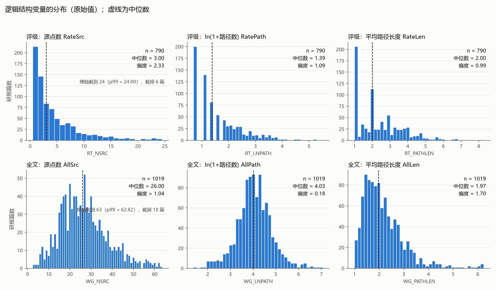
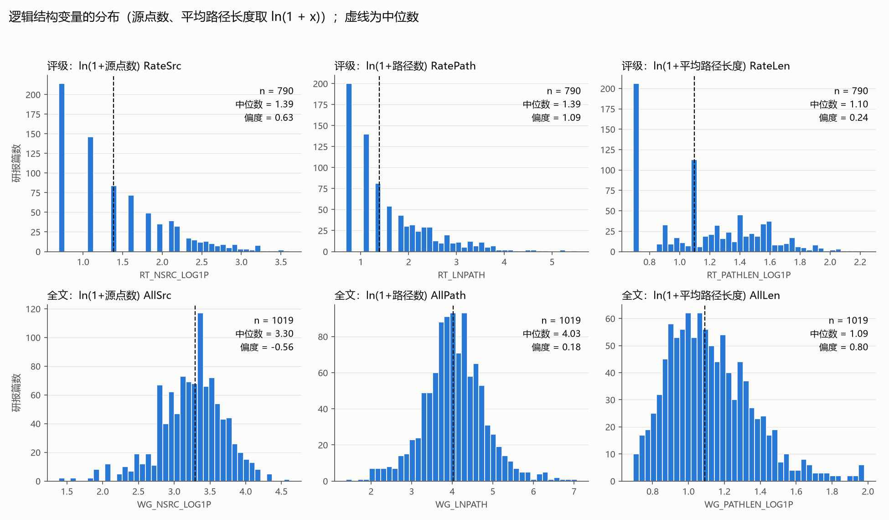

# 逻辑结构变量的分布

样本 hs300_deep；抽取版本 v1；范围：库中有结果的全部研报，1019 篇；生成时间 2026-11-25 17:30:33

## 统计表

统计对象是 measure 的原始值（不缩尾、不标准化）；每个变量在它有定义的研报上统计，n 是非缺失篇数，n_missing 是范围内缺失的篇数（RT_* 只在“投资评级”是严格汇点时有值，WG_* 在图非空时有值）。分位数为线性插值；skewness、excess_kurtosis 为偏差校正的样本偏度和超额峰度；share_min 是取最小值的研报占非缺失的比例。

### 回归用的六个变量

源点数为整数；路径数一列已是 ln(1 + 路径条数)；平均路径长度按边数计。

| variable | label | n | n_missing | mean | sd | min | p1 | p5 | p10 | p25 | p50 | p75 | p90 | p95 | p99 | max | skewness | excess_kurtosis | share_min | n_unique |
|---|---|---|---|---|---|---|---|---|---|---|---|---|---|---|---|---|---|---|---|---|
| RT_NSRC | 评级：源点数 RateSrc | 790 | 229 | 4.75 | 5.03 | 1.00 | 1.00 | 1.00 | 1.00 | 1.00 | 3.00 | 6.00 | 11.00 | 15.00 | 24.00 | 36.00 | 2.33 | 6.83 | 0.27 | 29 |
| RT_LNPATH | 评级：ln(1+路径数) RatePath | 790 | 229 | 1.65 | 0.92 | 0.69 | 0.69 | 0.69 | 0.69 | 0.69 | 1.39 | 2.20 | 2.94 | 3.48 | 4.55 | 5.52 | 1.09 | 1.01 | 0.25 | 57 |
| RT_PATHLEN | 评级：平均路径长度 RateLen | 790 | 229 | 2.42 | 1.31 | 1.00 | 1.00 | 1.00 | 1.00 | 1.00 | 2.00 | 3.25 | 4.00 | 4.76 | 6.53 | 8.28 | 0.99 | 0.96 | 0.26 | 183 |
| WG_NSRC | 全文：源点数 AllSrc | 1019 | 0 | 27.16 | 12.14 | 3.00 | 6.00 | 11.00 | 14.00 | 18.00 | 26.00 | 34.00 | 43.00 | 50.00 | 62.82 | 100.00 | 1.04 | 2.21 | 0.00 | 68 |
| WG_LNPATH | 全文：ln(1+路径数) AllPath | 1019 | 0 | 4.05 | 0.76 | 1.39 | 2.20 | 2.77 | 3.18 | 3.61 | 4.03 | 4.51 | 4.94 | 5.28 | 6.22 | 7.07 | 0.18 | 1.12 | 0.00 | 214 |
| WG_PATHLEN | 全文：平均路径长度 AllLen | 1019 | 0 | 2.16 | 0.83 | 1.00 | 1.07 | 1.22 | 1.35 | 1.58 | 1.97 | 2.56 | 3.17 | 3.69 | 5.33 | 6.25 | 1.70 | 4.38 | 0.01 | 797 |

### 路径条数

取对数前的路径条数（整数）。

| variable | label | n | n_missing | mean | sd | min | p1 | p5 | p10 | p25 | p50 | p75 | p90 | p95 | p99 | max | skewness | excess_kurtosis | share_min | n_unique |
|---|---|---|---|---|---|---|---|---|---|---|---|---|---|---|---|---|---|---|---|---|
| RT_N_PATHS | 评级：路径条数 | 790 | 229 | 8.27 | 18.00 | 1.00 | 1.00 | 1.00 | 1.00 | 1.00 | 3.00 | 8.00 | 18.00 | 31.55 | 94.00 | 249.00 | 7.38 | 73.63 | 0.25 | 57 |
| WG_N_PATHS | 全文：路径条数 | 1019 | 0 | 77.82 | 90.40 | 3.00 | 8.00 | 15.00 | 23.00 | 36.00 | 55.00 | 90.00 | 139.00 | 195.20 | 500.50 | 1180.00 | 5.57 | 45.46 | 0.00 | 214 |

### 对数变换后

与回归 --log1p 相同的变换：源点数、平均路径长度换成 ln(1 + 原始值)。

| variable | label | n | n_missing | mean | sd | min | p1 | p5 | p10 | p25 | p50 | p75 | p90 | p95 | p99 | max | skewness | excess_kurtosis | share_min | n_unique |
|---|---|---|---|---|---|---|---|---|---|---|---|---|---|---|---|---|---|---|---|---|
| RT_NSRC_LOG1P | 评级：ln(1+源点数) RateSrc | 790 | 229 | 1.48 | 0.70 | 0.69 | 0.69 | 0.69 | 0.69 | 0.69 | 1.39 | 1.95 | 2.48 | 2.77 | 3.22 | 3.61 | 0.63 | -0.45 | 0.27 | 29 |
| RT_PATHLEN_LOG1P | 评级：ln(1+平均路径长度) RateLen | 790 | 229 | 1.16 | 0.37 | 0.69 | 0.69 | 0.69 | 0.69 | 0.69 | 1.10 | 1.45 | 1.61 | 1.75 | 2.02 | 2.23 | 0.24 | -0.85 | 0.26 | 183 |
| WG_NSRC_LOG1P | 全文：ln(1+源点数) AllSrc | 1019 | 0 | 3.24 | 0.45 | 1.39 | 1.95 | 2.48 | 2.71 | 2.94 | 3.30 | 3.56 | 3.78 | 3.93 | 4.16 | 4.62 | -0.56 | 0.97 | 0.00 | 68 |
| WG_PATHLEN_LOG1P | 全文：ln(1+平均路径长度) AllLen | 1019 | 0 | 1.12 | 0.24 | 0.69 | 0.73 | 0.80 | 0.85 | 0.95 | 1.09 | 1.27 | 1.43 | 1.55 | 1.85 | 1.98 | 0.80 | 0.79 | 0.01 | 797 |

## 整数变量的频数表

只列出现过的取值；≥ k 的取值合并成一行，k 是使前面各行累计占比 ≥ 99% 的最小整数且不小于 21。share、cum_share 的分母是该变量的非缺失篇数。每个变量最多显示 25 行，完整的表见 frequency.csv。

### RT_NSRC

| value | n_reports | share | cum_share |
|---|---|---|---|
| 1 | 214 | 27.09% | 27.09% |
| 2 | 146 | 18.48% | 45.57% |
| 3 | 84 | 10.63% | 56.20% |
| 4 | 72 | 9.11% | 65.32% |
| 5 | 49 | 6.20% | 71.52% |
| 6 | 35 | 4.43% | 75.95% |
| 7 | 39 | 4.94% | 80.89% |
| 8 | 32 | 4.05% | 84.94% |
| 9 | 17 | 2.15% | 87.09% |
| 10 | 15 | 1.90% | 88.99% |
| 11 | 12 | 1.52% | 90.51% |
| 12 | 13 | 1.65% | 92.15% |
| 13 | 10 | 1.27% | 93.42% |
| 14 | 7 | 0.89% | 94.30% |
| 15 | 9 | 1.14% | 95.44% |
| 16 | 5 | 0.63% | 96.08% |
| 17 | 4 | 0.51% | 96.58% |
| 18 | 5 | 0.63% | 97.22% |
| 19 | 3 | 0.38% | 97.59% |
| 21 | 3 | 0.38% | 97.97% |
| 22 | 2 | 0.25% | 98.23% |
| 23 | 5 | 0.63% | 98.86% |
| 24 | 3 | 0.38% | 99.24% |
| ≥25 | 6 | 0.76% | 100.00% |

### WG_NSRC（共 61 行，这里显示前 25 行）

| value | n_reports | share | cum_share |
|---|---|---|---|
| 3 | 2 | 0.20% | 0.20% |
| 4 | 2 | 0.20% | 0.39% |
| 5 | 2 | 0.20% | 0.59% |
| 6 | 8 | 0.79% | 1.37% |
| 7 | 12 | 1.18% | 2.55% |
| 8 | 5 | 0.49% | 3.04% |
| 9 | 10 | 0.98% | 4.02% |
| 10 | 7 | 0.69% | 4.71% |
| 11 | 19 | 1.86% | 6.58% |
| 12 | 12 | 1.18% | 7.75% |
| 13 | 19 | 1.86% | 9.62% |
| 14 | 11 | 1.08% | 10.70% |
| 15 | 31 | 3.04% | 13.74% |
| 16 | 36 | 3.53% | 17.27% |
| 17 | 40 | 3.93% | 21.20% |
| 18 | 41 | 4.02% | 25.22% |
| 19 | 21 | 2.06% | 27.28% |
| 20 | 47 | 4.61% | 31.89% |
| 21 | 33 | 3.24% | 35.13% |
| 22 | 40 | 3.93% | 39.06% |
| 23 | 40 | 3.93% | 42.98% |
| 24 | 29 | 2.85% | 45.83% |
| 25 | 35 | 3.43% | 49.26% |
| 26 | 33 | 3.24% | 52.50% |
| 27 | 52 | 5.10% | 57.61% |

### RT_N_PATHS（共 51 行，这里显示前 25 行）

| value | n_reports | share | cum_share |
|---|---|---|---|
| 1 | 200 | 25.32% | 25.32% |
| 2 | 140 | 17.72% | 43.04% |
| 3 | 81 | 10.25% | 53.29% |
| 4 | 54 | 6.84% | 60.13% |
| 5 | 43 | 5.44% | 65.57% |
| 6 | 30 | 3.80% | 69.37% |
| 7 | 32 | 4.05% | 73.42% |
| 8 | 24 | 3.04% | 76.46% |
| 9 | 29 | 3.67% | 80.13% |
| 10 | 20 | 2.53% | 82.66% |
| 11 | 9 | 1.14% | 83.80% |
| 12 | 13 | 1.65% | 85.44% |
| 13 | 5 | 0.63% | 86.08% |
| 14 | 5 | 0.63% | 86.71% |
| 15 | 9 | 1.14% | 87.85% |
| 16 | 11 | 1.39% | 89.24% |
| 17 | 3 | 0.38% | 89.62% |
| 18 | 7 | 0.89% | 90.51% |
| 19 | 5 | 0.63% | 91.14% |
| 20 | 1 | 0.13% | 91.27% |
| 21 | 5 | 0.63% | 91.90% |
| 22 | 2 | 0.25% | 92.15% |
| 23 | 3 | 0.38% | 92.53% |
| 25 | 4 | 0.51% | 93.04% |
| 26 | 5 | 0.63% | 93.67% |

### WG_N_PATHS（共 206 行，这里显示前 25 行）

| value | n_reports | share | cum_share |
|---|---|---|---|
| 3 | 1 | 0.10% | 0.10% |
| 5 | 1 | 0.10% | 0.20% |
| 6 | 1 | 0.10% | 0.29% |
| 7 | 7 | 0.69% | 0.98% |
| 8 | 7 | 0.69% | 1.67% |
| 9 | 7 | 0.69% | 2.36% |
| 10 | 3 | 0.29% | 2.65% |
| 11 | 5 | 0.49% | 3.14% |
| 12 | 2 | 0.20% | 3.34% |
| 13 | 5 | 0.49% | 3.83% |
| 14 | 5 | 0.49% | 4.32% |
| 15 | 9 | 0.88% | 5.20% |
| 16 | 7 | 0.69% | 5.89% |
| 17 | 4 | 0.39% | 6.28% |
| 18 | 4 | 0.39% | 6.67% |
| 19 | 6 | 0.59% | 7.26% |
| 20 | 9 | 0.88% | 8.15% |
| 21 | 8 | 0.79% | 8.93% |
| 22 | 7 | 0.69% | 9.62% |
| 23 | 12 | 1.18% | 10.79% |
| 24 | 5 | 0.49% | 11.29% |
| 25 | 14 | 1.37% | 12.66% |
| 26 | 12 | 1.18% | 13.84% |
| 27 | 11 | 1.08% | 14.92% |
| 28 | 12 | 1.18% | 16.09% |

## 按正文字数分组

按研报表的 n_chars 分组（左闭右开）；n_reports 是该组的研报数，n 是该变量非缺失的篇数，mean、p50 在非缺失值上算。

| variable | group | n_reports | n | mean | p50 |
|---|---|---|---|---|---|
| RT_NSRC | <1000 | 12 | 4 | 1.00 | 1.00 |
| RT_NSRC | 1000–2000 | 18 | 7 | 2.29 | 2.00 |
| RT_NSRC | 2000–5000 | 13 | 8 | 1.38 | 1.00 |
| RT_NSRC | 5000–10000 | 298 | 222 | 3.75 | 2.50 |
| RT_NSRC | ≥10000 | 678 | 549 | 5.27 | 3.00 |
| RT_LNPATH | <1000 | 12 | 4 | 0.69 | 0.69 |
| RT_LNPATH | 1000–2000 | 18 | 7 | 1.14 | 1.10 |
| RT_LNPATH | 2000–5000 | 13 | 8 | 0.85 | 0.69 |
| RT_LNPATH | 5000–10000 | 298 | 222 | 1.52 | 1.39 |
| RT_LNPATH | ≥10000 | 678 | 549 | 1.72 | 1.39 |
| RT_PATHLEN | <1000 | 12 | 4 | 1.00 | 1.00 |
| RT_PATHLEN | 1000–2000 | 18 | 7 | 1.80 | 1.00 |
| RT_PATHLEN | 2000–5000 | 13 | 8 | 1.69 | 1.00 |
| RT_PATHLEN | 5000–10000 | 298 | 222 | 2.29 | 2.00 |
| RT_PATHLEN | ≥10000 | 678 | 549 | 2.50 | 2.17 |
| WG_NSRC | <1000 | 12 | 12 | 6.92 | 7.00 |
| WG_NSRC | 1000–2000 | 18 | 18 | 8.00 | 7.50 |
| WG_NSRC | 2000–5000 | 13 | 13 | 12.54 | 11.00 |
| WG_NSRC | 5000–10000 | 298 | 298 | 20.02 | 19.00 |
| WG_NSRC | ≥10000 | 678 | 678 | 31.45 | 30.00 |
| WG_LNPATH | <1000 | 12 | 12 | 2.16 | 2.25 |
| WG_LNPATH | 1000–2000 | 18 | 18 | 2.38 | 2.40 |
| WG_LNPATH | 2000–5000 | 13 | 13 | 2.78 | 2.77 |
| WG_LNPATH | 5000–10000 | 298 | 298 | 3.70 | 3.66 |
| WG_LNPATH | ≥10000 | 678 | 678 | 4.31 | 4.25 |
| WG_PATHLEN | <1000 | 12 | 12 | 1.39 | 1.39 |
| WG_PATHLEN | 1000–2000 | 18 | 18 | 1.38 | 1.18 |
| WG_PATHLEN | 2000–5000 | 13 | 13 | 1.39 | 1.29 |
| WG_PATHLEN | 5000–10000 | 298 | 298 | 2.05 | 1.88 |
| WG_PATHLEN | ≥10000 | 678 | 678 | 2.26 | 2.05 |

## 直方图

上排为“投资评级”对应的三个变量，下排为全文的三个变量；虚线为中位数，图上的 n、中位数、偏度按全部非缺失值算。原始值图中源点数用整数柱，横轴截到 p99（截掉的篇数写在子图里）；对数图中源点数和平均路径长度换成 ln(1 + x)，路径数一列与原始值图相同。

