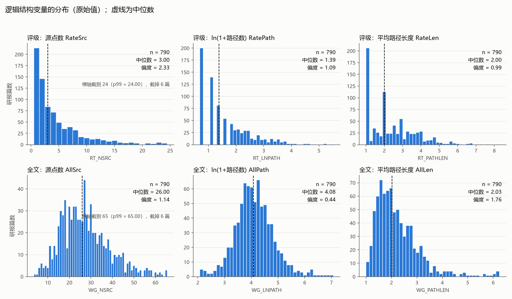
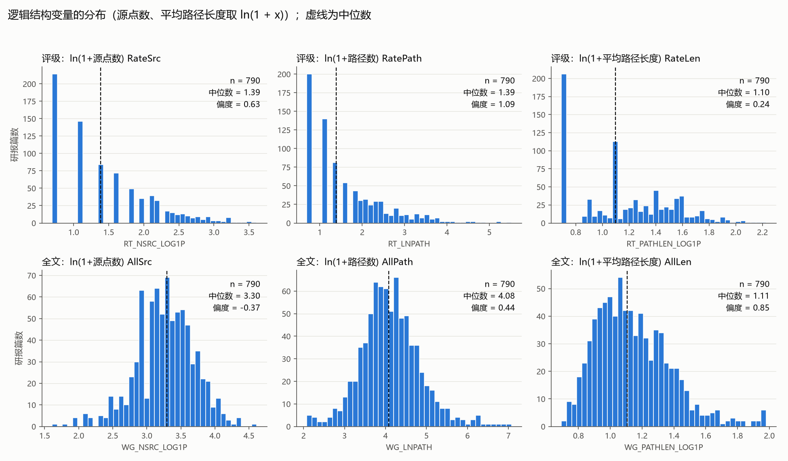

# 逻辑结构变量的分布

样本 hs300_deep；抽取版本 v1；范围：“投资评级”是严格汇点的研报（--rating-only，不套公司名单），790 篇；生成时间 2026-11-25 17:30:39

## 统计表

统计对象是 measure 的原始值（不缩尾、不标准化）；每个变量在它有定义的研报上统计，n 是非缺失篇数，n_missing 是范围内缺失的篇数（RT_* 只在“投资评级”是严格汇点时有值，WG_* 在图非空时有值）。分位数为线性插值；skewness、excess_kurtosis 为偏差校正的样本偏度和超额峰度；share_min 是取最小值的研报占非缺失的比例。

### 回归用的六个变量

源点数为整数；路径数一列已是 ln(1 + 路径条数)；平均路径长度按边数计。

| variable | label | n | n_missing | mean | sd | min | p1 | p5 | p10 | p25 | p50 | p75 | p90 | p95 | p99 | max | skewness | excess_kurtosis | share_min | n_unique |
|---|---|---|---|---|---|---|---|---|---|---|---|---|---|---|---|---|---|---|---|---|
| RT_NSRC | 评级：源点数 RateSrc | 790 | 0 | 4.75 | 5.03 | 1.00 | 1.00 | 1.00 | 1.00 | 1.00 | 3.00 | 6.00 | 11.00 | 15.00 | 24.00 | 36.00 | 2.33 | 6.83 | 0.27 | 29 |
| RT_LNPATH | 评级：ln(1+路径数) RatePath | 790 | 0 | 1.65 | 0.92 | 0.69 | 0.69 | 0.69 | 0.69 | 0.69 | 1.39 | 2.20 | 2.94 | 3.48 | 4.55 | 5.52 | 1.09 | 1.01 | 0.25 | 57 |
| RT_PATHLEN | 评级：平均路径长度 RateLen | 790 | 0 | 2.42 | 1.31 | 1.00 | 1.00 | 1.00 | 1.00 | 1.00 | 2.00 | 3.25 | 4.00 | 4.76 | 6.53 | 8.28 | 0.99 | 0.96 | 0.26 | 183 |
| WG_NSRC | 全文：源点数 AllSrc | 790 | 0 | 27.80 | 12.11 | 4.00 | 7.00 | 12.00 | 15.00 | 19.00 | 26.00 | 34.00 | 44.00 | 50.00 | 65.00 | 100.00 | 1.14 | 2.60 | 0.00 | 65 |
| WG_LNPATH | 全文：ln(1+路径数) AllPath | 790 | 0 | 4.13 | 0.73 | 2.08 | 2.30 | 3.04 | 3.30 | 3.69 | 4.08 | 4.55 | 4.98 | 5.33 | 6.31 | 7.07 | 0.44 | 1.22 | 0.00 | 203 |
| WG_PATHLEN | 全文：平均路径长度 AllLen | 790 | 0 | 2.23 | 0.85 | 1.00 | 1.11 | 1.29 | 1.39 | 1.63 | 2.03 | 2.64 | 3.22 | 3.72 | 5.71 | 6.25 | 1.76 | 4.53 | 0.00 | 658 |

### 路径条数

取对数前的路径条数（整数）。

| variable | label | n | n_missing | mean | sd | min | p1 | p5 | p10 | p25 | p50 | p75 | p90 | p95 | p99 | max | skewness | excess_kurtosis | share_min | n_unique |
|---|---|---|---|---|---|---|---|---|---|---|---|---|---|---|---|---|---|---|---|---|
| RT_N_PATHS | 评级：路径条数 | 790 | 0 | 8.27 | 18.00 | 1.00 | 1.00 | 1.00 | 1.00 | 1.00 | 3.00 | 8.00 | 18.00 | 31.55 | 94.00 | 249.00 | 7.38 | 73.63 | 0.25 | 57 |
| WG_N_PATHS | 全文：路径条数 | 790 | 0 | 83.21 | 97.66 | 7.00 | 9.00 | 20.00 | 26.00 | 39.00 | 58.00 | 93.75 | 145.00 | 206.00 | 550.55 | 1180.00 | 5.42 | 41.32 | 0.00 | 203 |

### 对数变换后

与回归 --log1p 相同的变换：源点数、平均路径长度换成 ln(1 + 原始值)。

| variable | label | n | n_missing | mean | sd | min | p1 | p5 | p10 | p25 | p50 | p75 | p90 | p95 | p99 | max | skewness | excess_kurtosis | share_min | n_unique |
|---|---|---|---|---|---|---|---|---|---|---|---|---|---|---|---|---|---|---|---|---|
| RT_NSRC_LOG1P | 评级：ln(1+源点数) RateSrc | 790 | 0 | 1.48 | 0.70 | 0.69 | 0.69 | 0.69 | 0.69 | 0.69 | 1.39 | 1.95 | 2.48 | 2.77 | 3.22 | 3.61 | 0.63 | -0.45 | 0.27 | 29 |
| RT_PATHLEN_LOG1P | 评级：ln(1+平均路径长度) RateLen | 790 | 0 | 1.16 | 0.37 | 0.69 | 0.69 | 0.69 | 0.69 | 0.69 | 1.10 | 1.45 | 1.61 | 1.75 | 2.02 | 2.23 | 0.24 | -0.85 | 0.26 | 183 |
| WG_NSRC_LOG1P | 全文：ln(1+源点数) AllSrc | 790 | 0 | 3.27 | 0.43 | 1.61 | 2.08 | 2.56 | 2.77 | 3.00 | 3.30 | 3.56 | 3.81 | 3.93 | 4.19 | 4.62 | -0.37 | 0.62 | 0.00 | 65 |
| WG_PATHLEN_LOG1P | 全文：ln(1+平均路径长度) AllLen | 790 | 0 | 1.14 | 0.23 | 0.69 | 0.75 | 0.83 | 0.87 | 0.97 | 1.11 | 1.29 | 1.44 | 1.55 | 1.90 | 1.98 | 0.85 | 0.91 | 0.00 | 658 |

## 整数变量的频数表

只列出现过的取值；≥ k 的取值合并成一行，k 是使前面各行累计占比 ≥ 99% 的最小整数且不小于 21。share、cum_share 的分母是该变量的非缺失篇数。每个变量最多显示 25 行，完整的表见 frequency.csv。

### RT_NSRC

| value | n_reports | share | cum_share |
|---|---|---|---|
| 1 | 214 | 27.09% | 27.09% |
| 2 | 146 | 18.48% | 45.57% |
| 3 | 84 | 10.63% | 56.20% |
| 4 | 72 | 9.11% | 65.32% |
| 5 | 49 | 6.20% | 71.52% |
| 6 | 35 | 4.43% | 75.95% |
| 7 | 39 | 4.94% | 80.89% |
| 8 | 32 | 4.05% | 84.94% |
| 9 | 17 | 2.15% | 87.09% |
| 10 | 15 | 1.90% | 88.99% |
| 11 | 12 | 1.52% | 90.51% |
| 12 | 13 | 1.65% | 92.15% |
| 13 | 10 | 1.27% | 93.42% |
| 14 | 7 | 0.89% | 94.30% |
| 15 | 9 | 1.14% | 95.44% |
| 16 | 5 | 0.63% | 96.08% |
| 17 | 4 | 0.51% | 96.58% |
| 18 | 5 | 0.63% | 97.22% |
| 19 | 3 | 0.38% | 97.59% |
| 21 | 3 | 0.38% | 97.97% |
| 22 | 2 | 0.25% | 98.23% |
| 23 | 5 | 0.63% | 98.86% |
| 24 | 3 | 0.38% | 99.24% |
| ≥25 | 6 | 0.76% | 100.00% |

### WG_NSRC（共 60 行，这里显示前 25 行）

| value | n_reports | share | cum_share |
|---|---|---|---|
| 4 | 1 | 0.13% | 0.13% |
| 5 | 1 | 0.13% | 0.25% |
| 6 | 4 | 0.51% | 0.76% |
| 7 | 6 | 0.76% | 1.52% |
| 8 | 4 | 0.51% | 2.03% |
| 9 | 5 | 0.63% | 2.66% |
| 10 | 4 | 0.51% | 3.16% |
| 11 | 14 | 1.77% | 4.94% |
| 12 | 8 | 1.01% | 5.95% |
| 13 | 14 | 1.77% | 7.72% |
| 14 | 10 | 1.27% | 8.99% |
| 15 | 23 | 2.91% | 11.90% |
| 16 | 30 | 3.80% | 15.70% |
| 17 | 28 | 3.54% | 19.24% |
| 18 | 35 | 4.43% | 23.67% |
| 19 | 13 | 1.65% | 25.32% |
| 20 | 32 | 4.05% | 29.37% |
| 21 | 26 | 3.29% | 32.66% |
| 22 | 32 | 4.05% | 36.71% |
| 23 | 32 | 4.05% | 40.76% |
| 24 | 26 | 3.29% | 44.05% |
| 25 | 26 | 3.29% | 47.34% |
| 26 | 25 | 3.16% | 50.51% |
| 27 | 44 | 5.57% | 56.08% |
| 28 | 28 | 3.54% | 59.62% |

### RT_N_PATHS（共 51 行，这里显示前 25 行）

| value | n_reports | share | cum_share |
|---|---|---|---|
| 1 | 200 | 25.32% | 25.32% |
| 2 | 140 | 17.72% | 43.04% |
| 3 | 81 | 10.25% | 53.29% |
| 4 | 54 | 6.84% | 60.13% |
| 5 | 43 | 5.44% | 65.57% |
| 6 | 30 | 3.80% | 69.37% |
| 7 | 32 | 4.05% | 73.42% |
| 8 | 24 | 3.04% | 76.46% |
| 9 | 29 | 3.67% | 80.13% |
| 10 | 20 | 2.53% | 82.66% |
| 11 | 9 | 1.14% | 83.80% |
| 12 | 13 | 1.65% | 85.44% |
| 13 | 5 | 0.63% | 86.08% |
| 14 | 5 | 0.63% | 86.71% |
| 15 | 9 | 1.14% | 87.85% |
| 16 | 11 | 1.39% | 89.24% |
| 17 | 3 | 0.38% | 89.62% |
| 18 | 7 | 0.89% | 90.51% |
| 19 | 5 | 0.63% | 91.14% |
| 20 | 1 | 0.13% | 91.27% |
| 21 | 5 | 0.63% | 91.90% |
| 22 | 2 | 0.25% | 92.15% |
| 23 | 3 | 0.38% | 92.53% |
| 25 | 4 | 0.51% | 93.04% |
| 26 | 5 | 0.63% | 93.67% |

### WG_N_PATHS（共 198 行，这里显示前 25 行）

| value | n_reports | share | cum_share |
|---|---|---|---|
| 7 | 2 | 0.25% | 0.25% |
| 8 | 3 | 0.38% | 0.63% |
| 9 | 4 | 0.51% | 1.14% |
| 10 | 2 | 0.25% | 1.39% |
| 11 | 1 | 0.13% | 1.52% |
| 12 | 1 | 0.13% | 1.65% |
| 13 | 4 | 0.51% | 2.15% |
| 14 | 3 | 0.38% | 2.53% |
| 15 | 5 | 0.63% | 3.16% |
| 16 | 3 | 0.38% | 3.54% |
| 17 | 2 | 0.25% | 3.80% |
| 18 | 2 | 0.25% | 4.05% |
| 19 | 4 | 0.51% | 4.56% |
| 20 | 9 | 1.14% | 5.70% |
| 21 | 5 | 0.63% | 6.33% |
| 22 | 6 | 0.76% | 7.09% |
| 23 | 9 | 1.14% | 8.23% |
| 24 | 3 | 0.38% | 8.61% |
| 25 | 8 | 1.01% | 9.62% |
| 26 | 9 | 1.14% | 10.76% |
| 27 | 8 | 1.01% | 11.77% |
| 28 | 9 | 1.14% | 12.91% |
| 29 | 8 | 1.01% | 13.92% |
| 30 | 10 | 1.27% | 15.19% |
| 31 | 9 | 1.14% | 16.33% |

## 按正文字数分组

按研报表的 n_chars 分组（左闭右开）；n_reports 是该组的研报数，n 是该变量非缺失的篇数，mean、p50 在非缺失值上算。

| variable | group | n_reports | n | mean | p50 |
|---|---|---|---|---|---|
| RT_NSRC | <1000 | 4 | 4 | 1.00 | 1.00 |
| RT_NSRC | 1000–2000 | 7 | 7 | 2.29 | 2.00 |
| RT_NSRC | 2000–5000 | 8 | 8 | 1.38 | 1.00 |
| RT_NSRC | 5000–10000 | 222 | 222 | 3.75 | 2.50 |
| RT_NSRC | ≥10000 | 549 | 549 | 5.27 | 3.00 |
| RT_LNPATH | <1000 | 4 | 4 | 0.69 | 0.69 |
| RT_LNPATH | 1000–2000 | 7 | 7 | 1.14 | 1.10 |
| RT_LNPATH | 2000–5000 | 8 | 8 | 0.85 | 0.69 |
| RT_LNPATH | 5000–10000 | 222 | 222 | 1.52 | 1.39 |
| RT_LNPATH | ≥10000 | 549 | 549 | 1.72 | 1.39 |
| RT_PATHLEN | <1000 | 4 | 4 | 1.00 | 1.00 |
| RT_PATHLEN | 1000–2000 | 7 | 7 | 1.80 | 1.00 |
| RT_PATHLEN | 2000–5000 | 8 | 8 | 1.69 | 1.00 |
| RT_PATHLEN | 5000–10000 | 222 | 222 | 2.29 | 2.00 |
| RT_PATHLEN | ≥10000 | 549 | 549 | 2.50 | 2.17 |
| WG_NSRC | <1000 | 4 | 4 | 7.75 | 7.50 |
| WG_NSRC | 1000–2000 | 7 | 7 | 6.71 | 6.00 |
| WG_NSRC | 2000–5000 | 8 | 8 | 11.88 | 11.00 |
| WG_NSRC | 5000–10000 | 222 | 222 | 20.01 | 19.00 |
| WG_NSRC | ≥10000 | 549 | 549 | 31.59 | 30.00 |
| WG_LNPATH | <1000 | 4 | 4 | 2.28 | 2.30 |
| WG_LNPATH | 1000–2000 | 7 | 7 | 2.42 | 2.40 |
| WG_LNPATH | 2000–5000 | 8 | 8 | 2.72 | 2.77 |
| WG_LNPATH | 5000–10000 | 222 | 222 | 3.74 | 3.71 |
| WG_LNPATH | ≥10000 | 549 | 549 | 4.34 | 4.26 |
| WG_PATHLEN | <1000 | 4 | 4 | 1.48 | 1.40 |
| WG_PATHLEN | 1000–2000 | 7 | 7 | 1.47 | 1.25 |
| WG_PATHLEN | 2000–5000 | 8 | 8 | 1.40 | 1.36 |
| WG_PATHLEN | 5000–10000 | 222 | 222 | 2.10 | 1.97 |
| WG_PATHLEN | ≥10000 | 549 | 549 | 2.31 | 2.08 |

## 直方图

上排为“投资评级”对应的三个变量，下排为全文的三个变量；虚线为中位数，图上的 n、中位数、偏度按全部非缺失值算。原始值图中源点数用整数柱，横轴截到 p99（截掉的篇数写在子图里）；对数图中源点数和平均路径长度换成 ln(1 + x)，路径数一列与原始值图相同。

