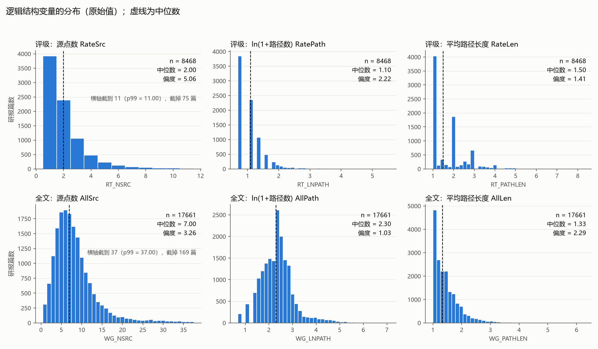
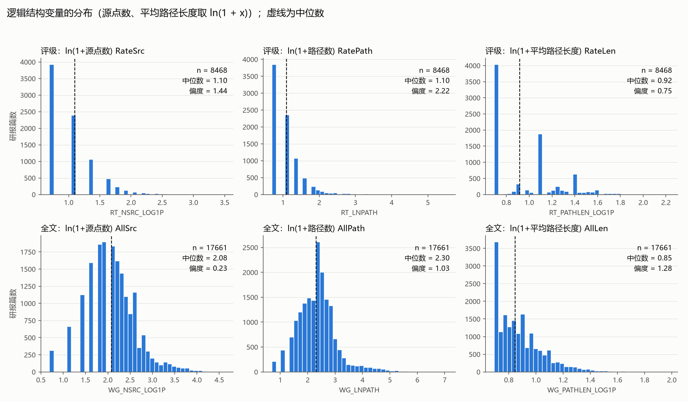

# 逻辑结构变量的分布

样本 hs300_full；抽取版本 v1；范围：库中有结果的全部研报，17748 篇；生成时间 2026-11-25 17:30:28

## 统计表

统计对象是 measure 的原始值（不缩尾、不标准化）；每个变量在它有定义的研报上统计，n 是非缺失篇数，n_missing 是范围内缺失的篇数（RT_* 只在“投资评级”是严格汇点时有值，WG_* 在图非空时有值）。分位数为线性插值；skewness、excess_kurtosis 为偏差校正的样本偏度和超额峰度；share_min 是取最小值的研报占非缺失的比例。

### 回归用的六个变量

源点数为整数；路径数一列已是 ln(1 + 路径条数)；平均路径长度按边数计。

| variable | label | n | n_missing | mean | sd | min | p1 | p5 | p10 | p25 | p50 | p75 | p90 | p95 | p99 | max | skewness | excess_kurtosis | share_min | n_unique |
|---|---|---|---|---|---|---|---|---|---|---|---|---|---|---|---|---|---|---|---|---|
| RT_NSRC | 评级：源点数 RateSrc | 8468 | 9280 | 2.19 | 2.09 | 1.00 | 1.00 | 1.00 | 1.00 | 1.00 | 2.00 | 3.00 | 4.00 | 5.00 | 11.00 | 32.00 | 5.06 | 41.62 | 0.46 | 29 |
| RT_LNPATH | 评级：ln(1+路径数) RatePath | 8468 | 9280 | 1.08 | 0.49 | 0.69 | 0.69 | 0.69 | 0.69 | 0.69 | 1.10 | 1.39 | 1.61 | 1.95 | 2.89 | 5.52 | 2.22 | 8.77 | 0.45 | 57 |
| RT_PATHLEN | 评级：平均路径长度 RateLen | 8468 | 9280 | 1.73 | 0.90 | 1.00 | 1.00 | 1.00 | 1.00 | 1.00 | 1.50 | 2.00 | 3.00 | 3.50 | 4.65 | 8.28 | 1.41 | 2.50 | 0.48 | 213 |
| WG_NSRC | 全文：源点数 AllSrc | 17661 | 87 | 8.71 | 6.64 | 1.00 | 1.00 | 2.00 | 3.00 | 5.00 | 7.00 | 10.00 | 15.00 | 20.00 | 37.00 | 100.00 | 3.26 | 17.42 | 0.02 | 71 |
| WG_LNPATH | 全文：ln(1+路径数) AllPath | 17661 | 87 | 2.36 | 0.68 | 0.69 | 0.69 | 1.39 | 1.61 | 1.95 | 2.30 | 2.64 | 3.04 | 3.56 | 4.68 | 7.07 | 1.03 | 3.51 | 0.01 | 218 |
| WG_PATHLEN | 全文：平均路径长度 AllLen | 17661 | 87 | 1.45 | 0.48 | 1.00 | 1.00 | 1.00 | 1.00 | 1.11 | 1.33 | 1.65 | 2.00 | 2.33 | 3.17 | 6.25 | 2.29 | 9.97 | 0.20 | 1114 |

### 路径条数

取对数前的路径条数（整数）。

| variable | label | n | n_missing | mean | sd | min | p1 | p5 | p10 | p25 | p50 | p75 | p90 | p95 | p99 | max | skewness | excess_kurtosis | share_min | n_unique |
|---|---|---|---|---|---|---|---|---|---|---|---|---|---|---|---|---|---|---|---|---|
| RT_N_PATHS | 评级：路径条数 | 8468 | 9280 | 2.59 | 6.14 | 1.00 | 1.00 | 1.00 | 1.00 | 1.00 | 2.00 | 3.00 | 4.00 | 6.00 | 17.00 | 249.00 | 22.45 | 702.04 | 0.45 | 57 |
| WG_N_PATHS | 全文：路径条数 | 17661 | 87 | 13.78 | 27.23 | 1.00 | 1.00 | 3.00 | 4.00 | 6.00 | 9.00 | 13.00 | 20.00 | 34.00 | 107.00 | 1180.00 | 16.54 | 460.52 | 0.01 | 218 |

### 对数变换后

与回归 --log1p 相同的变换：源点数、平均路径长度换成 ln(1 + 原始值)。

| variable | label | n | n_missing | mean | sd | min | p1 | p5 | p10 | p25 | p50 | p75 | p90 | p95 | p99 | max | skewness | excess_kurtosis | share_min | n_unique |
|---|---|---|---|---|---|---|---|---|---|---|---|---|---|---|---|---|---|---|---|---|
| RT_NSRC_LOG1P | 评级：ln(1+源点数) RateSrc | 8468 | 9280 | 1.05 | 0.42 | 0.69 | 0.69 | 0.69 | 0.69 | 0.69 | 1.10 | 1.39 | 1.61 | 1.79 | 2.48 | 3.50 | 1.44 | 2.77 | 0.46 | 29 |
| RT_PATHLEN_LOG1P | 评级：ln(1+平均路径长度) RateLen | 8468 | 9280 | 0.96 | 0.30 | 0.69 | 0.69 | 0.69 | 0.69 | 0.69 | 0.92 | 1.10 | 1.39 | 1.50 | 1.73 | 2.23 | 0.75 | -0.37 | 0.48 | 213 |
| WG_NSRC_LOG1P | 全文：ln(1+源点数) AllSrc | 17661 | 87 | 2.11 | 0.55 | 0.69 | 0.69 | 1.10 | 1.39 | 1.79 | 2.08 | 2.40 | 2.77 | 3.04 | 3.64 | 4.62 | 0.23 | 0.84 | 0.02 | 71 |
| WG_PATHLEN_LOG1P | 全文：ln(1+平均路径长度) AllLen | 17661 | 87 | 0.88 | 0.17 | 0.69 | 0.69 | 0.69 | 0.69 | 0.75 | 0.85 | 0.98 | 1.10 | 1.20 | 1.43 | 1.98 | 1.28 | 2.43 | 0.20 | 1114 |

## 整数变量的频数表

只列出现过的取值；≥ k 的取值合并成一行，k 是使前面各行累计占比 ≥ 99% 的最小整数且不小于 21。share、cum_share 的分母是该变量的非缺失篇数。每个变量最多显示 25 行，完整的表见 frequency.csv。

### RT_NSRC

| value | n_reports | share | cum_share |
|---|---|---|---|
| 1 | 3919 | 46.28% | 46.28% |
| 2 | 2392 | 28.25% | 74.53% |
| 3 | 1057 | 12.48% | 87.01% |
| 4 | 478 | 5.64% | 92.65% |
| 5 | 230 | 2.72% | 95.37% |
| 6 | 126 | 1.49% | 96.86% |
| 7 | 74 | 0.87% | 97.73% |
| 8 | 48 | 0.57% | 98.30% |
| 9 | 24 | 0.28% | 98.58% |
| 10 | 29 | 0.34% | 98.93% |
| 11 | 16 | 0.19% | 99.11% |
| 12 | 14 | 0.17% | 99.28% |
| 13 | 8 | 0.09% | 99.37% |
| 14 | 10 | 0.12% | 99.49% |
| 15 | 9 | 0.11% | 99.60% |
| 16 | 5 | 0.06% | 99.66% |
| 17 | 3 | 0.04% | 99.69% |
| 18 | 6 | 0.07% | 99.76% |
| 19 | 3 | 0.04% | 99.80% |
| ≥21 | 17 | 0.20% | 100.00% |

### WG_NSRC（共 38 行，这里显示前 25 行）

| value | n_reports | share | cum_share |
|---|---|---|---|
| 1 | 310 | 1.76% | 1.76% |
| 2 | 663 | 3.75% | 5.51% |
| 3 | 1124 | 6.36% | 11.87% |
| 4 | 1592 | 9.01% | 20.89% |
| 5 | 1861 | 10.54% | 31.43% |
| 6 | 1894 | 10.72% | 42.15% |
| 7 | 1835 | 10.39% | 52.54% |
| 8 | 1619 | 9.17% | 61.71% |
| 9 | 1438 | 8.14% | 69.85% |
| 10 | 1099 | 6.22% | 76.07% |
| 11 | 845 | 4.78% | 80.86% |
| 12 | 671 | 3.80% | 84.66% |
| 13 | 487 | 2.76% | 87.41% |
| 14 | 355 | 2.01% | 89.42% |
| 15 | 297 | 1.68% | 91.10% |
| 16 | 243 | 1.38% | 92.48% |
| 17 | 174 | 0.99% | 93.47% |
| 18 | 126 | 0.71% | 94.18% |
| 19 | 95 | 0.54% | 94.72% |
| 20 | 103 | 0.58% | 95.30% |
| 21 | 73 | 0.41% | 95.71% |
| 22 | 68 | 0.39% | 96.10% |
| 23 | 56 | 0.32% | 96.42% |
| 24 | 46 | 0.26% | 96.68% |
| 25 | 41 | 0.23% | 96.91% |

### RT_N_PATHS

| value | n_reports | share | cum_share |
|---|---|---|---|
| 1 | 3843 | 45.38% | 45.38% |
| 2 | 2349 | 27.74% | 73.12% |
| 3 | 1066 | 12.59% | 85.71% |
| 4 | 481 | 5.68% | 91.39% |
| 5 | 233 | 2.75% | 94.14% |
| 6 | 128 | 1.51% | 95.65% |
| 7 | 88 | 1.04% | 96.69% |
| 8 | 51 | 0.60% | 97.30% |
| 9 | 38 | 0.45% | 97.74% |
| 10 | 30 | 0.35% | 98.10% |
| 11 | 18 | 0.21% | 98.31% |
| 12 | 14 | 0.17% | 98.48% |
| 13 | 14 | 0.17% | 98.64% |
| 14 | 8 | 0.09% | 98.74% |
| 15 | 10 | 0.12% | 98.85% |
| 16 | 11 | 0.13% | 98.98% |
| 17 | 3 | 0.04% | 99.02% |
| 18 | 8 | 0.09% | 99.11% |
| 19 | 4 | 0.05% | 99.16% |
| ≥21 | 71 | 0.84% | 100.00% |

### WG_N_PATHS（共 108 行，这里显示前 25 行）

| value | n_reports | share | cum_share |
|---|---|---|---|
| 1 | 210 | 1.19% | 1.19% |
| 2 | 437 | 2.47% | 3.66% |
| 3 | 701 | 3.97% | 7.63% |
| 4 | 1030 | 5.83% | 13.46% |
| 5 | 1200 | 6.79% | 20.26% |
| 6 | 1377 | 7.80% | 28.06% |
| 7 | 1484 | 8.40% | 36.46% |
| 8 | 1432 | 8.11% | 44.57% |
| 9 | 1316 | 7.45% | 52.02% |
| 10 | 1292 | 7.32% | 59.33% |
| 11 | 1080 | 6.12% | 65.45% |
| 12 | 923 | 5.23% | 70.68% |
| 13 | 825 | 4.67% | 75.35% |
| 14 | 628 | 3.56% | 78.90% |
| 15 | 526 | 2.98% | 81.88% |
| 16 | 447 | 2.53% | 84.41% |
| 17 | 355 | 2.01% | 86.42% |
| 18 | 288 | 1.63% | 88.05% |
| 19 | 204 | 1.16% | 89.21% |
| 20 | 171 | 0.97% | 90.18% |
| 21 | 163 | 0.92% | 91.10% |
| 22 | 103 | 0.58% | 91.68% |
| 23 | 95 | 0.54% | 92.22% |
| 24 | 80 | 0.45% | 92.67% |
| 25 | 74 | 0.42% | 93.09% |

## 按正文字数分组

按研报表的 n_chars 分组（左闭右开）；n_reports 是该组的研报数，n 是该变量非缺失的篇数，mean、p50 在非缺失值上算。

| variable | group | n_reports | n | mean | p50 |
|---|---|---|---|---|---|
| RT_NSRC | <1000 | 4553 | 1933 | 1.79 | 1.00 |
| RT_NSRC | 1000–2000 | 10383 | 4879 | 1.92 | 2.00 |
| RT_NSRC | 2000–5000 | 1708 | 845 | 2.26 | 2.00 |
| RT_NSRC | 5000–10000 | 429 | 290 | 3.66 | 2.00 |
| RT_NSRC | ≥10000 | 675 | 521 | 5.24 | 3.00 |
| RT_LNPATH | <1000 | 4553 | 1933 | 0.97 | 0.69 |
| RT_LNPATH | 1000–2000 | 10383 | 4879 | 1.02 | 1.10 |
| RT_LNPATH | 2000–5000 | 1708 | 845 | 1.11 | 1.10 |
| RT_LNPATH | 5000–10000 | 429 | 290 | 1.49 | 1.39 |
| RT_LNPATH | ≥10000 | 675 | 521 | 1.72 | 1.39 |
| RT_PATHLEN | <1000 | 4553 | 1933 | 1.64 | 1.00 |
| RT_PATHLEN | 1000–2000 | 10383 | 4879 | 1.66 | 1.00 |
| RT_PATHLEN | 2000–5000 | 1708 | 845 | 1.75 | 1.50 |
| RT_PATHLEN | 5000–10000 | 429 | 290 | 2.26 | 2.00 |
| RT_PATHLEN | ≥10000 | 675 | 521 | 2.48 | 2.00 |
| WG_NSRC | <1000 | 4553 | 4502 | 5.76 | 5.00 |
| WG_NSRC | 1000–2000 | 10383 | 10351 | 7.65 | 7.00 |
| WG_NSRC | 2000–5000 | 1708 | 1704 | 11.44 | 11.00 |
| WG_NSRC | 5000–10000 | 429 | 429 | 19.11 | 18.00 |
| WG_NSRC | ≥10000 | 675 | 675 | 31.15 | 30.00 |
| WG_LNPATH | <1000 | 4553 | 4502 | 2.00 | 2.08 |
| WG_LNPATH | 1000–2000 | 10383 | 10351 | 2.28 | 2.30 |
| WG_LNPATH | 2000–5000 | 1708 | 1704 | 2.71 | 2.77 |
| WG_LNPATH | 5000–10000 | 429 | 429 | 3.56 | 3.53 |
| WG_LNPATH | ≥10000 | 675 | 675 | 4.29 | 4.25 |
| WG_PATHLEN | <1000 | 4553 | 4502 | 1.38 | 1.25 |
| WG_PATHLEN | 1000–2000 | 10383 | 10351 | 1.41 | 1.33 |
| WG_PATHLEN | 2000–5000 | 1708 | 1704 | 1.50 | 1.40 |
| WG_PATHLEN | 5000–10000 | 429 | 429 | 1.93 | 1.74 |
| WG_PATHLEN | ≥10000 | 675 | 675 | 2.24 | 2.00 |

## 直方图

上排为“投资评级”对应的三个变量，下排为全文的三个变量；虚线为中位数，图上的 n、中位数、偏度按全部非缺失值算。原始值图中源点数用整数柱，横轴截到 p99（截掉的篇数写在子图里）；对数图中源点数和平均路径长度换成 ln(1 + x)，路径数一列与原始值图相同。

