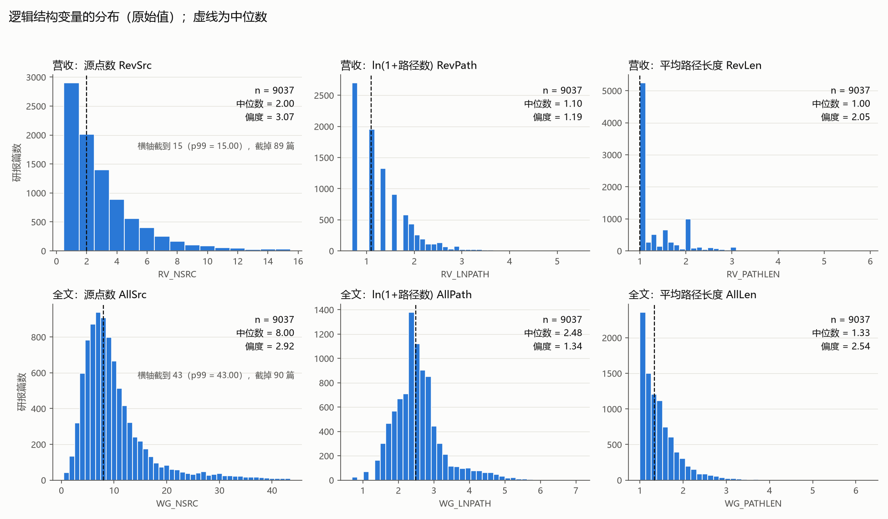
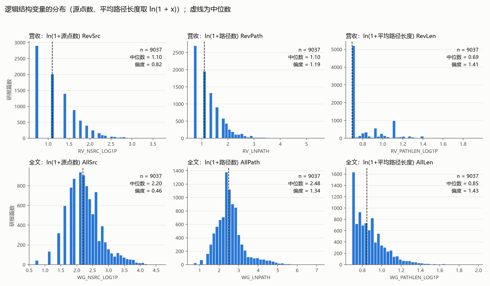

# 逻辑结构变量的分布

样本 hs300_full；抽取版本 v1；范围：目标：营收类汇点（--target revenue）；至少有一个营收类汇点的研报（--target revenue --target-only，不套公司名单），9037 篇；生成时间 2026-11-25 18:12:35

## 统计表

统计对象是 measure 的原始值（不缩尾、不标准化）；每个变量在它有定义的研报上统计，n 是非缺失篇数，n_missing 是范围内缺失的篇数（RV_* 只在至少有一个营收类汇点时有值，WG_* 在图非空时有值）。分位数为线性插值；skewness、excess_kurtosis 为偏差校正的样本偏度和超额峰度；share_min 是取最小值的研报占非缺失的比例。

### 回归用的六个变量

源点数为整数；路径数一列已是 ln(1 + 路径条数)；平均路径长度按边数计。

| variable | label | n | n_missing | mean | sd | min | p1 | p5 | p10 | p25 | p50 | p75 | p90 | p95 | p99 | max | skewness | excess_kurtosis | share_min | n_unique |
|---|---|---|---|---|---|---|---|---|---|---|---|---|---|---|---|---|---|---|---|---|
| RV_NSRC | 营收：源点数 RevSrc | 9037 | 0 | 3.19 | 3.00 | 1.00 | 1.00 | 1.00 | 1.00 | 1.00 | 2.00 | 4.00 | 6.00 | 9.00 | 15.00 | 38.00 | 3.07 | 14.94 | 0.32 | 31 |
| RV_LNPATH | 营收：ln(1+路径数) RevPath | 9037 | 0 | 1.33 | 0.62 | 0.69 | 0.69 | 0.69 | 0.69 | 0.69 | 1.10 | 1.61 | 2.08 | 2.48 | 3.33 | 5.45 | 1.19 | 2.13 | 0.30 | 66 |
| RV_PATHLEN | 营收：平均路径长度 RevLen | 9037 | 0 | 1.36 | 0.56 | 1.00 | 1.00 | 1.00 | 1.00 | 1.00 | 1.00 | 1.60 | 2.00 | 2.50 | 3.25 | 5.92 | 2.05 | 5.70 | 0.58 | 298 |
| WG_NSRC | 全文：源点数 AllSrc | 9037 | 0 | 10.43 | 7.80 | 1.00 | 2.00 | 3.00 | 4.00 | 6.00 | 8.00 | 12.00 | 18.00 | 26.00 | 43.00 | 100.00 | 2.92 | 12.71 | 0.00 | 69 |
| WG_LNPATH | 全文：ln(1+路径数) AllPath | 9037 | 0 | 2.56 | 0.70 | 0.69 | 1.10 | 1.61 | 1.79 | 2.08 | 2.48 | 2.83 | 3.37 | 4.01 | 4.94 | 7.07 | 1.34 | 3.50 | 0.00 | 209 |
| WG_PATHLEN | 全文：平均路径长度 AllLen | 9037 | 0 | 1.45 | 0.48 | 1.00 | 1.00 | 1.00 | 1.00 | 1.12 | 1.33 | 1.62 | 2.00 | 2.33 | 3.18 | 6.25 | 2.54 | 11.83 | 0.17 | 952 |

### 路径条数

取对数前的路径条数（整数）。

| variable | label | n | n_missing | mean | sd | min | p1 | p5 | p10 | p25 | p50 | p75 | p90 | p95 | p99 | max | skewness | excess_kurtosis | share_min | n_unique |
|---|---|---|---|---|---|---|---|---|---|---|---|---|---|---|---|---|---|---|---|---|
| RV_N_PATHS | 营收：路径条数 | 9037 | 0 | 3.89 | 6.27 | 1.00 | 1.00 | 1.00 | 1.00 | 1.00 | 2.00 | 4.00 | 7.00 | 11.00 | 27.00 | 231.00 | 12.59 | 301.81 | 0.30 | 66 |
| WG_N_PATHS | 全文：路径条数 | 9037 | 0 | 17.77 | 34.81 | 1.00 | 2.00 | 4.00 | 5.00 | 7.00 | 11.00 | 16.00 | 28.00 | 54.00 | 139.00 | 1180.00 | 13.57 | 304.99 | 0.00 | 209 |

### 对数变换后

与回归 --log1p 相同的变换：源点数、平均路径长度换成 ln(1 + 原始值)。

| variable | label | n | n_missing | mean | sd | min | p1 | p5 | p10 | p25 | p50 | p75 | p90 | p95 | p99 | max | skewness | excess_kurtosis | share_min | n_unique |
|---|---|---|---|---|---|---|---|---|---|---|---|---|---|---|---|---|---|---|---|---|
| RV_NSRC_LOG1P | 营收：ln(1+源点数) RevSrc | 9037 | 0 | 1.27 | 0.54 | 0.69 | 0.69 | 0.69 | 0.69 | 0.69 | 1.10 | 1.61 | 1.95 | 2.30 | 2.77 | 3.66 | 0.82 | 0.29 | 0.32 | 31 |
| RV_PATHLEN_LOG1P | 营收：ln(1+平均路径长度) RevLen | 9037 | 0 | 0.83 | 0.20 | 0.69 | 0.69 | 0.69 | 0.69 | 0.69 | 0.69 | 0.96 | 1.10 | 1.25 | 1.45 | 1.93 | 1.41 | 1.48 | 0.58 | 298 |
| WG_NSRC_LOG1P | 全文：ln(1+源点数) AllSrc | 9037 | 0 | 2.28 | 0.54 | 0.69 | 1.10 | 1.39 | 1.61 | 1.95 | 2.20 | 2.56 | 2.94 | 3.30 | 3.78 | 4.62 | 0.46 | 0.84 | 0.00 | 69 |
| WG_PATHLEN_LOG1P | 全文：ln(1+平均路径长度) AllLen | 9037 | 0 | 0.88 | 0.17 | 0.69 | 0.69 | 0.69 | 0.69 | 0.75 | 0.85 | 0.97 | 1.10 | 1.20 | 1.43 | 1.98 | 1.43 | 3.17 | 0.17 | 952 |

## 整数变量的频数表

只列出现过的取值；≥ k 的取值合并成一行，k 是使前面各行累计占比 ≥ 99% 的最小整数且不小于 21。share、cum_share 的分母是该变量的非缺失篇数。每个变量最多显示 25 行，完整的表见 frequency.csv。

### RV_NSRC

| value | n_reports | share | cum_share |
|---|---|---|---|
| 1 | 2898 | 32.07% | 32.07% |
| 2 | 2012 | 22.26% | 54.33% |
| 3 | 1401 | 15.50% | 69.84% |
| 4 | 888 | 9.83% | 79.66% |
| 5 | 557 | 6.16% | 85.82% |
| 6 | 404 | 4.47% | 90.30% |
| 7 | 250 | 2.77% | 93.06% |
| 8 | 169 | 1.87% | 94.93% |
| 9 | 103 | 1.14% | 96.07% |
| 10 | 86 | 0.95% | 97.02% |
| 11 | 52 | 0.58% | 97.60% |
| 12 | 46 | 0.51% | 98.11% |
| 13 | 26 | 0.29% | 98.40% |
| 14 | 28 | 0.31% | 98.71% |
| 15 | 28 | 0.31% | 99.02% |
| 16 | 15 | 0.17% | 99.18% |
| 17 | 17 | 0.19% | 99.37% |
| 18 | 9 | 0.10% | 99.47% |
| 19 | 4 | 0.04% | 99.51% |
| 20 | 4 | 0.04% | 99.56% |
| ≥21 | 40 | 0.44% | 100.00% |

### WG_NSRC（共 44 行，这里显示前 25 行）

| value | n_reports | share | cum_share |
|---|---|---|---|
| 1 | 43 | 0.48% | 0.48% |
| 2 | 133 | 1.47% | 1.95% |
| 3 | 319 | 3.53% | 5.48% |
| 4 | 597 | 6.61% | 12.08% |
| 5 | 782 | 8.65% | 20.74% |
| 6 | 873 | 9.66% | 30.40% |
| 7 | 938 | 10.38% | 40.78% |
| 8 | 908 | 10.05% | 50.82% |
| 9 | 797 | 8.82% | 59.64% |
| 10 | 666 | 7.37% | 67.01% |
| 11 | 512 | 5.67% | 72.68% |
| 12 | 417 | 4.61% | 77.29% |
| 13 | 321 | 3.55% | 80.85% |
| 14 | 240 | 2.66% | 83.50% |
| 15 | 217 | 2.40% | 85.90% |
| 16 | 175 | 1.94% | 87.84% |
| 17 | 131 | 1.45% | 89.29% |
| 18 | 97 | 1.07% | 90.36% |
| 19 | 74 | 0.82% | 91.18% |
| 20 | 84 | 0.93% | 92.11% |
| 21 | 60 | 0.66% | 92.77% |
| 22 | 57 | 0.63% | 93.40% |
| 23 | 46 | 0.51% | 93.91% |
| 24 | 36 | 0.40% | 94.31% |
| 25 | 32 | 0.35% | 94.67% |

### RV_N_PATHS（共 28 行，这里显示前 25 行）

| value | n_reports | share | cum_share |
|---|---|---|---|
| 1 | 2697 | 29.84% | 29.84% |
| 2 | 1954 | 21.62% | 51.47% |
| 3 | 1326 | 14.67% | 66.14% |
| 4 | 908 | 10.05% | 76.19% |
| 5 | 581 | 6.43% | 82.62% |
| 6 | 433 | 4.79% | 87.41% |
| 7 | 259 | 2.87% | 90.27% |
| 8 | 194 | 2.15% | 92.42% |
| 9 | 112 | 1.24% | 93.66% |
| 10 | 107 | 1.18% | 94.84% |
| 11 | 74 | 0.82% | 95.66% |
| 12 | 56 | 0.62% | 96.28% |
| 13 | 38 | 0.42% | 96.70% |
| 14 | 28 | 0.31% | 97.01% |
| 15 | 32 | 0.35% | 97.37% |
| 16 | 24 | 0.27% | 97.63% |
| 17 | 29 | 0.32% | 97.95% |
| 18 | 20 | 0.22% | 98.17% |
| 19 | 15 | 0.17% | 98.34% |
| 20 | 8 | 0.09% | 98.43% |
| 21 | 7 | 0.08% | 98.51% |
| 22 | 8 | 0.09% | 98.59% |
| 23 | 11 | 0.12% | 98.72% |
| 24 | 6 | 0.07% | 98.78% |
| 25 | 12 | 0.13% | 98.92% |

### WG_N_PATHS（共 137 行，这里显示前 25 行）

| value | n_reports | share | cum_share |
|---|---|---|---|
| 1 | 26 | 0.29% | 0.29% |
| 2 | 69 | 0.76% | 1.05% |
| 3 | 162 | 1.79% | 2.84% |
| 4 | 301 | 3.33% | 6.17% |
| 5 | 466 | 5.16% | 11.33% |
| 6 | 569 | 6.30% | 17.63% |
| 7 | 669 | 7.40% | 25.03% |
| 8 | 710 | 7.86% | 32.89% |
| 9 | 696 | 7.70% | 40.59% |
| 10 | 683 | 7.56% | 48.15% |
| 11 | 584 | 6.46% | 54.61% |
| 12 | 535 | 5.92% | 60.53% |
| 13 | 509 | 5.63% | 66.16% |
| 14 | 393 | 4.35% | 70.51% |
| 15 | 343 | 3.80% | 74.31% |
| 16 | 279 | 3.09% | 77.39% |
| 17 | 230 | 2.55% | 79.94% |
| 18 | 180 | 1.99% | 81.93% |
| 19 | 138 | 1.53% | 83.46% |
| 20 | 126 | 1.39% | 84.85% |
| 21 | 113 | 1.25% | 86.10% |
| 22 | 72 | 0.80% | 86.90% |
| 23 | 61 | 0.68% | 87.57% |
| 24 | 56 | 0.62% | 88.19% |
| 25 | 57 | 0.63% | 88.82% |

## 按正文字数分组

按研报表的 n_chars 分组（左闭右开）；n_reports 是该组的研报数，n 是该变量非缺失的篇数，mean、p50 在非缺失值上算。

| variable | group | n_reports | n | mean | p50 |
|---|---|---|---|---|---|
| RV_NSRC | <1000 | 1860 | 1860 | 2.27 | 2.00 |
| RV_NSRC | 1000–2000 | 5214 | 5214 | 2.67 | 2.00 |
| RV_NSRC | 2000–5000 | 1048 | 1048 | 3.60 | 3.00 |
| RV_NSRC | 5000–10000 | 320 | 320 | 5.60 | 5.00 |
| RV_NSRC | ≥10000 | 595 | 595 | 8.65 | 7.00 |
| RV_LNPATH | <1000 | 1860 | 1860 | 1.14 | 1.10 |
| RV_LNPATH | 1000–2000 | 5214 | 5214 | 1.23 | 1.10 |
| RV_LNPATH | 2000–5000 | 1048 | 1048 | 1.44 | 1.39 |
| RV_LNPATH | 5000–10000 | 320 | 320 | 1.87 | 1.95 |
| RV_LNPATH | ≥10000 | 595 | 595 | 2.35 | 2.40 |
| RV_PATHLEN | <1000 | 1860 | 1860 | 1.26 | 1.00 |
| RV_PATHLEN | 1000–2000 | 5214 | 5214 | 1.28 | 1.00 |
| RV_PATHLEN | 2000–5000 | 1048 | 1048 | 1.40 | 1.14 |
| RV_PATHLEN | 5000–10000 | 320 | 320 | 1.72 | 1.50 |
| RV_PATHLEN | ≥10000 | 595 | 595 | 1.99 | 1.89 |
| WG_NSRC | <1000 | 1860 | 1860 | 6.54 | 6.00 |
| WG_NSRC | 1000–2000 | 5214 | 5214 | 8.43 | 8.00 |
| WG_NSRC | 2000–5000 | 1048 | 1048 | 12.55 | 12.00 |
| WG_NSRC | 5000–10000 | 320 | 320 | 19.69 | 19.00 |
| WG_NSRC | ≥10000 | 595 | 595 | 31.46 | 30.00 |
| WG_LNPATH | <1000 | 1860 | 1860 | 2.15 | 2.20 |
| WG_LNPATH | 1000–2000 | 5214 | 5214 | 2.39 | 2.40 |
| WG_LNPATH | 2000–5000 | 1048 | 1048 | 2.83 | 2.83 |
| WG_LNPATH | 5000–10000 | 320 | 320 | 3.60 | 3.56 |
| WG_LNPATH | ≥10000 | 595 | 595 | 4.30 | 4.25 |
| WG_PATHLEN | <1000 | 1860 | 1860 | 1.33 | 1.25 |
| WG_PATHLEN | 1000–2000 | 5214 | 5214 | 1.37 | 1.29 |
| WG_PATHLEN | 2000–5000 | 1048 | 1048 | 1.49 | 1.40 |
| WG_PATHLEN | 5000–10000 | 320 | 320 | 1.92 | 1.74 |
| WG_PATHLEN | ≥10000 | 595 | 595 | 2.23 | 2.00 |

## 直方图

上排为营收类汇点对应的三个变量，下排为全文的三个变量；虚线为中位数，图上的 n、中位数、偏度按全部非缺失值算。原始值图中源点数用整数柱，横轴截到 p99（截掉的篇数写在子图里）；对数图中源点数和平均路径长度换成 ln(1 + x)，路径数一列与原始值图相同。

